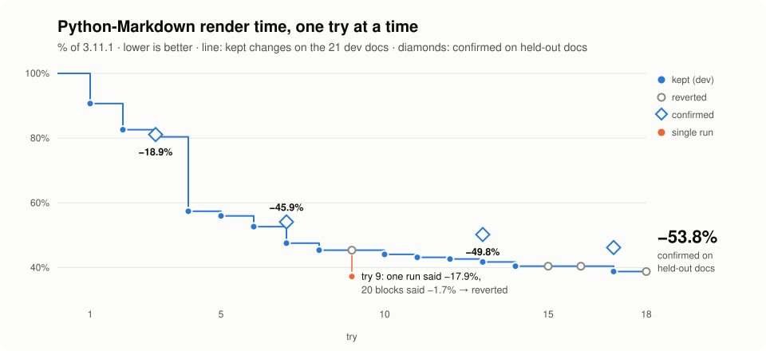
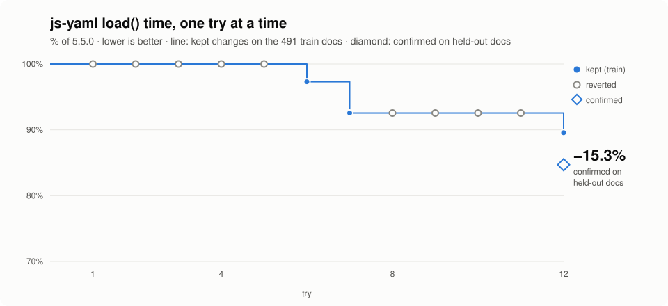
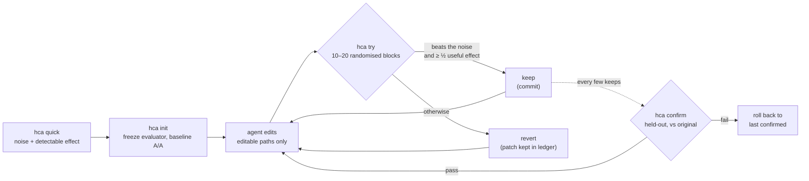

<div align="center">

**English** · [简体中文](docs/readme/README.zh-CN.md) · [繁體中文](docs/readme/README.zh-TW.md) · [日本語](docs/readme/README.ja.md) · [한국어](docs/readme/README.ko.md) · [Español](docs/readme/README.es.md) · [Português (Brasil)](docs/readme/README.pt-BR.md) · [Français](docs/readme/README.fr.md) · [Deutsch](docs/readme/README.de.md) · [Русский](docs/readme/README.ru.md) · [Türkçe](docs/readme/README.tr.md) · [Tiếng Việt](docs/readme/README.vi.md) · [Bahasa Indonesia](docs/readme/README.id.md) · [हिन्दी](docs/readme/README.hi.md)

# HillClimbAnything

### The harness to get you to hill-climb any technical challenge.

**Point your coding agent at a number. Keep only the wins that are real.**

[](#quick-start)
[](pyproject.toml)
[](tests)
[](skills/hca/SKILL.md)
[](LICENSE)

[Quick start](#quick-start) · [Showcase](#showcase-python-markdown-2-faster) · [How it works](#how-it-works) · [For agents](#for-agents) · [FAQ](#faq)

<code>uvx --from hillclimbanything hca quick -- python bench.py</code>

<sub>Try it without installing anything: how noisy is your benchmark, and what win could you detect?</sub>

<br /><br />

<picture>
  <source media="(prefers-color-scheme: dark)" srcset="docs/assets/climb-dark.svg" />
  
</picture>

</div>

---

Autoresearch-style loops let an agent edit, measure, and keep whatever scored best. On a noisy
metric, "best" is often luck. On an ordinary desktop, keeping the raw best score kept **17–55%**
of the changes that did nothing, depending on the benchmark ([measured](spikes/phase0/RESULT.md)).

HillClimbAnything is the **referee** for that loop:

- it measures how noisy your number is before you start;
- it keeps a change only if it beats that noise;
- it confirms the total gain on data the agent never tuned against.

Your agent proposes, and HCA decides. HCA is a small Python CLI with no dependencies, plus a skill
(plain Markdown) that teaches a coding agent the method. It has been tested with Claude Code.

## Quick start

**1. Install** (Python 3.11+; tested on Linux, WSL and native Windows, macOS untested):

```bash
uv tool install hillclimbanything   # or: pipx install hillclimbanything
hca setup                                                        # add the agent skill (shows its plan first)
```

`hca setup` puts the skill where agents look for it: `~/.claude/skills/hca` (Claude Code) and
`~/.agents/skills/hca` (Codex, Cursor, Gemini CLI, Copilot). It backs up anything it replaces, and
`hca setup --uninstall` removes it again. No [`uv`](https://docs.astral.sh/uv/getting-started/installation/)
or [`pipx`](https://pipx.pypa.io/stable/installation/)? Plain `pip install` works inside a
virtualenv; many systems refuse it outside one (PEP 668).

<details>
<summary>Other ways to add the skill</summary>

**Claude Code plugin:**

```text
/plugin marketplace add JaiS1/HillClimbAnything
/plugin install hca@hillclimbanything
```

**[skills.sh](https://github.com/vercel-labs/skills):**

```bash
npx skills add JaiS1/HillClimbAnything --skill hca
```

Either way, the skill drives the `hca` CLI, so install the CLI too.
</details>

**2. Ask your agent:**

```text
Use the hca skill (HillClimbAnything) to make `python bench.py` faster: run `hca quick` first,
write hca.toml with me, climb with `hca try`, and report only what `hca confirm` passes.
```

**3. Or drive it yourself:**

<div align="center">

</div>

```bash
hca compare -- <A> -- <B>   # the 2-minute first result: is B really better than A? no git, no hca.toml
hca quick -- <cmd>     # 2 minutes, no setup: how noisy is this number, what win can we detect?
hca init               # freeze the evaluator, make a branch, measure the baseline noise
hca try -m "why"       # measure your edit against the last keep → keep (commit) or revert
hca confirm            # re-measure the total gain vs the original, on held-out data
hca report             # every attempt, its verdict and evidence
```

`hca compare` needs no repo and no config: it runs the two commands in randomised A/B blocks and
reports the difference with an interval, a p-value, the noise it saw and the smallest difference it
could have detected, so "no detectable difference" means something. Exit code 0 means B is better than A
by a significant amount, 1 means not, 2 means a run failed or lacked the metric. The commands run without a
shell (write `sh -c '...'` if you need one); the default metric is wall time, or pass `--metric NAME` to
read a `METRIC NAME=value` line. When you want a guarded climb on your own code, `hca init` is the next step.

A task is a brief, the paths the agent may edit, and one command that prints the number:

```toml
# hca.toml
[task]
name     = "api-latency"
editable = ["src/**"]          # the agent may change these
frozen   = ["bench/**"]        # the evaluator: hashed, never edited

[objective]
command       = ["python3", "bench/run.py"]   # prints METRIC p95_ms=212.4
metric        = "p95_ms"
direction     = "min"
useful_effect = "5%"           # the smallest win worth keeping
```

## Showcase: Python-Markdown, 2× faster

A Sonnet coding agent climbed [Python-Markdown](https://github.com/Python-Markdown/markdown)
3.11.1 with HCA as the referee: 18 tries in about 80 minutes, 14 kept.

| Check | Result |
|---|---|
| `hca confirm` on held-out documents | render time **−53.8%** (at least −53.0%) |
| Independent re-measurement outside HCA, on the project's test fixtures | **−63.5%** |
| Output: the project's test suite (1,126 tests; 110 skipped, as in 3.11.1) and 23,000 random documents | **identical** to 3.11.1 |
| Changes HCA rejected that a single-run loop would have kept | **3 of 4**, one of them a "−17.9%" that was really −1.7% |

The biggest win was skipping inline regex patterns when the text can't contain a character that
every match needs. Read the [write-up, patch, per-try log and raw ledger](showcases/python-markdown/README.md).
It is one machine and one run, and the patch has not been reviewed upstream.

## Showcase: js-yaml, 15% faster

A second climb, in another language and on a different kind of metric: [js-yaml](https://github.com/nodeca/js-yaml)
5.5.0 on Node, timing `load()` once per document over 491 real GitHub Actions, Kubernetes, Helm,
Compose and OpenAPI files. A coding agent made 12 tries in about an hour, and 3 were kept.

<div align="center">
<picture>
  <source media="(prefers-color-scheme: dark)" srcset="docs/assets/climb-yaml-dark.svg" />
  
</picture>
</div>

| Check | Result |
|---|---|
| `hca confirm` on held-out documents (same genres, mostly different files) | `load()` time **−15.3%** median per item (at least −13.3%) |
| Clean-clone A/B against the original release, 200 fresh processes | total time **−15.3%** (95% CI −16.6% to −14.4%) |
| Output: js-yaml's own 1,633 tests, 25,384 comparisons on each of the ESM and CJS builds, 11,250 fuzz comparisons | **0 differences** from 5.5.0 |

The wins are small avoid-work changes in the parser: fewer allocations per node, a first-character
dispatch, and a fast path for plain scalars. Two of the three kept tries bundle changes that were
each below the keep floor alone, which the write-up discloses; the confirm covers the final state.
The metric is per-call, cold-ish time on mostly small documents, not hot-loop throughput. It is one
machine, and the patch has not been submitted upstream. Read the
[write-up, patch, ledger and harness](showcases/js-yaml/README.md).

## Why a referee?

Two identical builds, compared the way most loops compare them ([Phase 0](spikes/phase0/RESULT.md)):

| Keep rule | No-op changes kept | Real 5% speedups kept |
|---|---|---|
| Keep the raw best score | **17–55%** | 100% |
| HCA's test on randomised blocks | **≤ 1%** | 76–96% (15 blocks) |

Ranges cover two benchmarks (a web server and a CLI). The HCA row is one look at α = 1%; the
shipped rule is stricter.

A loop that keeps a fifth to a half of its no-ops is climbing noise. Its gains look stacked, then evaporate when
you re-measure.

## How it works



- **Randomised blocks.** Each try runs baseline and candidate back to back in random order, 10 to
  20 times. The random order makes an exact sign-flip test valid whatever the noise looks like:
  heavy tails, thermal blips, a game running in the background.
- **Evidence and size.** A keep needs the one-sided test to pass at 1% per try, and the estimate to
  reach at least half your useful effect.
- **Identical arms.** Both arms are clean git worktrees of exact commits. The commit that is kept
  is exactly the tree that was measured.
- **Confirm or it didn't happen.** `hca confirm` checks the history, then re-measures the total
  gain against the original. The agent sees PASS or FAIL.
- **Everything on disk.** Every attempt's patch, raw runs, verdict and reasons are in `.hca/`.

## What you can climb

Anything a command can turn into a number, if the number is repeatable enough to measure its
noise.

| Target | Example metric | Status |
|---|---|---|
| Library hot path | render / parse time | ✅ showcased (Python-Markdown, −53.8%; js-yaml, −15.3%) |
| CLI and build time | wall seconds | 🧪 calibrated ([Phase 0](spikes/phase0/RESULT.md)) |
| Web server latency | time to first byte per route | 🧪 calibrated ([Phase 0](spikes/phase0/RESULT.md)) |
| Page load in a browser | LCP per page | 🗺️ planned showcase |
| UI or game frame time | p99 frame ms per scene | 🗺️ planned showcase |
| Model or prompt accuracy | per-item eval score | 🧪 `items` mode, unit-tested |
| Paid GPU training runs | eval score after training | 📋 campaign method in the [skill references](skills/hca/references/campaign-card.md); tooling planned |

## For agents

If you are an AI agent reading this:

- **Method:** [`skills/hca/SKILL.md`](skills/hca/SKILL.md). It covers the premise checks, one
  mechanism per try, and never touching frozen files.
- **Spec and output contract:** [`skills/hca/references/spec.md`](skills/hca/references/spec.md).
- **Overview for crawlers and assistants:** [`llms.txt`](llms.txt).
- **Working on this repo:** [`AGENTS.md`](AGENTS.md).

| Exit code | `hca try` | `hca confirm` |
|---|---|---|
| 0 | kept | passed |
| 1 | reverted | failed (rolled back) |
| 2 | invalid / void / refused: nothing kept, your edits left in place | inconclusive or refused |
| 3 / 4 | usage error / internal error | same |

Report only what `hca confirm` passed, with its bound and the number of tries.

## FAQ

<details>
<summary><strong>Does HCA call an LLM or need an API key?</strong></summary>

No. HCA never calls a model. Your agent (Claude Code, Codex, Cursor or any other) does the
thinking, and HCA only measures and decides. `hca quick` works with no agent at all.
</details>

<details>
<summary><strong>How long does a try take?</strong></summary>

About 20 to 40 runs of your command: 10 blocks, extended to 20 when the result looks promising,
with two runs per block. A 3-second benchmark takes 1 to 2 minutes per try. `hca quick` tells you
the cost before you start.
</details>

<details>
<summary><strong>My metric is noisy. Will this work?</strong></summary>

`hca quick` answers that in about 2 minutes. It reports the noise and the smallest win you can
detect. If the answer is "too noisy here", it names the cheapest fix: more items per run, longer
runs, or closing other load. Climbing before that is wasted effort.
</details>

<details>
<summary><strong>Can the agent cheat?</strong></summary>

It can try, and HCA makes it inconvenient:

- frozen evaluator files are hashed;
- edits outside the declared paths invalidate the try;
- both arms run from clean worktrees;
- crashes score as the worst value;
- repeated attempts are counted.

It is not a security boundary, so read the patches. [docs/LIMITS.md](docs/LIMITS.md) lists every
known gap and what to do about it.
</details>

<details>
<summary><strong>How is this different from autoresearch?</strong></summary>

[autoresearch](https://github.com/karpathy/autoresearch) showed how productive an
agent-in-a-loop can be, and HCA keeps that loop. What HCA adds is the decision: for any command
and any metric, whether a change is real or noise, plus a confirmation step that guards against
the winner's curse.
</details>

<details>
<summary><strong>What about expensive runs, like GPU training?</strong></summary>

The skill's references carry the discipline from a real months-long model fine-tuning campaign:

- a preregistered card with a matched "same compute, no idea" control;
- a cheap rehearsal before the paid run;
- adversarial review;
- watchers and budget meters inside the remote job;
- a deep evaluation before any verdict.

The tooling for this is planned.
</details>

<details>
<summary><strong>Windows?</strong></summary>

Native Windows works (Python 3.11+). A timeout kills the whole process tree through a Job Object and `taskkill`. There is no shell, so write commands as argv lists (a batch file is `["cmd", "/c", "build.bat"]`). WSL still gives the strictest process isolation, and macOS is untested.
</details>

## Documentation

- [Showcase: Python-Markdown](showcases/python-markdown/README.md)
- [Showcase: js-yaml](showcases/js-yaml/README.md)
- [Limits and known gaps](docs/LIMITS.md)
- [Phase 0 calibration](spikes/phase0/RESULT.md)
- [Design](docs/DESIGN-hca.md)
- [Architecture contract](docs/ARCHITECTURE-v1.md)

## Status and credits

Early research release (0.2.0.dev): the core loop and two showcases. HCA grew out of
[Dream Loop](https://github.com/JaiS1/dream-loop/tree/dream-loop-v0.1), whose paired statistics it
keeps. It borrows ideas from [autoresearch](https://github.com/karpathy/autoresearch)-style loops
and from the evaluation hygiene of the [Harness Learning](https://arxiv.org/abs/2609.35738) paper.

```bash
python3 -m unittest discover -s tests      # development
```

[MIT License](LICENSE). If HCA saved you from shipping a fake win, a star helps others find it.
