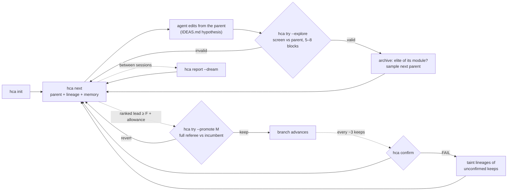

# HCA climb engine: design v0.5 (draft)

Status: DRAFT 2026-10-16. v0.3 → v0.4 after the design review
(`.private/research/climb-engine-review-2026-10.md`) and Jai's decisions; v0.4 → v0.5 after a
second adversarial review that checked v0.4 against the code (verdict: "OK to build Phase 1 after
fixes"; all its must-fix and should-fix items are applied here, §9 lists them). No code written.
Branch `hca/design`. Builds on [DESIGN-hca.md](DESIGN-hca.md) (v0.2) and
[ARCHITECTURE-v1.md](ARCHITECTURE-v1.md) (A1, A2).

> **HillClimbAnything should help you climb, not only tell you when you fell.**
> Today HCA is a referee: it says whether a change is real. v0.5 adds what a climber needs and a
> referee alone forbids: a **memory** of every idea and why it failed, a **tree of candidate
> programs** in which a parent need not be the incumbent and a stepping stone may look worse first,
> and an offline **dream** in which the agent reads that history with no benchmark running.
> The agent writes all code and hypotheses. Nothing is kept except by a fresh test against the
> incumbent at α, and nothing is claimed except by a held-out confirm.

Tags: [V] source opened in a review pass; [U] from memory; **[SPEC]** speculation or unmeasured
estimate; [CALC] arithmetic from the ledgers. Terminal examples are illustrative: real noise and
timings, invented ids and outcomes.

---

## 0. The decisions on one page

| Decision (Jai, 2026-10-16) | What this doc specifies |
|---|---|
| Exploration is **population search** | An archive of attempt snapshots with one elite per touched module; any untainted member can be a parent; children are *screened* (5–8 blocks vs their parent) only to rank and archive; only a **promotion** (a normal referee try vs the incumbent, then `confirm`) can keep. Honestly named: **coverage-weighted tree search** with a MAP-Elites archive (§3c) |
| Dream is the **offline hypothesis dream** | `hca report --dream` writes `.hca/DREAM.md`; the agent writes ideas with no bench running. A learned parent sampler comes later, from logged sampling data (§3d) |
| Phase 1 is **lean** | ~900 core LOC [SPEC], 1 new command (`next`, replacing `status`), 6 new flags, 2 new nouns (§5) |
| Referee honesty is non-negotiable; zero deps; any agent | Screens have their own code path that cannot keep; the store tags every entry `try`/`promote`/`screen`; replay, taint and dropped-keep rules close the laundering routes the code review found (§3e) |

---

## 1. Problem and principles

### 1.1 What three real climbs taught

| Lesson | Evidence (checked against the ledgers) | What the engine does |
|---|---|---|
| Wins came from profiling first | PM CLIMB-LOG opens with a hand profile (~70% in the inline treeprocessor); try 4 (−28.6%) came from it | `quick --ceiling` (Phase 1.5), pstats `--profile` (Phase 2) |
| Failed ideas were lost between tries | PM try 9 (dispatch, NO EVIDENCE [−3.9%, +5.9%]) reverted; its simpler form became a keep later by luck of memory | memory in `hca next` (§3a) |
| Sub-floor real wins were stacked by hand | js-yaml ledger 1, 4, 5 (−2.0%, +0.5%, +0.8%; the agent's T1/T2b/T3) each reverted, then bundled as try 6 (KEEP −2.7%) on the agent's own in-process A/B; try 12 bundled ledger 9 + 11 + a new change. PM bundles: try 17 (kept: 15 + 16 + a micro change) and 18 (reverted) | a lineage of children each screened vs its parent, promoted once (§3c); note the screen cannot *see* +0.5% parts on yaml (§3c resolution) |
| The one-line rule hides stepping stones | Every candidate must beat the incumbent now; a refactor that reads 0 to −2% alone and enables a later win can only be tried as one guessed bundle. How often this happened is invisible in the ledgers [SPEC] | archive members are kept for their module cell, not their score |
| A doomed climb wasted an hour | portfolio LCP: ±18% block noise vs ~10% headroom | one "climbable?" verdict (Phase 1.5) |
| Reviews found gaming every time | caches, harness detection, quality knobs, untimed work, lazy proxies | review pointers, lineage-wide at promotion (§3e) |
| Single-run keep rules lie on noisy targets | `REPLAY.md` (20,000 replicates): on js-yaml a one-run rule keeps 7.2 of 10 tries, 2.9 HCA-null (≈ 41%), claims +5.8 pp too much; on PM it keeps no null (+4.1 pp inflation): a quiet-target null | the referee stays the only path to a keep; screens print "not evidence" |

Invalid and duplicate tries: 3 of 12 on js-yaml, 0 of 18 on PM.

### 1.2 Principles

1. **The agent does the thinking; HCA does selection, bookkeeping, measurement and memory.** HCA
   never calls a model, writes a hypothesis, edits code, builds a child or promotes on its own.
2. **The referee is non-negotiable.** Unchanged: the keep rule (one-sided α = 0.01 over two looks,
   floor F = ½ useful effect), snapshot arms, frozen hashes, scope, the held-out store, the confirm
   cap, PASS/FAIL-only confirm output. Exploration may rank, archive, sample and suggest.
3. **Every measurement is counted, from the referee store.** Tries, promotions and screens are
   counted from the store's `kind` field, never from agent-writable `verdict.json`. Budgets are in
   **wall time of hca commands** (arm builds, warm-ups, guards and blocks included).
4. **Files, not services.** Markdown for agents, JSON for records, git refs for programs.
5. **Any agent**, from a plain shell.
6. **Logged for later learning.** Every child records the sampler version, weights and candidate
   set behind its parent choice, so a learned sampler can be evaluated off-policy *if* that turns
   out to be feasible (§3d).

### 1.3 Lightweight budget (hard cap)

| Budget | Cap | Phase 1 |
|---|---|---|
| New top-level commands | ≤ 1 | `next` (replaces `status`; alias one release) |
| New flags | ≤ 6 | `try --idea`, `try --explore`, `try --promote`, `try --tainted`, `next --parent`, `report --dream` (`--again` exists) |
| New core LOC (`hca/`, excl. tests) | ≤ 900 | ~900 [SPEC], range 850–1,000 (§5.2) |
| New nouns | ≤ 2 | *idea*, *archive* (*screen* is a kind of record, *promote* a verb) |
| New persisted state | derived where possible | `IDEAS.md` (agent); `kind` on store entries; new `verdict.json` fields; `state.explore`; derived `archive.json` and `DREAM.md` |
| New git refs | 0 | members are the existing `refs/hca/attempts/NNNN` |
| Skill delta | ≤ 20 lines | details in `skills/hca/references/engine.md` |
| Dependencies | 0 | 0 |

Scope: Phase 1 explore mode is **blocks mode only** (`items` mode has no screen statistic yet;
`try --explore` refuses there). `seeds` mode is still rejected by `spec.py:155`; remote runners are
undocumented. The README should not say "anything" until those exist (Q7).

---

## 2. The loop

**Plan → propose → screen → archive → promote → confirm → dream → repeat.**



**Line mode** is today's `hca try` (candidate vs incumbent, full rule). **Explore mode** is
`try --explore`. Both coexist in a climb; the agent chooses.

| Phase | Command | New |
|---|---|---|
| Plan (each child) | `hca next [--parent M]` | parent, lineage, memory digest, promotion hint, warnings |
| Propose | agent edits + `IDEAS.md` | the agent's notebook |
| Screen | `hca try --explore --idea I7` | measured vs parent; archived; cannot keep |
| Test | `hca try --promote M` / plain `hca try` | the referee, unchanged |
| Confirm | `hca confirm` | FAIL now taints lineages (§3e) |
| Dream | `hca report --dream` | offline packet |

Reused untouched: `stats.py`, `measure.py`, `compare`, the held-out store, the confirm cap.

---

## 3. Components

### 3a. Memory: ideas, outcome classes, the `next` digest

**`IDEAS.md`** (repo root, untracked, excluded from scope and snapshots):

```markdown
## I4 [avoid-work] Skip inline patterns whose required character is absent
where: markdown/treeprocessors.py
why: ~87% of (pattern, text) pairs are no-match; every match needs one literal char.

## I14 [dispatch] Dispatch table keyed on trigger char  (stepping stone)
parent: 0019
why: alone it may cost ~1%; it makes I9 and I12 one-line changes.
```

Grammar: `## I<n> [<kind>] <title>`; an optional `parent: NNNN` line; the rest is free text. Kinds
are a fixed list of ten (`avoid-work`, `algorithm`, `data-structure`, `allocation`, `dispatch`,
`io`, `concurrency`, `config`, `micro`, `other`). `try --idea I4` reads the kind from the header;
an unknown idea is `untagged`. Bad grammar never fails anything. Kinds feed memory and the dream,
**not** the archive key, until tagging proves reliable (§3c).

**Outcome classes** (derived; same words everywhere):

| Class | Rule | Meaning |
|---|---|---|
| `KEPT` | referee keep | real, above the floor |
| `SMALL` | revert, p ≤ the look's level, estimate below F | real but sub-floor |
| `NO EVIDENCE` | revert, estimate favourable, interval includes the useful effect | not shown either way |
| `NULL` | revert, interval excludes the useful effect | tested, too small |
| `HARMFUL` | revert, significantly worse | tested, worse |
| `SCREENED` | an explore child with its screen estimate vs parent | ranked, **not tested** |
| `INVALID` | scope, guard, crash, refused replay | not a test of the idea |

**`hca next`** replaces `status` and carries the memory digest inline (v0.4's separate `MEMORY.md`
is folded in: one artefact the agent reads, ≤ 60 lines however long the climb):

- budget line: wall time used of the climb's budget, tries / promotions / screens (from the store),
  confirms used of the cap;
- the parent HCA sampled, its lineage, siblings, two "inspiration" elites from other modules with
  their patch paths, any dropped keeps (§3c);
- kept / open / closed ideas with outcome classes (kept estimates labelled "selected, biased
  upward"; only the confirm line is a result), counts by kind, archive summary;
- the overlap warning (hunk overlap of the working diff with reverted or screened patches:
  ShinkaEvolve's novelty rejection without embeddings);
- the promotion hint (§3c) and warnings: "10 screens since the last promotion attempt" (N7), "20
  screens since the last confirm" (dev overfitting);
- the backlog in fixed mechanical order: ideas naming the current parent; `NO EVIDENCE` ideas with
  room; ideas whose `where:` module has no archive member; the rest; kinds with 2 `NULL`s last.

### 3b. Climbable? (Phase 1.5)

Moved out of Phase 1 to hold the LOC cap; the design is unchanged from v0.4. `quick --ceiling X%`
takes the share of the metric editable code can move; in `items` mode `quick` prints the five
worst dev items. Verdict (D = detectable at 20 blocks, U useful, F = ½U, C ceiling):
`CLIMBABLE` if D ≤ F and C ≥ 2U; `MARGINAL` if F < D ≤ U, C unknown, or U ≤ C < 2U;
`NOT CLIMBABLE HERE` if D > U or C < U. Proof: portfolio LCP NOT CLIMBABLE in ≤ 10 min.

### 3c. Population search

The lightest design that is still a population search: parents other than the incumbent, an
archive that keeps members for where they are rather than how they score, stepping stones, and
selection pressure from cheap screens, without weakening what a keep means.

#### Representation: attempts are already programs

Every try writes a snapshot commit and pins it at `refs/hca/attempts/NNNN`; arms are detached
worktrees built from a sha. So an **archive member** is a valid (guards passed) attempt snapshot;
the archive is a function of the referee store and the attempt records, cached in
`.hca/archive.json`. HEAD and the climb branch move only on a keep. After a screen HCA restores
the **editable paths** to the next parent with the same `gitops.revert` that today restores them to
the last keep.

#### Base threading (the code review's B3; not a one-variable swap)

`state["last_keep"]` is the implicit base in more places than v0.4 admitted. Phase 1 adds an
explicit `base` argument to each, and keeps "HEAD == last_keep" as a separate check:

| Site | Today | Explore mode |
|---|---|---|
| `gitops.scope_check` | change list vs `last_keep`; HEAD check vs `last_keep` | change list vs `base`; HEAD check still vs `last_keep` |
| `editable_changes` / `snapshot` | overlays only paths that differ from `last_keep` | overlays paths that differ from `base` |
| `patch_between`, `working_tree_hash`, `uncommitted_patch` | vs `last_keep` | vs `base` |
| empty check (`try_.py:119`) | snapshot tree == `last_keep` tree | == `base` tree |
| `_Try.prepare` / `refresh` (`:51`, `:59`), `ensure_arm`, arm verification (`:182`) | baseline arm at `last_keep` | baseline arm at `base` |
| `revert` after the try | to `last_keep` | to the next sampled parent |
| `arms.prune_unused` keep list | init, confirmed, last keep | plus the current parent; other member arms pruned by age/count (keep ≤ 6) |

The silent bug this prevents: the parent changed file P; the agent hand-restores P to the
`last_keep` content; a change list computed vs `last_keep` does not overlay P, the snapshot keeps
the parent's P, and **the measured tree differs from the tree on disk**. Two defences: the change
list is computed vs `base`, and every screen and promotion asserts
`working_tree_hash(base) == snapshot.tree` before measuring (a test reproduces the P case).

#### Diversity: one elite per module (coverage-weighted tree search)

| Key | Verdict |
|---|---|
| Islands (FunSearch, OpenEvolve) | No: built for parallel samplers and 10³+ evaluations; a 25–35-child climb gives a handful per island |
| `kind × module` (v0.4) | Deferred: kind is the agent's own label and tagging reliability is unproven |
| Behaviour descriptors (mechanism metrics) | Later, opt-in [SPEC]: needs per-target metrics |
| Embedding novelty | Killed: a dependency |
| **`module`** *(Phase 1)* | The editable file with the most changed lines vs the parent, two path components; files outside the six most-touched share `other`. ≤ 7 cells |

With ≤ 7 cells this is **coverage-weighted tree search with a MAP-Elites archive**, not
behavioural novelty search, and the doc says so. What it does deliver is the mechanism that
matters at this scale: each module keeps its own elite regardless of global rank, so a lineage in
an unpromising file survives long enough to improve. The key is one function, `cell_of(record)`,
swappable for `kind × module` or descriptors when data justifies it.

#### Archive rules and fitness

1. A valid, untainted screened child enters the archive iff its cell is empty or its **ranking
   fitness** beats the cell elite's. Displaced elites stay in the ledger, unsampled.
2. **Raw chained fitness** `f_raw` = parent's `f_raw` + this child's Hodges–Lehmann log estimate vs
   its parent; keeps carry their referee estimate; the original is 0. Along a lineage it telescopes
   over actual composed trees, so no additivity assumption, but **each step was selected**, so the
   selection bias compounds per step (v0.4's own example: −61.5% chained vs −45.9% confirmed).
3. **Ranking fitness** `f = f_raw − k·SE_s·d`, with SE_s the screen's standard error, d the number
   of screened steps since the last keep, k = 1. Linear in depth because bias is added at each
   selected step, not averaged away [CALC basis: per-step winner's curse ≈ SE·√(2 ln m)].
4. **Stepping stones**: members whose `f` is behind the incumbent. Kept for their cell.
5. Line-mode reverts are not members unless named by `--parent` (they then join on their recorded
   estimate, subject to the replay rule in §3e).
6. **Tainted** members (§3e) stay in the ledger, are never sampled, never hinted, shown greyed.

#### Parent sampling

```text
incumbent:      mass ≥ 0.40
other members:  w_i = sigmoid((f_i − f_med) / s) / (1 + c_i)   for f_inc − f_i ≤ 2F, else 0
                normalised over the remaining 0.60; drawn with rng_sample(seed, n)
```

`s` = max(F, robust spread of `f`), `c_i` = children already drawn from i. The v0.4 sampler was
near-uniform over a small archive; the incumbent floor keeps exploitation (OpenEvolve defaults
exploit at 0.7 [V]) and the 2F deficit cap stops the sampler spending children on members too far
behind to matter. Stepping stones within 2F remain eligible; deeper ones only by `--parent`.

`rng_sample` is seeded from the climb seed and the screen number and is **independent of** the
block-order RNG of screens and promotions (separate seeds, tested). Every child logs
`{sampler: "w1", weights_hash, candidates: [ids], weights: [..], parent, parent_p}`. Overrides:
`next --parent M` (recorded with `parent_p: null`), then an idea's `parent:` line, then the sample.

#### Screens vs promotions (the crux)

| | Screen (`try --explore`) | Promotion (`try --promote M`) |
|---|---|---|
| Code path | `_decide_screen` / `_finish_screen`: never call `_apply_keep` or `write_pending` | the existing try path (`_decide_blocks`, `_finish`) |
| Compared with | the parent | the incumbent |
| Blocks | `n_s = clamp(ceil((3σ/F)²), 5, 8)`: **PM 5, yaml 7** | 10, extended once to 20, as today |
| Statistic | HL estimate; a one-sided 95% bound printed only when n_s ≥ 5 (2⁻⁴ > 0.05, so 4 blocks cannot give one) | sign-flip test at α/2 per look, floor F |
| Store `kind` | `screen` | `promote` (plain tries: `try`) |
| Counts toward | the screen counter and wall budget | tries-and-promotions bound; `max_tries` counts `try` only |
| Can move the branch | never | only on keep |

**Resolution.** A screen can only tell apart effects of about 2·SE_s or more. PM (σ 0.29%,
5 blocks): SE ≈ 0.14%, resolution ≈ 0.3%. yaml (σ 2.19%, 7 blocks): SE ≈ 0.9%, resolution ≈ 2%.
So on yaml the +0.5% / +0.8% parts of bundle 6 are **invisible** to a screen; a lineage reproducing
that stack would be steered by the agent's mechanism reasoning, not by the screens. `next` prints
the resolution in its header.

**Promotion hint.** Shown when a member's ranking-fitness lead over the incumbent is ≥ F + A,
with the selection allowance A = SE_chain·√(2 ln M) (M members): PM ≈ 0.2% × 2.3 ≈ 0.5 pp, so
hint at ≥ 1.5 pp; yaml ≈ 1.3% × 2.3 ≈ 3 pp, so ≥ 5.5 pp [CALC]. On targets where SE_s > F/3
(yaml), the hint first asks for a re-screen of the member (a `try --explore` on an identical tree
is a re-screen, pooled with its earlier blocks). The agent may promote anything untainted anytime.

**Promotion** restores the editable paths to M's tree and runs the normal try. N3: it **never
trusts `archive.json` or any recorded fitness**; it re-derives M's validity, lineage, taint and
replay status from the referee store and the refs. A member forked from an old keep is promoted as
its whole tree; the keeps it lacks are recorded as `dropped_keeps` and printed on the KEEP line, in
`report` and in `next` ("keep 0011 dropped by 0025").

**The multiple-comparison story.**

- *Selection inflates screen estimates*, by about A per comparison and compounding along a lineage;
  on yaml A exceeds the floor. The ranking shrink and the raised hint limit how often noise is
  promoted; they do not need to be exact, because:
- *The promotion is a new measurement.* Its blocks are fresh and independent of the screens (and of
  the sampler RNG), so for a member no better than the incumbent P(keep) ≤ α = 1% however it was
  selected. The report prints "false keeps ≤ (tries + promotions) × 1%", counted from the store;
  screens cannot keep and do not enter it. The kept estimate is still selected by the keep rule
  itself (as today) and labelled so.
- *What fresh blocks do not fix:* dev-corpus overfitting (screens and promotions share the dev
  corpus). The held-out confirm is the only check; `next` warns after 20 screens without one.
- *Confirm budget (N1).* More promotions → more keeps → the confirm cap (default 5) is reached
  sooner; `next` shows confirms left. Each confirm reveals one bit (PASS/FAIL) about a lineage, so
  the held-out leak is bounded by the cap, exactly as today.
- *Wasted promotions are the price of noise*: on yaml perhaps a third to a half revert [SPEC].

#### Budget per round, in wall time of hca commands

From `wall_seconds` in the ledgers (arm builds, warm-ups, guards, blocks): PM ≈ 10 s + 3.8 s per
block (10-block tries 45–80 s, 20-block 84–113 s, mean 72 s); yaml ≈ 37 s + 11.3 s per block
(10-block ≈ 150 s, 20-block ≈ 263 s, mean of measured tries 218 s). Promotion rate assumed 1 per
8 children [SPEC].

| | PM | yaml |
|---|---|---|
| One screen | 5 blocks ≈ 30 s | 7 blocks ≈ 116 s |
| One referee try (mean) | ≈ 72 s | ≈ 218 s |
| Round: 4 screens + 0.5 promotions | ≈ 156 s | ≈ 573 s |
| Same 4 candidates in line mode | ≈ 288 s | ≈ 872 s |
| Candidates in the recorded climb's hca wall time (PM 18 tries ≈ 21.5 min; yaml 16 tries at the mean ≈ 58 min) | ≈ 33 children vs 18 tries (**~1.8×**, not v0.4's 2.4×) | ≈ 24 vs 16 (**~1.5×**) |
| Agent time per candidate | ~1.5 min: **dominates** (33 × 1.5 ≈ 50 min vs 27) | comparable to hca time |

On a fast, quiet target the population's real cost is agent calls; on a slow, noisy one the screen
saves hca time but buys a ranking at ~2% resolution. Hence three cost frontiers in §4.

#### Divergence from the sampled parent (S11)

Explore children are measured against the parent the working tree was restored to. If the agent
rewrites most of it, the "child" is a fresh program with a nominal parent. `try --explore` prints
and records `divergence` = changed lines vs parent / parent's editable lines, and lines changed vs
the incumbent; `report` counts parent overrides and high-divergence children (> 25%) per climb.

#### Recombination: deferred, with a free substitute

Mechanical crossover (A's and B's diffs vs their fork points, 3-way applied onto a parent) is the
v0.3 `--bundle` machinery (~160 LOC) and is deferred to Phase 2. Phase 1 gets LLM-mediated
recombination for free: `next` prints two inspiration elites with patch paths.

#### A full round (PM-shaped, illustrative)

```text
$ hca next
climb     markdown-render · 9.4 of 25 min (hca wall) · tries 9 · promotions 2 · screens 14 · confirms 2 of 5
screens   5 blocks vs parent · resolution ≈ 0.3% · keep floor 1.0%
incumbent keep 0013 (confirmed -45.9% at keep 0008; later keep estimates are selected)
parent    0021  [markdown/treeprocessors.py]  sampled p = 0.21 (incumbent mass 0.40, sampler w1)
          lineage  0013 keep → 0019 I14 dispatch table on trigger char   +1.9% vs parent (stepping stone)
                              → 0021 I9 route patterns via the table      -0.9% vs parent
          lead vs incumbent  raw -1.0 pp · ranked -1.3 pp (2 screened steps)
siblings  0022 I12 abbr test() via the table +0.3% · 0023 INVALID (guard: tests)
inspire   0018 [markdown/serializers.py] ranked lead +0.2 pp · .hca/attempts/0018/patch.diff
kept      I1 -9.3%* · I2 -8.9%* · I4 -28.6%* ...   (* selected, biased upward)
open      I9 NO EVIDENCE -1.7% [-3.9%, +5.9%] (try 9) · I11 SMALL -1.1% (try 12)
archive   9 members, 5 of 7 modules · 2 stepping stones · 0 tainted
promote   none: best ranked lead 0018 +0.2 pp < 1.5 pp (floor 1.0 + selection allowance 0.5)
working   editable paths are at 0021 (branch still at 0013)
then      edit, then `hca try --explore --idea I9b -m "..."`

$ hca try --explore --idea I9b -m "table lookup also skips the escape pattern pass"
screen 0024  render_ms -3.4% vs parent 0021 (5 blocks, 31 s; at least -3.1% at 95%) · a screen, not evidence
  divergence 6% of the parent's editable lines · review pointers: none
  archive    new elite of [markdown/treeprocessors.py] · lead vs incumbent: raw +2.4 pp, ranked +1.9 pp
  next       parent 0024 (p = 0.27); editable paths set to it

$ hca next      # abridged
promote   0024 ranked lead +1.9 pp ≥ 1.5 pp  →  hca try --promote 0024 -m "..."

$ hca try --promote 0024 -m "dispatch lineage: table + routed patterns + escape skip"
attempt 0025  KEEP  render_ms -1.9% vs keep 0013 (better; cut of at least 1.2%, p = 0.000977, 10 blocks, 48 s)
  promoted member 0024 (lineage 0019, 0021, 0024; 3 screens; review pointers over the lineage: none)
  dropped keeps: none · fresh blocks; the screens' chained -2.4% was selected and is not reused
  kept as commit 5b20e7c1a9d3 · confirm due (3 keeps since the last confirm)

$ hca confirm                      # unchanged output: PASS/FAIL and the passed estimate only
```

0019 alone read +1.9% (worse): in line mode it is a revert and the lineage never exists.

### 3d. Dream: the offline hypothesis dream now, a learned sampler later

**Now: `hca report --dream`** writes `.hca/DREAM.md` (≤ 150 lines) from the store, the attempt
records and the archive, with no bench run:

1. **Archive map**: each module's elite, its ranked lead, child count; empty and tainted modules.
2. **Lineages and stepping stones** with their trend ("0019 +1.9% → 0021 −0.9% → 0024 −3.4%").
3. **Open evidence**: `NO EVIDENCE` and `SMALL` ideas with intervals; `NULL`s grouped by kind.
4. **Overlap map**: files and hunks tried, and how often.
5. **Screen resolution and budget left** (hca wall, confirms).
6. A fixed instruction: "write 5–10 ideas into IDEAS.md; each names a parent member; at least one
   targets an empty module **if any is meaningful**; at least one is a stepping stone you expect to
   read worse first; say which evidence above each answers".

The v0.4 cross-climb table is dropped. Nothing confirm-related beyond PASS/FAIL and the passed
estimate enters the packet. The agent reads it between sessions, which is Dream-RSI's real trick
(an LLM reasoning over recorded outcomes) without the policy code; its score is the next climb.

**Later: a learned parent sampler [SPEC].** Dream-RSI's dream learns because its live search is a
tree and its policy picks nodes [V]; v0.5 has the tree. Each child logs the full sampling context
(sampler version, candidate ids, weights, hash, chosen parent). In principle an alternative sampler
can then be scored by inverse-propensity weighting. **This may be infeasible**: the 0.40 incumbent
floor and the deficit cap give many members zero or tiny propensity; agent overrides have no
propensity at all; climbs are short, so variance will be large; and IPS scores the *choice of
parent*, never which child the agent would have written. Threshold to try: ~30 explore-mode
climbs. Exactly replayable referee knobs (extension threshold, `n_s`) are decided by a dev-side
replay spike, never by a user-facing dream (§4.1).

### 3e. Exploration vs honesty

| Loose and creative | Strict |
|---|---|
| `IDEAS.md`, `parent:` lines, kinds | The keep rule: α, two looks, floor, guards |
| Sampling, archive, cells, inspirations | Snapshot arms, manifests, warm-ups, base-tree assert |
| Screens (5–8 blocks vs parent, no test) | Scope check, frozen hashes, HEAD == last keep |
| Promotion hints | Held-out store, confirm cap, PASS/FAIL-only confirm |
| `DREAM.md`, `next` ordering | Store `kind` tags, replay and taint rules, counts from the store |

**Store kinds (B1).** Every referee-store attempt entry and `verdict.json` gets
`kind: try | promote | screen`. `ledger.seen_tree` today searches all entries, so v0.4 would have
refused every promotion as a replay of its own screen. Rules:

- A **screen** of a tree already screened is a re-screen (pooled); a screen of a tree with a prior
  `try`/`promote` entry is allowed (screens cannot keep).
- A **promotion** ignores `screen` entries. If the tree has **any prior `try` or `promote` entry**,
  the promotion requires `--again` (the existing flag, recorded). This closes the laundering route
  "revert line try R as NULL, name R as parent, re-screen it, promote R": R's own test result
  stays the first word, and a second test is an explicit, counted retry.
- A refused replay is recorded as `INVALID` and counts, as today.

**Confirm FAIL taint (B2).** Today a FAIL resets the editable paths to the last confirmed commit.
Without more, an archive member descending from the failed, unconfirmed keeps could be promoted
straight back. On FAIL: every member whose lineage contains a keep after the last confirmed commit
is marked `tainted` in the store; tainted members are excluded from sampling and the hint; promoting
one requires `--tainted` and is recorded as such (and printed in `report`); `state.explore.parent`
is reset to the new incumbent.

**Consumers that must filter screens (N2).** The verdict headline, `render_verdicts` (VERDICTS.md),
`report._rows` and confirm's pending-keep sweep must ignore `kind == screen`, or a screen record
would read as an attempt with no verdict. Listed in the Phase 1 checklist and tested.

**Review pointers**: a configurable regex over each patch (`cache|memo|lru_cache|pickle|open\(|
os\.environ|sys\.argv|thread|subprocess|ctypes|Proxy|setTimeout|process\.|eval`), recorded; a
promotion prints the union over its whole lineage, so a hack three screens deep surfaces at the keep.
No LLM in the keep path.

**Gaming surface and the answer:** more candidates on one dev corpus → held-out confirm and the
20-screens warning; lineage laundering → lineage-wide pointers; NULL laundering → the `--again`
rule; FAIL laundering → taint; overriding the sampler every time → allowed, logged
(`parent_p: null`), counted in `report`; screen-only speed (fast for a few blocks) → same arms and
warm-ups, and the promotion re-measures.

---

## 4. Benchmark plan

Claims, cheapest first: (1) the referee beats single-run rules on noisy targets (**done**);
(2) a fresh agent per candidate with only `hca next` climbs as well as a session agent;
(3) population search beats the single line, attributable to the population and not to memory;
(4) a doomed target is caught in minutes (Phase 1.5).

### 4.1 Done, and the remaining zero-cost work

- **Single-run replay: done** (`~/hca-showcase-h2h/replay/REPLAY.md`, seed 20261016, 20,000
  replicates). js-yaml: R1 keeps 7.2 of 10, 2.9 HCA-null or harmful (≈ 41%), +5.8 pp claim
  inflation, 9 of 20 A/A false keeps. Python-Markdown: 15.8 of 18, 0.0 false keeps, +4.1 pp,
  7 of 20 A/A. The quiet-target null is a recorded result.
- **Referee-knob replay** (dev spike, `spikes/engine-replay/`, ~150 lines, not shipped): the
  extension threshold (`estimate > 0` vs `≥ ½F` vs `≥ F`) on recorded blocks, and the screen size:
  subsample each recorded try's first 5–8 blocks and measure sign and rank agreement with the
  full-block estimate. Any change to the extension rule is a referee amendment, decided before
  PREREG v1 is tagged or not at all for v1.
- **Wasted-try share** (descriptive): invalid + duplicate + NULL-after-NULL shares, before and after
  the overlap warning would have fired.
- **Stepping-stone archaeology** [SPEC value]: retro-tag the 30 tries (messages only, verdicts
  hidden); count reverted tries a later keep built on (PM 9 → later keep; yaml 1/4/5 → 6;
  9/11 → 12).

### 4.2 PREREG v1 first, unchanged

PREREG v1 (`~/hca-showcase-h2h/PREREG.md`, commit `d9edd6a`, not yet tagged): RAW vs HCA, 2 targets
× 2 seeds. Tag and run it unchanged before engine code lands. PREREG-engine is written after
Phase 1 and before any engine climb, reusing v1's targets, start commits, `BRIEF.md`, wall caps,
`scalar_bench.py`, `eval_keeps.py`, `analyze.py`, ABBA order, noise gate, leakage grep, fresh
`CLAUDE_CONFIG_DIR`, `nice -n 19`, one heavy job at a time.

### 4.3 PREREG-engine

**Arms** (Sonnet, as v1; 2 targets × 2 seeds unless noted):

| Arm | Search | Memory (`next` digest) | Agent | Purpose |
|---|---|---|---|---|
| LINE | line | no (v1 skill) | session | v1's HCA arm, reused if model id and noise gate match |
| LINE+MEM | line | yes | session | isolates memory, so a POP win is attributable to the population |
| POP | explore + promote | yes | session | the population |
| POP-FRESH | explore + promote | yes | a new `claude -p` per candidate seeing only `BRIEF.md`, `hca next`, the repo | "the ledger is the memory" (M1) |
| POP-EQ (PM only) | explore + promote | yes | session | equal candidates **and** equal agent calls to LINE+MEM (18), so the population is tested without more proposals |

**Budgets**: v1's wall cap per climb for all arms; agent calls capped at 4× LINE+MEM's (except
POP-EQ). No single cost is primary. Each arm reports **three cost frontiers**: confirmed held-out
gain against hca wall time, against agent calls, and against total wall time, using held-out
re-measurement of the incumbent at 25/50/75/100% of each axis (one evaluation session for all
trees).

**Primary contrasts** (preregistered): POP vs LINE+MEM (population), LINE+MEM vs LINE (memory),
POP-FRESH vs POP (context), POP-EQ vs LINE+MEM on PM (population at equal proposals), each read on
all three frontiers. A contrast counts only if both seeds agree on at least two of the three axes.

**Mechanism metrics** (reported, not tested): modules filled; promotions hinted / attempted / kept;
**stepping-stone keeps** (kept promotions with an ancestor screened worse than its own parent);
dropped keeps; tainted members; parent overrides and high-divergence children; screens per keep.

**Cost**: LINE+MEM, POP, POP-FRESH × 2 × 2 = 12 climbs, POP-EQ × 2 = 2, at ~90 min, plus
evaluation (~4 h): ≈ 25 h machine time over 5–7 nights; +4 climbs if LINE must be rerun.

### 4.4 Plausible outcomes

| Contrast | PM | yaml | Why |
|---|---|---|---|
| POP / LINE+MEM, held-out gain at equal hca wall | 0.9–1.2× [SPEC] | 1.0–1.4× [SPEC] | PM was dominated by one profile-led idea either mode finds; yaml stacks were sub-floor parts the screen cannot resolve (§3c), so the gain there depends on the agent's reasoning along a lineage |
| POP-EQ / LINE+MEM (PM) | 0.9–1.1× | — | same proposals; only parent choice and stepping stones differ |
| LINE+MEM / LINE | 1.0–1.2× | 1.0–1.3× | fewer lost ideas and duplicates (PM had none to lose) |
| POP-FRESH / POP | 0.8–1.0× | 0.8–1.0× | 1.0× is the headline; the gap measures what `next` failed to carry |
| Stepping-stone keeps per POP climb | 0–2 | 0–2 | zero across all POP climbs means the archive bought coverage and nothing else |

Two seeds decide little; the mechanism metrics carry the write-up if contrasts are flat. If POP is
~1.0× with zero stepping-stone keeps, line mode stays the default and the conclusion is "20–35
candidates are too few for population search to pay on these targets".

---

## 5. Phased build plan

Granular commits; a Sonnet adversarial review of each phase's diff before the next starts.

| Phase | Scope | Core LOC | Proof |
|---|---|---|---|
| **0** | Tag and run PREREG v1; referee-knob replay; archaeology | ~150 spike | RESULT.md; v1 results |
| **1. Remember and explore** | §5.1 | ~900 | §5.4 |
| **1.5 Climbable** | `quick --ceiling`, verdict rule, worst-5 items | ~40 | portfolio LCP NOT CLIMBABLE ≤ 10 min |
| **2. Stack, profile, items** | pstats `--profile` + hotspot stubs; pool + `--bundle`; crossover `--explore --bundle A,B` if asked for; an `items`-mode screen statistic | ~350 | yaml: a bundle or lineage reproduces the ledger-6 stack |
| **3. Scaffold** | `hca scaffold` with `py-lib`/`node-lib`/`cli`; `report --front` | ~280 + ~600 data | stranger setup ≤ 30 min |
| **later** | learned parent sampler; `kind × module` or descriptor cells | — | ≥ 30 explore climbs; tagging reliability measured |

### 5.1 Phase 1 scope

1. `IDEAS.md` parser; `try --idea` (kind from header); backlog snapshot.
2. Outcome classes from records.
3. `hca next` (replaces `status`, alias one release): budget line, parent, lineage, siblings,
   inspirations, inline memory digest, promotion hint, N7 and dev-overfit warnings, fixed backlog;
   `next --parent M` (refuses with unscreened editable edits).
4. Review pointers, recorded; lineage union at promotion.
5. Base threading through every site in §3c's table, plus the base-tree assert.
6. Screen path: `_decide_screen`, `_finish_screen`, re-screen pooling, divergence, store
   `kind`, blocks mode only.
7. Archive: module cells, admission, raw and ranking fitness, taint, `archive.json`.
8. Sampler: incumbent floor, deficit cap, independent RNG, full logging.
9. Promotion: store-derived checks (N3), `--again` rule (B1), `--tainted` (B2), `dropped_keeps`.
10. Confirm FAIL hook: taint and parent reset.
11. Counts from the store; `max_tries` on `try` only; the bound line; screen filtering in all
    consumers (N2); arm pruning keeps the parent.
12. `report --dream` → `.hca/DREAM.md`.

### 5.2 LOC estimate [SPEC]

The code review put v0.4's Phase 1 at ~950–1,100 once base threading is counted. After its cuts
(MEMORY.md folded into `next`, `quick --ceiling` to 1.5, no cross-climb table, no
consecutive-non-keep suggestion, module-only cells) and the additions it required:

| Item | LOC |
|---|---|
| `IDEAS.md` parser, `--idea`, backlog | 70 |
| Outcome classes | 40 |
| `hca next` with inline digest, `--parent`, warnings, alias | 130 |
| Review pointers + lineage union | 25 |
| Base threading (gitops, arms, try_) + base-tree assert | 110 |
| Screen path, re-screen, divergence | 110 |
| Store `kind`, replay rules, store counts, `max_tries` | 45 |
| Archive: cells, admission, fitness, taint, cache | 105 |
| Sampler + logging | 45 |
| Promotion (N3 checks, `--again`, `--tainted`, dropped keeps) | 70 |
| Confirm FAIL hook | 20 |
| Report/verdict consumers filtering screens, bound line, override counts | 50 |
| Arm pruning | 15 |
| `report --dream` | 65 |
| **Total** | **~900** (range 850–1,000) |

If review of the first diff puts it above ~950, `report --dream` moves to Phase 1.5 first.

### 5.3 File formats

**Referee store attempt entry**: existing fields plus `"kind": "try" | "promote" | "screen"`,
`"tainted": bool`, and for promotions `"member": 24, "dropped_keeps": [11]`.

**`verdict.json` additions** (`base` already exists and is the parent's snapshot in explore mode):

```json
{"kind": "screen", "idea": "I9b", "idea_kind": "dispatch", "class": "SCREENED",
 "backlog": {"ids": ["I9","I9b","I12"], "sha256": "5c1e…"},
 "explore": {"parent": 21, "cell": "markdown/treeprocessors.py",
             "sampling": {"sampler": "w1", "candidates": [13, 18, 21], "weights": [0.40, 0.39, 0.21],
                          "weights_hash": "9a0f…", "parent_p": 0.21},
             "screen": {"blocks": 5, "estimate_log": 0.0346, "bound95": 0.031},
             "divergence": 0.06, "f_raw": 0.981, "f_rank": 0.978},
 "review_pointers": []}
```

A promotion: `"kind": "promote", "explore": {"member": 24, "lineage": [19, 21, 24],
"dropped_keeps": [], "tainted": false}` plus the normal referee fields. Agent-writable copies are
for display; every count and check reads the store.

**`.hca/archive.json`** (derived, regenerable byte-identically):

```json
{"seed": 47312, "sampler": "w1", "incumbent": 13, "cells": {
  "markdown/treeprocessors.py": {"elite": 24, "f_rank": 0.978, "children": 0},
  "markdown/serializers.py": {"elite": 18, "f_rank": 0.961, "children": 2}},
 "members": [13, 8, 16, 18, 24], "stepping_stones": [16], "tainted": []}
```

**`state.json`**: `"explore": {"parent": 24}` (null in line mode; reset on confirm FAIL).

### 5.4 Tests (~45) and proofs

**Bug-class tests** (the code review's findings, each with a failing-first fixture):

- **B1**: promote a member right after its screen → accepted (not a replay); promote a tree with a
  prior `try` entry → refused without `--again`, accepted and recorded with it; the NULL-laundering
  sequence (line revert R → `--parent R` → re-screen → promote) is refused without `--again`.
- **B2**: confirm FAIL taints exactly the members whose lineage contains a post-confirmed keep;
  tainted members never sampled or hinted; promotion needs `--tainted`; `state.explore.parent`
  reset.
- **B3**: the "file P restored to `last_keep` content" case measures the on-disk tree (or the
  assert fires); scope check vs `base` while HEAD is still checked vs `last_keep`; empty check vs
  `base`; baseline arm built at `base`; a frozen-file edit is still caught in explore mode.
- **S4**: a screen can never reach `_apply_keep` or `write_pending` (patch them to raise).
- **S3/N2**: counts and `max_tries` from the store with tampered `verdict.json`; headline,
  `render_verdicts`, `report._rows` and confirm's pending sweep ignore screens.
- **S1**: promoting a member forked before keep K records and prints `dropped_keeps: [K]`.
- **S5**: pruning keeps the parent's arm; member arms beyond the cap are pruned.
- **S7**: `n_s` never below 5; no bound printed below 5 blocks.

**Statistical invariants:**

1. Explore never moves HEAD or the branch, never reads held-out, never carries a keep.
2. **Selection-then-promote at exact α (S2):** fake arms with injected Gaussian noise and true
   effect 0, floor set to 0, so α is the only barrier: 2,000 rounds of "screen 20 null children,
   promote the best"; the keep count must be consistent with α = 0.01 under a one-sided binomial
   test at 10⁻⁴ (fails deterministically if selection leaks into the promotion's blocks). Seeds fixed.
3. **RNG independence:** the sampler stream and the block-order stream are distinct seeds;
   changing the sampler seed leaves every block order unchanged.
4. 100 no-op line tries keep ≤ 3 (A2.6 #15, unchanged).
5. `next`, `archive.json`, `DREAM.md` contain no held-out ids and no confirm detail beyond
   PASS/FAIL and the passed estimate.
6. Same seed and store → same parent sequence; `archive.json` regenerates byte-identically.
7. The report's bound counts tries + promotions; screens on a separate line.

**Proof climbs:**

1. **PM explore climb** from the showcase start, budget = the recorded climb's hca wall (~21.5 min).
   Pass: ≥ 4 modules filled, ≥ 1 promotion kept, invariants hold, a final confirm. The confirmed
   gain is reported beside −53.8%, not gated.
2. **yaml explore climb** from `harness-base` (~58 min), **exploratory**: does a lineage build a
   T1/T2b/T3-like stack and get promoted? The screens cannot resolve those parts (§3c), so a yes
   credits the agent's reasoning plus the lineage, a no is expected and not a failure.
3. **Ledger re-ingest**: the two recorded ledgers, retro-tagged, give a sensible `hca next` and a
   `DREAM.md` Jai would act on.

Deferred from Phase 1: `quick --ceiling` (1.5), `items`-mode explore, the learned sampler,
scaffold, `hca climb`, `--bundle` and crossover, `--profile`, kind or descriptor cells.

---

## 6. Risks

- **Too few candidates for population search to pay.** 25–35 children vs the hundreds-to-millions
  in the cited systems. Line mode stays; mechanism metrics decide.
- **Agent cost on fast targets.** ~1.8× candidates on PM at equal hca wall means ~1.8× agent calls;
  the three frontiers and POP-EQ expose it.
- **Screens are blind below ~2% on yaml.** Ranking there is mostly the agent's judgement plus
  noise; re-screen before promotion; promotions re-test.
- **Shrinkage too weak or too strong.** k = 1 is a guess [SPEC]; the Phase 0 subsampling spike and
  proof climb 1 calibrate it (ranked lead vs promotion estimate).
- **Chained fitness drifts across sessions.** `next` shows member age; promotion re-measures.
- **Base threading regressions in the referee.** The most dangerous Phase 1 change: it touches the
  scope check. Mitigation: the B3 tests, the base-tree assert, and line mode passing the full
  existing suite (282 tests) unchanged.
- **More screens, more dev overfitting.** Confirm cadence, 20-screens warning; the cap may run out
  sooner (N1).
- **Scope creep.** §1.3 caps, checked in every phase review.

---

## 7. Kill list

1. **Bandit over kinds, Thompson sampling, kind priors.** ~2 pulls per arm in a climb.
2. **`policy.toml`, the `hca dream` grid, `--adopt`, leave-one-climb-out over 6 worlds, the dream
   library.** Too few worlds; no support.
3. **The early-stop screen (v0.3 F1+).** Saves ≈ 0% on PM, ≈ 3% on yaml [CALC].
4. **Islands.** Built for parallel samplers and 10³+ evaluations.
5. **Embedding novelty, LLM novelty judges.** Dependencies.
6. **Parallel arms / `hca race` on one machine.**
7. **HCA writing ideas, children or crossovers, or auto-promoting.**
8. **Any model verdict in the keep path.**
9. **Screens that keep, extend, test, relax the floor, or share `_finish` behind a flag.**
10. **Leave-one-out attribution** of bundles or lineages.
11. **`hca climb`** as a product command; the fresh-agent loop is benchmark shell.
12. **Templates without a real climb**, `--floor-cmd`, `report --memory`, a separate `MEMORY.md`,
    `--kind`, per-template kinds, a structured idea CLI, the DREAM cross-climb table, the
    "3 consecutive non-keeps" suggestion.
13. **Blind arms by export, counter backends, MCP server, a kernel showcase** (2026-10 review).
14. **Harness Learning (2609.35738) cited against branching.** It is about parallel sampling.

---

## 8. Open questions for Jai (recommended answer first)

1. **Explore mode opt-in or default?** *Recommended:* opt-in until PREREG-engine shows it pays.
2. **Budget unit?** *Recommended:* wall time of hca commands, with tries / promotions / screens as
   store-counted counters and agent calls reported.
3. **May a member forked from an old keep be promoted as its whole tree?** *Recommended:* **yes,
   with disclosure**: `dropped_keeps` on the KEEP line, in `report` and in `next`.
4. **Screen size**: `clamp(ceil((3σ/F)²), 5, 8)` (PM 5, yaml 7)? *Recommended:* yes, checked by the
   Phase 0 rank-agreement spike.
5. **Incumbent mass 0.40 and the 2F deficit cap?** *Recommended:* yes as constants for Phase 1;
   revisit with proof-climb data.
6. **Auto-restore editable paths to the sampled parent after each screen?** *Recommended:* yes;
   refuse only with unscreened edits.
7. **Does v0.5 claim "anything"?** *Recommended:* no. README: "remembers your ideas, searches a tree
   of candidates without lowering the bar for a keep". `seeds` mode, `items`-mode screens and a
   remote template come first.
8. **Extension rule change?** *Recommended:* decide by the Phase 0 spike before tagging PREREG v1,
   or leave v1 as is.
9. **PREREG-engine at ~25 h machine time?** *Recommended:* yes, but run POP-EQ and LINE+MEM first on
   PM; if POP-EQ is flat and stepping-stone keeps are 0, cut POP-FRESH to PM only.

---

## 9. Changes from v0.4 (code review, 2026-10-16)

B1 store `kind` + `--again` rule · B2 FAIL taint + `--tainted` · B3 explicit base threading,
base-tree assert, LOC re-estimate and cuts · S1 `dropped_keeps` · S2 exact-α selection test and RNG
independence · S3 counts from the store, `max_tries` on tries only · S4 separate screen path · S5
parent kept when pruning, hca-wall budget, 2.4× → 1.8× (PM), 1.8× → 1.5× (yaml) · S6 blocks mode
only, items proof dropped · S7 screens ≥ 5 blocks · S8 screen resolution, yaml proof exploratory ·
S9 ranked (shrunk) fitness, raised hint, re-screen on noisy targets · S10 incumbent floor, deficit
cap · S11 divergence and override counts · S12 DREAM instruction softened · S13 LINE+MEM, POP-EQ,
three frontiers · N1 confirm cap and 1-bit leak · N2 screen-filtering consumers · N3 promotion
re-derives from the store · N5 full sampling log, IPS may be infeasible · N7 10-screens warning.
