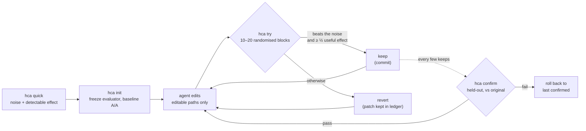

Übersetzt aus README.md, Commit b9bad05. Für Zahlen ist das englische README maßgeblich.

<div align="center">

[English](../../README.md) · [简体中文](README.zh-CN.md) · [繁體中文](README.zh-TW.md) · [日本語](README.ja.md) · [한국어](README.ko.md) · [Español](README.es.md) · [Português (Brasil)](README.pt-BR.md) · [Français](README.fr.md) · **Deutsch** · [Русский](README.ru.md) · [Türkçe](README.tr.md) · [Tiếng Việt](README.vi.md) · [Bahasa Indonesia](README.id.md) · [हिन्दी](README.hi.md)

# HillClimbAnything

### Das Harness, mit dem sich jede technische Herausforderung per Hill-Climbing angehen lässt.

**Richte deinen Coding-Agenten auf eine Zahl. Behalte nur die Gewinne, die echt sind.**

[](#schnellstart)
[](../../pyproject.toml)
[](../../tests)
[](../../skills/hca/SKILL.md)
[](../../LICENSE)

<code>pip install git+https://github.com/JaiS1/HillClimbAnything && hca quick -- python bench.py</code>

<br /><br />

<picture>
  <source media="(prefers-color-scheme: dark)" srcset="../assets/climb-dark.svg" />
  
</picture>

</div>

---

Loops im Stil von autoresearch lassen einen Agenten editieren, messen und behalten, was am besten
abschneidet. Bei einer verrauschten Metrik ist „am besten“ oft Glück. Auf einem gewöhnlichen
Desktop-Rechner hat das Behalten des rohen Bestwerts je nach Benchmark **17–55%** der Änderungen
behalten, die nichts bewirkt haben ([gemessen](../../spikes/phase0/RESULT.md)).

HillClimbAnything ist der **Schiedsrichter** für diesen Loop:

- Es misst, wie verrauscht deine Zahl ist, bevor du anfängst.
- Es behält eine Änderung nur, wenn sie dieses Rauschen übertrifft.
- Es bestätigt den Gesamtgewinn auf Daten, auf die der Agent nie hin optimiert hat.

Dein Agent schlägt vor, HCA entscheidet. HCA ist ein kleines Python-CLI ohne Abhängigkeiten plus ein
Skill (reines Markdown), der einem Coding-Agenten die Methode beibringt. Es wurde mit Claude Code getestet.

## Schnellstart

**1. Installieren** (Python 3.11+; getestet unter Linux und WSL, macOS ungetestet):

```bash
pip install git+https://github.com/JaiS1/HillClimbAnything     # noch nicht auf PyPI
npx skills add JaiS1/HillClimbAnything --skill hca             # optional: der Agent-Skill
```

**2. Deinen Agenten bitten:**

```text
Installiere HillClimbAnything (github.com/JaiS1/HillClimbAnything) und folge seiner skills/hca/SKILL.md.
Mach `python bench.py` schneller: führe zuerst `hca quick` aus, schreibe hca.toml gemeinsam mit mir,
steigere mit `hca try` und berichte nur, was `hca confirm` besteht.
```

**3. Oder selbst bedienen:**

<div align="center">

</div>

```bash
hca quick -- <cmd>     # 2 Minuten, ohne Setup: Wie verrauscht ist diese Zahl, welchen Gewinn können wir erkennen?
hca init               # den Evaluator einfrieren, einen Branch anlegen, das Basisrauschen messen
hca try -m "why"       # deine Änderung gegen den letzten keep messen → keep (Commit) oder revert
hca confirm            # den Gesamtgewinn gegen das Original neu messen, auf zurückgehaltenen Daten
hca report             # jeder Versuch mit Urteil und Belegen
```

Eine Aufgabe besteht aus einem Briefing, den Pfaden, die der Agent ändern darf, und einem Befehl, der die Zahl ausgibt:

```toml
# hca.toml
[task]
name     = "api-latency"
editable = ["src/**"]          # der Agent darf diese Dateien ändern
frozen   = ["bench/**"]        # der Evaluator: gehasht, nie editiert

[objective]
command       = ["python3", "bench/run.py"]   # gibt METRIC p95_ms=212.4 aus
metric        = "p95_ms"
direction     = "min"
useful_effect = "5%"           # der kleinste Gewinn, der sich zu behalten lohnt
```

## Fallstudie: Python-Markdown, 2× schneller

Ein Sonnet-Coding-Agent hat [Python-Markdown](https://github.com/Python-Markdown/markdown)
3.11.1 mit HCA als Schiedsrichter optimiert: 18 Versuche in etwa 80 Minuten, 14 behalten.

| Prüfung | Ergebnis |
|---|---|
| `hca confirm` auf zurückgehaltenen Dokumenten | Render-Zeit **−53.8%** (mindestens −53.0%) |
| Unabhängige Nachmessung außerhalb von HCA, auf den Test-Fixtures des Projekts | **−63.5%** |
| Ausgabe: die Test-Suite des Projekts (1.126 Tests; 110 übersprungen, wie in 3.11.1) und 23.000 zufällige Dokumente | **identisch** mit 3.11.1 |
| Änderungen, die HCA verworfen hat und die ein Einzelmessungs-Loop behalten hätte | **3 von 4**, darunter ein „−17.9%“, das in Wahrheit −1.7% war |

Der größte Gewinn kam daher, Inline-Regex-Muster zu überspringen, wenn der Text kein Zeichen enthalten
kann, das jeder Treffer braucht. Lies den [Bericht, den Patch, das Log pro Versuch und das rohe Ledger](../../showcases/python-markdown/README.md).
Es ist eine Maschine und ein Lauf, und der Patch wurde upstream nicht begutachtet.

## Warum ein Schiedsrichter?

Zwei identische Builds, verglichen so, wie die meisten Loops vergleichen ([Phase 0](../../spikes/phase0/RESULT.md)):

| Behalte-Regel | Wirkungslose Änderungen behalten | Echte 5%-Beschleunigungen behalten |
|---|---|---|
| Den rohen Bestwert behalten | **17–55%** | 100% |
| HCAs Test auf randomisierten Blöcken | **≤ 1%** | 76–96% (15 Blöcke) |

Die Bereiche umfassen zwei Benchmarks (einen Webserver und ein CLI). Die HCA-Zeile ist ein einzelner
Blick bei α = 1%; die ausgelieferte Regel ist strenger.

Ein Loop, der ein Fünftel bis die Hälfte seiner wirkungslosen Änderungen behält, klettert auf Rauschen.
Seine Gewinne sehen aus, als würden sie sich stapeln, und verflüchtigen sich beim Nachmessen.

## So funktioniert es



- **Randomisierte Blöcke.** Jeder Versuch führt Baseline und Kandidat direkt nacheinander in
  zufälliger Reihenfolge aus, 10- bis 20-mal. Durch die zufällige Reihenfolge ist ein exakter
  Sign-Flip-Test gültig, egal wie das Rauschen aussieht: Heavy Tails, thermische Ausreißer, ein im
  Hintergrund laufendes Spiel.
- **Evidenz und Größe.** Ein keep verlangt, dass der einseitige Test pro Versuch bei 1% besteht und
  dass die Schätzung mindestens die Hälfte deines nützlichen Effekts erreicht.
- **Identische Arme.** Beide Arme sind saubere Git-Worktrees exakter Commits. Der Commit, der behalten
  wird, ist genau der Baum, der gemessen wurde.
- **Bestätigen, sonst zählt es nicht.** `hca confirm` prüft die Historie und misst dann den
  Gesamtgewinn gegen das Original neu. Der Agent sieht nur PASS oder FAIL.
- **Alles auf der Platte.** Patch, Rohläufe, Urteil und Begründung jedes Versuchs liegen in `.hca/`.

## Was du optimieren kannst

Alles, was ein Befehl in eine Zahl verwandeln kann, sofern die Zahl reproduzierbar genug ist, um ihr
Rauschen zu messen.

| Ziel | Beispielmetrik | Status |
|---|---|---|
| Hot Path einer Bibliothek | Render- / Parse-Zeit | ✅ Fallstudie (Python-Markdown, −53.8%) |
| CLI und Build-Zeit | Wanduhr-Sekunden | 🧪 kalibriert ([Phase 0](../../spikes/phase0/RESULT.md)) |
| Webserver-Latenz | Time to First Byte pro Route | 🧪 kalibriert ([Phase 0](../../spikes/phase0/RESULT.md)) |
| Seitenladezeit im Browser | LCP pro Seite | 🗺️ Fallstudie geplant |
| Frame-Zeit von UI oder Spiel | p99-Frame-ms pro Szene | 🗺️ Fallstudie geplant |
| Genauigkeit von Modell oder Prompt | Eval-Score pro Item | 🧪 `items`-Modus, per Unit-Test abgedeckt |
| Kostenpflichtige GPU-Trainingsläufe | Eval-Score nach dem Training | 📋 Kampagnenmethode in den [Skill-Referenzen](../../skills/hca/references/campaign-card.md); Tooling geplant |

## Für Agenten

Wenn du ein KI-Agent bist und das hier liest:

- **Methode:** [`skills/hca/SKILL.md`](../../skills/hca/SKILL.md). Sie behandelt die Prämissen-Checks,
  einen Mechanismus pro Versuch und dass eingefrorene Dateien nie angefasst werden.
- **Spezifikation und Ausgabevertrag:** [`skills/hca/references/spec.md`](../../skills/hca/references/spec.md).
- **Überblick für Crawler und Assistenten:** [`llms.txt`](../../llms.txt).
- **Arbeiten an diesem Repo:** [`AGENTS.md`](../../AGENTS.md).

| Exit-Code | `hca try` | `hca confirm` |
|---|---|---|
| 0 | keep | bestanden |
| 1 | revert | fehlgeschlagen (Rollback) |
| 2 | ungültig / nichtig / abgelehnt: nichts wird behalten, deine Änderungen bleiben unangetastet | nicht eindeutig oder abgelehnt |
| 3 / 4 | Bedienfehler / interner Fehler | dasselbe |

Berichte nur, was `hca confirm` bestanden hat, mit seiner Schranke und der Anzahl der Versuche.

## FAQ

<details>
<summary><strong>Ruft HCA ein LLM auf oder braucht es einen API-Key?</strong></summary>

Nein. HCA ruft nie ein Modell auf. Dein Agent (Claude Code, Codex, Cursor oder ein anderer) übernimmt
das Denken, HCA misst und entscheidet nur. `hca quick` funktioniert ganz ohne Agenten.
</details>

<details>
<summary><strong>Wie lange dauert ein Versuch?</strong></summary>

Etwa 20 bis 40 Läufe deines Befehls: 10 Blöcke, auf 20 erweitert, wenn das Ergebnis vielversprechend
aussieht, mit zwei Läufen pro Block. Ein Benchmark von 3 Sekunden braucht 1 bis 2 Minuten pro Versuch.
`hca quick` nennt dir die Kosten, bevor du anfängst.
</details>

<details>
<summary><strong>Meine Metrik ist verrauscht. Funktioniert das trotzdem?</strong></summary>

`hca quick` beantwortet das in etwa 2 Minuten. Es meldet das Rauschen und den kleinsten Gewinn, den du
erkennen kannst. Lautet die Antwort „hier zu verrauscht“, nennt es die günstigste Abhilfe: mehr Items
pro Lauf, längere Läufe oder andere Last beenden. Vorher zu optimieren ist vergeudete Mühe.
</details>

<details>
<summary><strong>Kann der Agent schummeln?</strong></summary>

Er kann es versuchen, und HCA macht es ihm unbequem:

- Eingefrorene Evaluator-Dateien werden gehasht.
- Änderungen außerhalb der deklarierten Pfade machen den Versuch ungültig.
- Beide Arme laufen aus sauberen Worktrees.
- Abstürze zählen als schlechtester Wert.
- Wiederholte Versuche werden mitgezählt.

Es ist keine Sicherheitsgrenze, also lies die Patches. [docs/LIMITS.md](../LIMITS.md) listet jede
bekannte Lücke auf und was man dagegen tun kann.
</details>

<details>
<summary><strong>Wie unterscheidet sich das von autoresearch?</strong></summary>

[autoresearch](https://github.com/karpathy/autoresearch) hat gezeigt, wie produktiv ein Agent in einem
Loop sein kann, und HCA behält diesen Loop bei. Neu bei HCA ist die Entscheidung: für jeden Befehl und
jede Metrik, ob eine Änderung echt oder Rauschen ist, dazu ein Bestätigungsschritt, der vor dem Fluch
des Gewinners (Winner's Curse) schützt.
</details>

<details>
<summary><strong>Was ist mit teuren Läufen wie GPU-Training?</strong></summary>

Die Referenzen des Skills enthalten die Disziplin aus einer echten, mehrmonatigen Kampagne zum Fine-Tuning von Modellen:

- eine vorab registrierte Karte mit einer passenden Kontrolle „gleiche Rechenleistung, ohne die Idee“;
- eine günstige Probe vor dem bezahlten Lauf;
- adversariales Review;
- Watcher und Budget-Zähler innerhalb des Remote-Jobs;
- eine gründliche Auswertung vor jedem Urteil.

Das Tooling dafür ist geplant.
</details>

<details>
<summary><strong>Windows?</strong></summary>

Nutze WSL. Native Prozesssteuerung unter Windows ist noch nicht getestet, macOS ebenfalls nicht.
</details>

## Dokumentation

- [Fallstudie: Python-Markdown](../../showcases/python-markdown/README.md)
- [Grenzen und bekannte Lücken](../LIMITS.md)
- [Phase-0-Kalibrierung](../../spikes/phase0/RESULT.md)
- [Design](../DESIGN-hca.md)
- [Architekturvertrag](../ARCHITECTURE-v1.md)

## Status und Danksagung

Früher Forschungs-Release (0.2.0.dev): die Kernschleife und eine Fallstudie. HCA ging aus
[Dream Loop](https://github.com/JaiS1/dream-loop/tree/dream-loop-v0.1) hervor, dessen gepaarte Statistik
es beibehält. Es übernimmt Ideen aus Loops im Stil von [autoresearch](https://github.com/karpathy/autoresearch)
und aus der Evaluationshygiene des Papers [Harness Learning](https://arxiv.org/abs/2609.35738).

```bash
python3 -m unittest discover -s tests      # Entwicklung
```

[MIT-Lizenz](../../LICENSE). Wenn HCA dich davor bewahrt hat, einen Scheingewinn auszuliefern, hilft ein Stern anderen, es zu finden.
