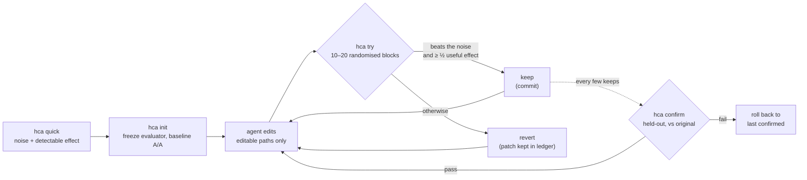

Traducido de README.md en el commit 59b1150. El README en inglés es la referencia para las cifras.

<div align="center">

[English](../../README.md) · [简体中文](README.zh-CN.md) · [繁體中文](README.zh-TW.md) · [日本語](README.ja.md) · [한국어](README.ko.md) · **Español** · [Português (Brasil)](README.pt-BR.md) · [Français](README.fr.md) · [Deutsch](README.de.md) · [Русский](README.ru.md) · [Türkçe](README.tr.md) · [Tiếng Việt](README.vi.md) · [Bahasa Indonesia](README.id.md) · [हिन्दी](README.hi.md)

# HillClimbAnything

### El arnés para hacer hill-climbing en cualquier reto técnico.

**Apunta a tu agente de programación hacia un número. Conserva solo las mejoras reales.**

[](#inicio-rápido)
[](../../pyproject.toml)
[](../../tests)
[](../../skills/hca/SKILL.md)
[](../../LICENSE)

<code>uvx --from hillclimbanything hca quick -- python bench.py</code>

<sub>Pruébalo sin instalar nada: ¿qué tan ruidoso es tu benchmark y qué mejora podrías detectar?</sub>

<br /><br />

<picture>
  <source media="(prefers-color-scheme: dark)" srcset="../assets/climb-dark.svg" />
  
</picture>

</div>

---

Los bucles al estilo autoresearch dejan que un agente edite, mida y conserve lo que mejor puntúe. Con una
métrica ruidosa, «lo mejor» suele ser suerte. En un equipo de escritorio normal, quedarse con la mejor
puntuación en bruto conservó el **17–55%** de los cambios que no hacían nada, según el benchmark ([medido](../../spikes/phase0/RESULT.md)).

HillClimbAnything es el **árbitro** de ese bucle:

- mide cuánto ruido tiene tu número antes de empezar;
- conserva un cambio solo si supera ese ruido;
- confirma la ganancia total con datos contra los que el agente nunca ajustó nada.

Tu agente propone y HCA decide. HCA es una CLI de Python pequeña y sin dependencias, más un skill
(Markdown plano) que enseña el método a un agente de programación. Se ha probado con Claude Code.

## Inicio rápido

**1. Instala** (Python 3.11+; probado en Linux, WSL y Windows nativo, macOS sin probar):

```bash
uv tool install hillclimbanything   # o: pipx install hillclimbanything
hca setup                                                        # añade el skill del agente (muestra antes su plan)
```

`hca setup` coloca el skill donde los agentes lo buscan: `~/.claude/skills/hca` (Claude Code) y
`~/.agents/skills/hca` (Codex, Cursor, Gemini CLI, Copilot). Hace una copia de seguridad de lo que reemplaza,
y `hca setup --uninstall` lo quita de nuevo. ¿Sin [`uv`](https://docs.astral.sh/uv/getting-started/installation/) ni [`pipx`](https://pipx.pypa.io/stable/installation/)? `pip install` a secas
funciona dentro de un entorno virtual; muchos sistemas lo rechazan fuera de uno (PEP 668).

<details>
<summary>Otras formas de añadir el skill</summary>

**Plugin de Claude Code:**

```text
/plugin marketplace add JaiS1/HillClimbAnything
/plugin install hca@hillclimbanything
```

**[skills.sh](https://github.com/vercel-labs/skills):**

```bash
npx skills add JaiS1/HillClimbAnything --skill hca
```

En ambos casos el skill maneja la CLI `hca`, así que instala también la CLI.
</details>

**2. Pídeselo a tu agente:**

```text
Usa el skill hca (HillClimbAnything) para hacer más rápido `python bench.py`: ejecuta primero
`hca quick`, escribe hca.toml conmigo, escala con `hca try` y reporta solo lo que `hca confirm` dé por bueno.
```

**3. O úsalo tú mismo:**

<div align="center">

</div>

```bash
hca compare -- <A> -- <B>   # el primer resultado en 2 minutos: ¿B es realmente mejor que A? sin git, sin hca.toml
hca quick -- <cmd>     # 2 minutos, sin configuración: ¿cuánto ruido tiene este número y qué mejora se puede detectar?
hca init               # congela el evaluador, crea una rama, mide el ruido de la línea base
hca try -m "why"       # mide tu edición contra el último keep → keep (commit) o revert
hca confirm            # vuelve a medir la ganancia total contra el original, con datos reservados
hca report             # cada intento, su veredicto y la evidencia
```

`hca compare` no necesita repositorio ni configuración: ejecuta los dos comandos en bloques A/B aleatorizados e informa de la diferencia con su intervalo y su valor p, del ruido que vio y de la menor diferencia que habría podido detectar, de modo que "sin diferencia detectable" signifique algo. El código de salida 0 significa que B es mejor que A por un margen significativo, 1 que no, y 2 que una ejecución falló o no devolvió la métrica. Los comandos se ejecutan sin shell (escribe `sh -c '...'` si necesitas uno); la métrica por defecto es el tiempo de ejecución, o usa `--metric NAME` para leer una línea `METRIC NAME=value`. Cuando quieras una escalada protegida sobre tu propio código, el siguiente paso es `hca init`.

Una tarea consta de una descripción, las rutas que el agente puede editar y un comando que imprime el número:

```toml
# hca.toml
[task]
name     = "api-latency"
editable = ["src/**"]          # el agente puede cambiar esto
frozen   = ["bench/**"]        # el evaluador: se calcula su hash, nunca se edita

[objective]
command       = ["python3", "bench/run.py"]   # imprime METRIC p95_ms=212.4
metric        = "p95_ms"
direction     = "min"
useful_effect = "5%"           # la mejora mínima que vale la pena conservar
```

## Caso de estudio: Python-Markdown, 2× más rápido

Un agente de programación Sonnet escaló [Python-Markdown](https://github.com/Python-Markdown/markdown)
3.11.1 con HCA como árbitro: 18 intentos en unos 80 minutos, 14 conservados.

| Comprobación | Resultado |
|---|---|
| `hca confirm` con documentos reservados | tiempo de render **−53.8%** (al menos −53.0%) |
| Nueva medición independiente fuera de HCA, con los fixtures de prueba del proyecto | **−63.5%** |
| Salida: la suite de pruebas del proyecto (1126 pruebas; 110 omitidas, igual que en 3.11.1) y 23 000 documentos aleatorios | **idéntica** a 3.11.1 |
| Cambios que HCA rechazó y que un bucle de una sola ejecución habría conservado | **3 de 4**, uno de ellos un «−17.9%» que en realidad era −1.7% |

La mayor mejora fue omitir los patrones regex en línea cuando el texto no puede contener un carácter que
necesita toda coincidencia. Lee el [informe, el parche, el registro por intento y el ledger en bruto](../../showcases/python-markdown/README.md).
Es una sola máquina y una sola ejecución, y el parche no ha sido revisado en el proyecto original.

## Caso de estudio: js-yaml, un 15% más rápido

Una segunda escalada, en otro lenguaje y con otro tipo de métrica: [js-yaml](https://github.com/nodeca/js-yaml) 5.5.0 sobre Node, midiendo `load()` una vez por documento en 491 archivos reales de GitHub Actions, Kubernetes, Helm, Compose y OpenAPI. Un agente de programación hizo 12 intentos en aproximadamente una hora y se conservaron 3.

<div align="center">
<picture>
  <source media="(prefers-color-scheme: dark)" srcset="../assets/climb-yaml-dark.svg" />
  
</picture>
</div>

| Comprobación | Resultado |
|---|---|
| `hca confirm` con documentos reservados (los mismos géneros, en su mayoría archivos distintos) | tiempo de `load()` **−15.3%** de mediana por ítem (al menos −13.3%) |
| A/B en un clon limpio contra la versión original, 200 procesos nuevos | tiempo total **−15.3%** (IC del 95%: −16.6% a −14.4%) |
| Salida: las 1633 pruebas propias de js-yaml, 25 384 comparaciones en cada una de las compilaciones ESM y CJS y 11 250 comparaciones de fuzz | **0 diferencias** con 5.5.0 |

Las mejoras son pequeños cambios que evitan trabajo en el parser: menos asignaciones por nodo, un despacho por el primer carácter y una vía rápida para escalares simples. Dos de los tres intentos conservados agrupan cambios que por separado quedaban por debajo del umbral de conservación, lo que el informe declara; la confirmación cubre el estado final. La métrica es el tiempo por llamada, más bien en frío, sobre documentos mayormente pequeños, no el rendimiento en un bucle caliente. Es una sola máquina y el parche no se ha enviado al proyecto original. Lee el [informe, el parche, el ledger y el arnés](../../showcases/js-yaml/README.md).

## ¿Por qué un árbitro?

Dos compilaciones idénticas, comparadas como las comparan la mayoría de los bucles ([Fase 0](../../spikes/phase0/RESULT.md)):

| Regla para conservar | Cambios nulos conservados | Aceleraciones reales del 5% conservadas |
|---|---|---|
| Conservar la mejor puntuación en bruto | **17–55%** | 100% |
| Test de HCA con bloques aleatorizados | **≤ 1%** | 76–96% (15 bloques) |

Los rangos abarcan dos benchmarks (un servidor web y una CLI). La fila de HCA corresponde a una sola
evaluación con α = 1%; la regla que se distribuye es más estricta.

Un bucle que conserva entre una quinta parte y la mitad de sus cambios nulos está escalando ruido. Sus
ganancias parecen acumularse y luego se evaporan al volver a medir.

## Cómo funciona



- **Bloques aleatorizados.** Cada intento ejecuta la línea base y el candidato uno tras otro, en orden
  aleatorio, de 10 a 20 veces. El orden aleatorio hace válido un test exacto de cambio de signo
  (sign-flip) sea cual sea la forma del ruido: colas pesadas, picos térmicos, un juego abierto en segundo plano.
- **Evidencia y tamaño.** Un keep exige que el test unilateral pase al 1% por intento y que la
  estimación alcance al menos la mitad de tu efecto útil.
- **Brazos idénticos.** Ambos brazos son git worktrees limpios de commits exactos. El commit que se
  conserva es exactamente el árbol que se midió.
- **Confirmar o no cuenta.** `hca confirm` comprueba el historial y luego vuelve a medir la ganancia
  total contra el original. El agente solo ve PASS o FAIL.
- **Todo en disco.** El parche de cada intento, las ejecuciones en bruto, el veredicto y los motivos
  están en `.hca/`.

## Qué puedes escalar

Cualquier cosa que un comando pueda convertir en un número, siempre que el número sea lo bastante
repetible como para medir su ruido.

| Objetivo | Métrica de ejemplo | Estado |
|---|---|---|
| Ruta crítica de una librería | tiempo de render / parseo | ✅ caso de estudio (Python-Markdown, −53.8%; js-yaml, −15.3%) |
| CLI y tiempo de compilación | segundos de reloj | 🧪 calibrado ([Fase 0](../../spikes/phase0/RESULT.md)) |
| Latencia de un servidor web | tiempo hasta el primer byte por ruta | 🧪 calibrado ([Fase 0](../../spikes/phase0/RESULT.md)) |
| Carga de página en un navegador | LCP por página | 🗺️ caso de estudio planificado |
| Tiempo de fotograma de una UI o un juego | ms de fotograma p99 por escena | 🗺️ caso de estudio planificado |
| Precisión de un modelo o prompt | puntuación de evaluación por ítem | 🧪 modo `items`, con tests unitarios |
| Entrenamientos de pago en GPU | puntuación de evaluación tras el entrenamiento | 📋 método de campaña en las [referencias del skill](../../skills/hca/references/campaign-card.md); herramientas planificadas |

## Para agentes

Si eres un agente de IA y estás leyendo esto:

- **Método:** [`skills/hca/SKILL.md`](../../skills/hca/SKILL.md). Cubre la comprobación de premisas, un
  mecanismo por intento y no tocar nunca los archivos congelados.
- **Especificación y contrato de salida:** [`skills/hca/references/spec.md`](../../skills/hca/references/spec.md).
- **Resumen para crawlers y asistentes:** [`llms.txt`](../../llms.txt).
- **Trabajar en este repositorio:** [`AGENTS.md`](../../AGENTS.md).

| Código de salida | `hca try` | `hca confirm` |
|---|---|---|
| 0 | keep | superado |
| 1 | revert | fallido (rollback) |
| 2 | inválido / nulo / rechazado: no se conserva nada, tus ediciones se quedan donde están | no concluyente o rechazado |
| 3 / 4 | error de uso / error interno | igual |

Reporta solo lo que `hca confirm` haya superado, con su cota y el número de intentos.

## FAQ

<details>
<summary><strong>¿HCA llama a un LLM o necesita una API key?</strong></summary>

No. HCA nunca llama a un modelo. Tu agente (Claude Code, Codex, Cursor o cualquier otro) hace el
trabajo de pensar, y HCA solo mide y decide. `hca quick` funciona sin ningún agente.
</details>

<details>
<summary><strong>¿Cuánto tarda un intento?</strong></summary>

Entre 20 y 40 ejecuciones de tu comando: 10 bloques, ampliados a 20 cuando el resultado parece
prometedor, con dos ejecuciones por bloque. Un benchmark de 3 segundos tarda de 1 a 2 minutos por
intento. `hca quick` te dice el coste antes de empezar.
</details>

<details>
<summary><strong>Mi métrica es ruidosa. ¿Funcionará?</strong></summary>

`hca quick` lo responde en unos 2 minutos. Informa del ruido y de la mejora más pequeña que puedes
detectar. Si la respuesta es «demasiado ruido aquí», indica la solución más barata: más ítems por
ejecución, ejecuciones más largas o cerrar otras cargas. Escalar antes de eso es esfuerzo perdido.
</details>

<details>
<summary><strong>¿Puede el agente hacer trampa?</strong></summary>

Puede intentarlo, y HCA se lo pone difícil:

- los archivos congelados del evaluador se verifican con hash;
- las ediciones fuera de las rutas declaradas invalidan el intento;
- ambos brazos se ejecutan desde worktrees limpios;
- los fallos puntúan como el peor valor;
- los intentos repetidos se cuentan.

No es una frontera de seguridad, así que revisa los parches. [docs/LIMITS.md](../LIMITS.md) enumera cada
brecha conocida y qué hacer al respecto.
</details>

<details>
<summary><strong>¿En qué se diferencia de autoresearch?</strong></summary>

[autoresearch](https://github.com/karpathy/autoresearch) mostró lo productivo que puede ser un
agente dentro de un bucle, y HCA conserva ese bucle. Lo que HCA añade es la decisión: para cualquier
comando y cualquier métrica, si un cambio es real o ruido, además de un paso de confirmación que
protege contra la maldición del ganador.
</details>

<details>
<summary><strong>¿Y las ejecuciones caras, como el entrenamiento en GPU?</strong></summary>

Las referencias del skill recogen la disciplina de una campaña real de varios meses de fine-tuning de modelos:

- una ficha preregistrada con un control equivalente de «mismo cómputo, sin la idea»;
- un ensayo barato antes de la ejecución de pago;
- revisión adversarial;
- vigilantes y medidores de presupuesto dentro del trabajo remoto;
- una evaluación en profundidad antes de cualquier veredicto.

Las herramientas para esto están planificadas.
</details>

<details>
<summary><strong>¿Windows?</strong></summary>

Windows nativo funciona (Python 3.11+). Un timeout mata todo el árbol de procesos mediante un Job Object y `taskkill`. No hay shell, así que escribe los comandos como listas argv (un archivo batch es `["cmd", "/c", "build.bat"]`). WSL sigue dando el aislamiento de procesos más estricto, y macOS no está probado.
</details>

## Documentación

- [Caso de estudio: Python-Markdown](../../showcases/python-markdown/README.md)
- [Caso de estudio: js-yaml](../../showcases/js-yaml/README.md)
- [Límites y brechas conocidas](../LIMITS.md)
- [Calibración de la Fase 0](../../spikes/phase0/RESULT.md)
- [Diseño](../DESIGN-hca.md)
- [Contrato de arquitectura](../ARCHITECTURE-v1.md)

## Estado y créditos

Versión de investigación temprana (0.2.0.dev): el bucle principal y dos casos de estudio. HCA surgió de
[Dream Loop](https://github.com/JaiS1/dream-loop/tree/dream-loop-v0.1), cuyas estadísticas pareadas
conserva. Toma ideas de los bucles al estilo [autoresearch](https://github.com/karpathy/autoresearch)
y de la higiene de evaluación del paper [Harness Learning](https://arxiv.org/abs/2609.35738).

```bash
python3 -m unittest discover -s tests      # desarrollo
```

[Licencia MIT](../../LICENSE). Si HCA te evitó publicar una mejora falsa, una estrella ayuda a que otros lo encuentren.
