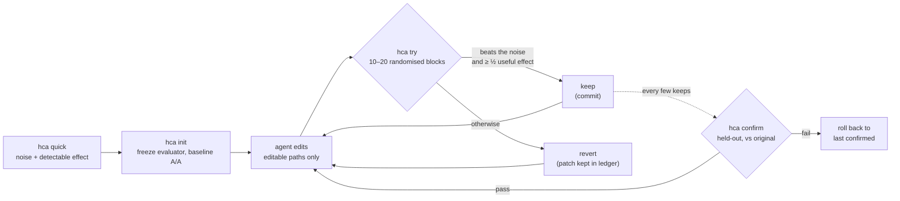

Traduit de README.md au commit 59b1150. Le README anglais fait foi pour les chiffres.

<div align="center">

[English](../../README.md) · [简体中文](README.zh-CN.md) · [繁體中文](README.zh-TW.md) · [日本語](README.ja.md) · [한국어](README.ko.md) · [Español](README.es.md) · [Português (Brasil)](README.pt-BR.md) · **Français** · [Deutsch](README.de.md) · [Русский](README.ru.md) · [Türkçe](README.tr.md) · [Tiếng Việt](README.vi.md) · [Bahasa Indonesia](README.id.md) · [हिन्दी](README.hi.md)

# HillClimbAnything

### Le harnais pour faire du hill-climbing sur n'importe quel défi technique.

**Pointez votre agent de code vers un chiffre. Ne gardez que les gains réels.**

[](#démarrage-rapide)
[](../../pyproject.toml)
[](../../tests)
[](../../skills/hca/SKILL.md)
[](../../LICENSE)

<code>uvx --from hillclimbanything hca quick -- python bench.py</code>

<sub>Essayez sans rien installer : quel est le bruit de votre benchmark, et quel gain pourriez-vous détecter ?</sub>

<br /><br />

<picture>
  <source media="(prefers-color-scheme: dark)" srcset="../assets/climb-dark.svg" />
  
</picture>

</div>

---

Les boucles de type autoresearch laissent un agent modifier, mesurer et garder ce qui obtient le meilleur
score. Sur une métrique bruitée, « le meilleur » relève souvent de la chance. Sur un poste de bureau
ordinaire, garder le meilleur score brut a conservé **17–55%** des changements qui ne faisaient rien,
selon le benchmark ([mesuré](../../spikes/phase0/RESULT.md)).

HillClimbAnything est l'**arbitre** de cette boucle :

- il mesure le bruit de votre chiffre avant que vous commenciez ;
- il ne garde un changement que s'il dépasse ce bruit ;
- il confirme le gain total sur des données contre lesquelles l'agent n'a jamais optimisé.

Votre agent propose, HCA tranche. HCA est une CLI Python minuscule, sans dépendances, accompagnée d'un
skill (du Markdown brut) qui enseigne la méthode à un agent de code. Il a été testé avec Claude Code.

## Démarrage rapide

**1. Installez** (Python 3.11+ ; testé sous Linux, WSL et Windows natif, macOS non testé) :

```bash
uv tool install hillclimbanything   # ou: pipx install hillclimbanything
hca setup                                                        # ajouter le skill de l'agent (montre d'abord son plan)
```

`hca setup` place le skill là où les agents le cherchent : `~/.claude/skills/hca` (Claude Code) et
`~/.agents/skills/hca` (Codex, Cursor, Gemini CLI, Copilot). Il sauvegarde ce qu'il remplace,
et `hca setup --uninstall` le retire. Pas de [`uv`](https://docs.astral.sh/uv/getting-started/installation/) ni de [`pipx`](https://pipx.pypa.io/stable/installation/) ? Un simple
`pip install` fonctionne dans un environnement virtuel ; beaucoup de systèmes le refusent en dehors d'un (PEP 668).

<details>
<summary>Autres façons d'ajouter le skill</summary>

**Plugin Claude Code :**

```text
/plugin marketplace add JaiS1/HillClimbAnything
/plugin install hca@hillclimbanything
```

**[skills.sh](https://github.com/vercel-labs/skills):**

```bash
npx skills add JaiS1/HillClimbAnything --skill hca
```

Dans les deux cas, le skill pilote la CLI `hca` : installez donc aussi la CLI.
</details>

**2. Demandez à votre agent :**

```text
Utilise le skill hca (HillClimbAnything) pour rendre `python bench.py` plus rapide : lance d'abord
`hca quick`, écris hca.toml avec moi, progresse avec `hca try`, et ne rapporte que ce que `hca confirm` valide.
```

**3. Ou pilotez-le vous-même :**

<div align="center">

</div>

```bash
hca compare -- <A> -- <B>   # premier résultat en quelques minutes pour une commande rapide : B est-il vraiment meilleur que A ? sans git, sans hca.toml
hca quick -- <cmd>     # 2 minutes, sans configuration : quel bruit sur ce chiffre, quel gain peut-on détecter ?
hca init               # fige l'évaluateur, crée une branche, mesure le bruit de la référence
hca try -m "why"       # mesure votre modification face au dernier keep → keep (commit) ou revert
hca confirm            # re-mesure le gain total face à l'original, sur des données mises de côté
hca report             # chaque tentative, son verdict et ses preuves
```

`hca compare` n'a besoin ni d'un dépôt ni d'une configuration : il exécute les deux commandes en blocs A/B randomisés et rapporte la différence avec son intervalle et sa valeur p, le bruit observé et la plus petite différence qu'il aurait pu détecter, pour que « aucune différence détectable » veuille dire quelque chose. Le code de sortie 0 signifie que B est meilleur que A de façon significative, 1 que non, 2 qu'une exécution a échoué ou n'a pas fourni la métrique. Les commandes s'exécutent sans shell (écrivez `sh -c '...'` si vous en avez besoin) ; la métrique par défaut est le temps d'exécution, ou passez `--metric NAME` pour lire une ligne `METRIC NAME=value`. Pour une ascension protégée de votre propre code, `hca init` est l'étape suivante. Il exécute généralement les 20 blocs (il s'arrête à 10 seulement quand le premier examen est déjà tranché). Codes de sortie : 0 B meilleur, 1 non, 2 invalide, 3 usage, 4 erreur interne. Sous Windows natif, les commandes internes du shell et les shims `.cmd` comme `npm` ou `dir` demandent `cmd /c ...`. La commande A ne peut pas contenir `--` ; choisissez un autre séparateur avec `--sep TOKEN`.

Une tâche se compose d'un brief, des chemins que l'agent peut modifier et d'une commande qui affiche le chiffre :

```toml
# hca.toml
[task]
name     = "api-latency"
editable = ["src/**"]          # l'agent peut modifier ces fichiers
frozen   = ["bench/**"]        # l'évaluateur : hashé, jamais modifié

[objective]
command       = ["python3", "bench/run.py"]   # affiche METRIC p95_ms=212.4
metric        = "p95_ms"
direction     = "min"
useful_effect = "5%"           # le plus petit gain qui vaut la peine d'être gardé
```

## Étude de cas : Python-Markdown, 2× plus rapide

Un agent de code Sonnet a optimisé [Python-Markdown](https://github.com/Python-Markdown/markdown)
3.11.1 avec HCA comme arbitre : 18 essais en environ 80 minutes, 14 conservés.

| Vérification | Résultat |
|---|---|
| `hca confirm` sur des documents mis de côté | temps de rendu **−53.8%** (au moins −53.0%) |
| Re-mesure indépendante en dehors de HCA, sur les fixtures de test du projet | **−63.5%** |
| Sortie : la suite de tests du projet (1 126 tests ; 110 ignorés, comme dans 3.11.1) et 23 000 documents aléatoires | **identique** à 3.11.1 |
| Changements que HCA a rejetés et qu'une boucle à exécution unique aurait gardés | **3 sur 4**, dont un « −17.9% » qui valait en réalité −1.7% |

Le plus gros gain a consisté à sauter les motifs regex inline quand le texte ne peut pas contenir un
caractère que toute correspondance exige. Lisez le [compte rendu, le patch, le journal par essai et le ledger brut](../../showcases/python-markdown/README.md).
Il s'agit d'une seule machine et d'une seule exécution, et le patch n'a pas été relu en amont.

## Étude de cas : js-yaml, 15% plus rapide

Une deuxième ascension, dans un autre langage et avec un autre type de métrique : [js-yaml](https://github.com/nodeca/js-yaml) 5.5.0 sur Node, en chronométrant `load()` une fois par document sur 491 vrais fichiers GitHub Actions, Kubernetes, Helm, Compose et OpenAPI. Un agent de code a fait 12 essais en environ une heure, et 3 ont été conservés.

<div align="center">
<picture>
  <source media="(prefers-color-scheme: dark)" srcset="../assets/climb-yaml-dark.svg" />
  
</picture>
</div>

| Vérification | Résultat |
|---|---|
| `hca confirm` sur des documents mis de côté (mêmes genres, fichiers pour la plupart différents) | temps de `load()` **−15.3%** en médiane par item (au moins −13.3%) |
| A/B dans un clone propre contre la version d'origine, 200 processus neufs | temps total **−15.3%** (IC à 95 % : −16.6% à −14.4%) |
| Sortie : les 1 633 tests propres à js-yaml, 25 384 comparaisons pour chacun des builds ESM et CJS, 11 250 comparaisons de fuzz | **0 différence** avec 5.5.0 |

Les gains viennent de petits changements qui évitent du travail dans l'analyseur : moins d'allocations par nœud, un aiguillage sur le premier caractère et un chemin rapide pour les scalaires simples. Deux des trois essais conservés regroupent des changements qui étaient chacun sous le seuil de conservation, ce que le compte rendu signale ; la confirmation couvre l'état final. La métrique est le temps par appel, plutôt à froid, sur des documents surtout petits, pas le débit dans une boucle chaude. Il s'agit d'une seule machine, et le patch n'a pas été proposé en amont. Lisez le [compte rendu, le patch, le ledger et le harnais](../../showcases/js-yaml/README.md).

## Pourquoi un arbitre ?

Deux builds identiques, comparés comme la plupart des boucles les comparent ([Phase 0](../../spikes/phase0/RESULT.md)) :

| Règle de conservation | Changements sans effet conservés | Vrais gains de 5% conservés |
|---|---|---|
| Garder le meilleur score brut | **17–55%** | 100% |
| Test de HCA sur blocs randomisés | **≤ 1%** | 76–96% (15 blocs) |

Les plages couvrent deux benchmarks (un serveur web et une CLI). La ligne HCA correspond à un seul
test à α = 1% ; la règle livrée est plus stricte.

Une boucle qui garde entre un cinquième et la moitié de ses changements sans effet escalade du bruit. Ses
gains semblent s'empiler, puis s'évaporent quand on re-mesure.

## Comment ça marche



- **Blocs randomisés.** Chaque essai exécute la référence et le candidat l'un après l'autre, dans un
  ordre aléatoire, 10 à 20 fois. L'ordre aléatoire rend valide un test exact par inversion de signes
  (sign-flip), quelle que soit la forme du bruit : queues lourdes, pics thermiques, un jeu qui tourne en arrière-plan.
- **Preuve et ampleur.** Un keep exige que le test unilatéral passe à 1% par essai et que l'estimation
  atteigne au moins la moitié de l'effet utile que vous avez fixé.
- **Bras identiques.** Les deux bras sont des worktrees git propres, sur des commits exacts. Le commit
  conservé est exactement l'arbre qui a été mesuré.
- **Confirmer, sinon ça ne compte pas.** `hca confirm` vérifie l'historique, puis re-mesure le gain
  total face à l'original. L'agent ne voit que PASS ou FAIL.
- **Tout sur disque.** Le patch de chaque essai, les exécutions brutes, le verdict et ses motifs se
  trouvent dans `.hca/`.

## Ce que vous pouvez optimiser

Tout ce qu'une commande peut transformer en chiffre, à condition que ce chiffre soit assez reproductible
pour qu'on puisse mesurer son bruit.

| Cible | Exemple de métrique | Statut |
|---|---|---|
| Chemin critique d'une bibliothèque | temps de rendu / d'analyse | ✅ étude de cas (Python-Markdown, −53.8%; js-yaml, −15.3%) |
| CLI et temps de build | secondes d'horloge | 🧪 calibré ([Phase 0](../../spikes/phase0/RESULT.md)) |
| Latence d'un serveur web | délai jusqu'au premier octet par route | 🧪 calibré ([Phase 0](../../spikes/phase0/RESULT.md)) |
| Chargement de page dans un navigateur | LCP par page | 🗺️ étude de cas prévue |
| Temps de frame d'une UI ou d'un jeu | ms de frame p99 par scène | 🗺️ étude de cas prévue |
| Précision d'un modèle ou d'un prompt | score d'évaluation par élément | 🧪 mode `items`, testé unitairement |
| Entraînements GPU payants | score d'évaluation après entraînement | 📋 méthode de campagne dans les [références du skill](../../skills/hca/references/campaign-card.md) ; outillage prévu |

## Pour les agents

Si vous êtes un agent d'IA et que vous lisez ceci :

- **Méthode :** [`skills/hca/SKILL.md`](../../skills/hca/SKILL.md). Elle couvre la vérification des
  prémisses, un seul mécanisme par essai et l'interdiction de toucher aux fichiers figés.
- **Spécification et contrat de sortie :** [`skills/hca/references/spec.md`](../../skills/hca/references/spec.md).
- **Vue d'ensemble pour les crawlers et assistants :** [`llms.txt`](../../llms.txt).
- **Travailler sur ce dépôt :** [`AGENTS.md`](../../AGENTS.md).

| Code de sortie | `hca try` | `hca confirm` |
|---|---|---|
| 0 | keep | réussi |
| 1 | revert | échoué (rollback) |
| 2 | invalide / nul / refusé : rien n'est conservé, vos modifications restent en place | non concluant ou refusé |
| 3 / 4 | erreur d'usage / erreur interne | idem |

Ne rapportez que ce que `hca confirm` a validé, avec sa borne et le nombre d'essais.

## FAQ

<details>
<summary><strong>HCA appelle-t-il un LLM ou exige-t-il une clé d'API ?</strong></summary>

Non. HCA n'appelle jamais de modèle. Votre agent (Claude Code, Codex, Cursor ou un autre) fait la
réflexion, et HCA se contente de mesurer et de trancher. `hca quick` fonctionne sans aucun agent.
</details>

<details>
<summary><strong>Combien de temps dure un essai ?</strong></summary>

Environ 20 à 40 exécutions de votre commande : 10 blocs, portés à 20 quand le résultat paraît
prometteur, avec deux exécutions par bloc. Un benchmark de 3 secondes prend 1 à 2 minutes par essai.
`hca quick` vous donne le coût avant de commencer.
</details>

<details>
<summary><strong>Ma métrique est bruitée. Est-ce que ça marchera ?</strong></summary>

`hca quick` y répond en 2 minutes environ. Il indique le bruit et le plus petit gain détectable. Si la
réponse est « trop bruité ici », il nomme le correctif le moins coûteux : plus d'éléments par exécution,
des exécutions plus longues, ou fermer les autres charges. Optimiser avant cela, c'est de l'effort perdu.
</details>

<details>
<summary><strong>L'agent peut-il tricher ?</strong></summary>

Il peut essayer, et HCA le lui rend pénible :

- les fichiers figés de l'évaluateur sont hashés ;
- les modifications en dehors des chemins déclarés invalident l'essai ;
- les deux bras s'exécutent depuis des worktrees propres ;
- les plantages comptent comme la pire valeur ;
- les tentatives répétées sont comptabilisées.

Ce n'est pas une frontière de sécurité : relisez les patches. [docs/LIMITS.md](../LIMITS.md) recense
chaque lacune connue et ce qu'il faut en faire.
</details>

<details>
<summary><strong>En quoi est-ce différent d'autoresearch ?</strong></summary>

[autoresearch](https://github.com/karpathy/autoresearch) a montré à quel point un agent en boucle peut
être productif, et HCA conserve cette boucle. Ce que HCA ajoute, c'est la décision : pour n'importe
quelle commande et n'importe quelle métrique, un changement est-il réel ou n'est-ce que du bruit ? Il
ajoute aussi une étape de confirmation qui protège de la malédiction du vainqueur.
</details>

<details>
<summary><strong>Et les exécutions coûteuses, comme l'entraînement sur GPU ?</strong></summary>

Les références du skill reprennent la discipline d'une vraie campagne de fine-tuning de modèle, étalée sur plusieurs mois :

- une fiche préenregistrée avec un contrôle apparié « même calcul, sans l'idée » ;
- une répétition à bas coût avant l'exécution payante ;
- une revue adversariale ;
- des surveillants et des compteurs de budget au sein du job distant ;
- une évaluation approfondie avant tout verdict.

L'outillage correspondant est prévu.
</details>

<details>
<summary><strong>Windows ?</strong></summary>

Windows natif fonctionne (Python 3.11+). Un timeout tue tout l'arbre de processus via un Job Object et `taskkill`. Il n'y a pas de shell : écrivez les commandes comme des listes argv (un fichier batch s'écrit `["cmd", "/c", "build.bat"]`). WSL garde l'isolation des processus la plus stricte, et macOS n'est pas testé.
</details>

## Documentation

- [Étude de cas : Python-Markdown](../../showcases/python-markdown/README.md)
- [Étude de cas : js-yaml](../../showcases/js-yaml/README.md)
- [Limites et lacunes connues](../LIMITS.md)
- [Calibration de la Phase 0](../../spikes/phase0/RESULT.md)
- [Conception](../DESIGN-hca.md)
- [Contrat d'architecture](../ARCHITECTURE-v1.md)

## Statut et crédits

Version de recherche précoce (0.2.0.dev) : la boucle centrale et deux études de cas. HCA est issu de
[Dream Loop](https://github.com/JaiS1/dream-loop/tree/dream-loop-v0.1), dont il conserve les statistiques
appariées. Il emprunte des idées aux boucles de type [autoresearch](https://github.com/karpathy/autoresearch)
et à l'hygiène d'évaluation de l'article [Harness Learning](https://arxiv.org/abs/2609.35738).

```bash
python3 -m unittest discover -s tests      # développement
```

[Licence MIT](../../LICENSE). Si HCA vous a évité de publier un faux gain, une étoile aide d'autres personnes à le trouver.
