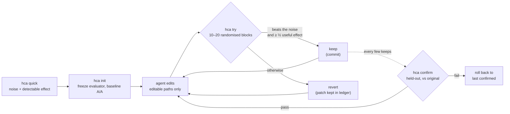

Translated from README.md at commit 59b1150. The English README is authoritative for numbers.

<div align="center">

[English](../../README.md) · [简体中文](README.zh-CN.md) · [繁體中文](README.zh-TW.md) · [日本語](README.ja.md) · [한국어](README.ko.md) · [Español](README.es.md) · [Português (Brasil)](README.pt-BR.md) · [Français](README.fr.md) · [Deutsch](README.de.md) · [Русский](README.ru.md) · [Türkçe](README.tr.md) · [Tiếng Việt](README.vi.md) · [Bahasa Indonesia](README.id.md) · **हिन्दी**

# HillClimbAnything

### किसी भी तकनीकी चुनौती पर hill-climb करने वाला harness।

**अपने coding agent को एक नंबर पर लगाइए। सिर्फ़ असली जीत रखिए।**

[](../../README.md#quick-start)
[](../../pyproject.toml)
[](../../tests)
[](../../skills/hca/SKILL.md)
[](../../LICENSE)

<code>uvx --from hillclimbanything hca quick -- python bench.py</code>

<sub>बिना कुछ install किए आज़माएँ: आपका benchmark कितना noisy है, और आप कितना सुधार पकड़ सकते हैं?</sub>

<br /><br />

<picture>
  <source media="(prefers-color-scheme: dark)" srcset="../assets/climb-dark.svg" />
  
</picture>

</div>

---

Autoresearch-style loops में agent कोड edit करता है, measure करता है, और जिसका स्कोर सबसे अच्छा आए उसे रख लेता है। noisy metric पर "सबसे अच्छा" अक्सर बस क़िस्मत होती है। एक सामान्य desktop पर, raw best score रखने से उन बदलावों में से **17–55%** रह गए जिनका कोई असर नहीं था, यह benchmark पर निर्भर करता है ([मापा गया](../../spikes/phase0/RESULT.md))।

HillClimbAnything इस loop का **रेफ़री** है:

- शुरू करने से पहले यह मापता है कि आपका नंबर कितना noisy है;
- कोई बदलाव तभी रखता है जब वह noise से बेहतर हो;
- कुल सुधार की पुष्टि उस data पर करता है जिस पर agent ने कभी tuning नहीं की।

आपका agent प्रस्ताव देता है, और HCA फ़ैसला करता है। HCA बिना dependencies वाला एक छोटा Python CLI है, साथ में एक skill (सादा Markdown) जो coding agent को यह तरीक़ा सिखाती है। इसे Claude Code के साथ test किया गया है।

## Quick start

**1. Install करें** (Python 3.11+; Linux, WSL और native Windows पर test किया गया, macOS पर test नहीं हुआ):

```bash
uv tool install hillclimbanything   # या: pipx install hillclimbanything
hca setup                                                        # agent skill जोड़ें (पहले अपनी योजना दिखाता है)
```

`hca setup` skill को वहाँ रखता है जहाँ agents उसे खोजते हैं: `~/.claude/skills/hca` (Claude Code) और
`~/.agents/skills/hca` (Codex, Cursor, Gemini CLI, Copilot)। जो कुछ यह बदलता है उसका backup लेता है,
और `hca setup --uninstall` उसे फिर हटा देता है। [`uv`](https://docs.astral.sh/uv/getting-started/installation/) या [`pipx`](https://pipx.pypa.io/stable/installation/) नहीं है? सादा
`pip install` virtualenv के अंदर चलता है; कई systems उसके बाहर इसे मना कर देते हैं (PEP 668)।

<details>
<summary>skill जोड़ने के अन्य तरीक़े</summary>

**Claude Code plugin:**

```text
/plugin marketplace add JaiS1/HillClimbAnything
/plugin install hca@hillclimbanything
```

**[skills.sh](https://github.com/vercel-labs/skills):**

```bash
npx skills add JaiS1/HillClimbAnything --skill hca
```

दोनों तरीक़ों में skill `hca` CLI को चलाता है, इसलिए CLI भी install करें।
</details>

**2. अपने agent से कहें:**

```text
hca skill (HillClimbAnything) इस्तेमाल करके `python bench.py` को तेज़ करो: पहले `hca quick` चलाओ,
मेरे साथ hca.toml लिखो, `hca try` से climb करो, और सिर्फ़ वही report करो जो `hca confirm` पास करे।
```

**3. या ख़ुद चलाएँ:**

<div align="center">

</div>

```bash
hca compare -- <A> -- <B>   # तेज़ command पर कुछ ही मिनट में पहला नतीजा: क्या B सच में A से बेहतर है? कोई git नहीं, कोई hca.toml नहीं
hca quick -- <cmd>     # 2 मिनट, कोई setup नहीं: यह नंबर कितना noisy है, कितनी जीत detect हो सकती है?
hca init               # evaluator को freeze करें, branch बनाएँ, baseline noise मापें
hca try -m "why"       # आपके edit को पिछले keep से measure करें → keep (commit) या revert
hca confirm            # original के मुक़ाबले कुल सुधार को held-out data पर दोबारा मापें
hca report             # हर attempt, उसका verdict और evidence
```

`hca compare` को न repo चाहिए न config: यह दोनों commands को randomised A/B blocks में चलाता है और अंतर को interval और p-value के साथ बताता है, साथ में दिखा हुआ noise और वह सबसे छोटा अंतर भी जो यह detect कर सकता था, ताकि "कोई detectable अंतर नहीं" का कुछ मतलब हो। Exit code 0 का मतलब है B, A से significant रूप से बेहतर है, 1 का मतलब नहीं, 2 का मतलब कोई run fail हुआ या metric नहीं मिला। Commands बिना shell के चलते हैं (ज़रूरत हो तो `sh -c '...'` लिखें); default metric wall time है, या `--metric NAME` देकर `METRIC NAME=value` लाइन पढ़ें। अपने code पर guarded climb चाहिए तो अगला कदम `hca init` है। यह आम तौर पर पूरे 20 blocks चलाता है (10 पर तभी रुकता है जब पहली जाँच में ही नतीजा साफ़ हो)। Exit codes: 0 B बेहतर, 1 नहीं, 2 invalid, 3 usage, 4 internal error। native Windows पर shell built-ins और `.cmd` shims (जैसे `npm`, `dir`) को `cmd /c ...` चाहिए। Command A में `--` नहीं हो सकता; दूसरा separator `--sep TOKEN` से चुनें।

एक task में होता है: एक brief, वे paths जिन्हें agent edit कर सकता है, और एक command जो नंबर print करे:

```toml
# hca.toml
[task]
name     = "api-latency"
editable = ["src/**"]          # agent इन्हें बदल सकता है
frozen   = ["bench/**"]        # evaluator: hash किया जाता है, कभी edit नहीं होता

[objective]
command       = ["python3", "bench/run.py"]   # METRIC p95_ms=212.4 print करता है
metric        = "p95_ms"
direction     = "min"
useful_effect = "5%"           # रखने लायक़ सबसे छोटी जीत
```

## Showcase: Python-Markdown, 2× तेज़

एक Sonnet coding agent ने HCA को रेफ़री बनाकर [Python-Markdown](https://github.com/Python-Markdown/markdown) 3.11.1 पर climb किया: लगभग 80 मिनट में 18 tries, 14 keep हुईं।

| जाँच | नतीजा |
|---|---|
| held-out documents पर `hca confirm` | render time **−53.8%** (कम से कम −53.0%) |
| HCA के बाहर, प्रोजेक्ट की test fixtures पर स्वतंत्र दोबारा measurement | **−63.5%** |
| Output: प्रोजेक्ट का test suite (1,126 tests; 110 skip हुए, जैसा 3.11.1 में) और 23,000 random documents | 3.11.1 के **बिल्कुल बराबर** |
| HCA ने जो बदलाव reject किए पर single-run वाला loop रख लेता | **4 में से 3**, जिनमें एक "−17.9%" असल में −1.7% था |

सबसे बड़ी जीत यह थी कि जब text में वह character हो ही नहीं सकता जो हर match के लिए ज़रूरी है, तब inline regex patterns को छोड़ दिया जाए। [write-up, patch, हर try का log और raw ledger](../../showcases/python-markdown/README.md) पढ़ें। यह एक मशीन और एक run है, और patch की upstream में review नहीं हुई है।

## Showcase: js-yaml, 15% तेज़

दूसरी climb, दूसरी भाषा और अलग तरह के metric पर: Node पर [js-yaml](https://github.com/nodeca/js-yaml) 5.5.0, GitHub Actions, Kubernetes, Helm, Compose और OpenAPI की 491 असली files पर हर document के लिए `load()` एक बार नापा गया। एक coding agent ने लगभग एक घंटे में 12 tries कीं, 3 keep हुईं।

<div align="center">
<picture>
  <source media="(prefers-color-scheme: dark)" srcset="../assets/climb-yaml-dark.svg" />
  
</picture>
</div>

| जाँच | नतीजा |
|---|---|
| held-out documents पर `hca confirm` (वही genres, ज़्यादातर अलग files) | `load()` time **−15.3%** (हर item का median; कम से कम −13.3%) |
| मूल release के मुक़ाबले clean clone में A/B, 200 नए processes | कुल समय **−15.3%** (95% CI −16.6% से −14.4%) |
| Output: js-yaml के अपने 1,633 tests, ESM और CJS दोनों builds में से हर एक पर 25,384 तुलनाएँ, 11,250 fuzz तुलनाएँ | 5.5.0 से **0 अंतर** |

फ़ायदा parser में काम बचाने वाले छोटे बदलावों से आता है: हर node पर कम allocations, पहले character पर dispatch, और सादे scalars के लिए तेज़ रास्ता। तीन kept tries में से दो ऐसे बदलाव मिलाती हैं जो अकेले keep की सीमा से नीचे थे; write-up यह बताता है, और confirm अंतिम स्थिति को कवर करता है। Metric हर call का समय है, कुछ हद तक cold, ज़्यादातर छोटे documents पर; यह hot loop का throughput नहीं है। यह एक मशीन है, और patch upstream को भेजा नहीं गया है। [write-up, patch, ledger और harness](../../showcases/js-yaml/README.md) पढ़ें।

## रेफ़री क्यों?

दो एक जैसे builds, जिन्हें उसी तरह compare किया गया जैसे ज़्यादातर loops करते हैं ([Phase 0](../../spikes/phase0/RESULT.md)):

| Keep का नियम | रखे गए no-op बदलाव | रखे गए असली 5% speedups |
|---|---|---|
| Raw best score रखें | **17–55%** | 100% |
| Randomised blocks पर HCA का test | **≤ 1%** | 76–96% (15 blocks) |

ये ranges दो benchmarks (एक web server और एक CLI) को कवर करती हैं। HCA वाली पंक्ति α = 1% पर एक नज़र है; जो नियम शिप होता है वह इससे सख़्त है।

जो loop अपने no-ops में से पाँचवें हिस्से से लेकर आधे तक रख लेता है, वह noise पर climb कर रहा है। उसके सुधार जमा होते दिखते हैं, फिर दोबारा measure करते ही ग़ायब हो जाते हैं।

## यह कैसे काम करता है



- **Randomised blocks।** हर try में baseline और candidate को random क्रम में एक के बाद एक, 10 से 20 बार चलाया जाता है। random क्रम की वजह से exact sign-flip test तब भी valid रहता है जब noise कैसा भी दिखे: heavy tails, thermal blips, या background में चल रहा कोई game।
- **Evidence और size।** Keep के लिए one-sided test का हर try पर 1% पर पास होना ज़रूरी है, और estimate का आपके useful effect के कम से कम आधे तक पहुँचना भी।
- **एक जैसे arms।** दोनों arms exact commits के साफ़ git worktrees हैं। जो commit keep होता है, वही वह tree है जिसे measure किया गया था।
- **Confirm नहीं तो हुआ ही नहीं।** `hca confirm` history की जाँच करता है, फिर original के मुक़ाबले कुल सुधार को दोबारा मापता है। Agent को सिर्फ़ PASS या FAIL दिखता है।
- **सब कुछ disk पर।** हर attempt का patch, raw runs, verdict और कारण `.hca/` में रहते हैं।

## Explore mode (experimental, opt-in)

ऊपर जो कुछ है वह *line mode* है: हर candidate को last keep के मुक़ाबले test किया जाता है। Explore mode ideas की एक memory और candidate programs का एक tree जोड़ता है, keep की शर्त ढीली किए बिना।

- **Ideas।** Agent अपनी hypotheses `IDEAS.md` में रखता है (`## I4 [avoid-work] Skip absent patterns`)। `hca try --idea I4` दर्ज करता है कि किसी attempt ने कौन-सी idea test की, और `hca next` हर idea का नतीजा दिखाता है।
- **Screens।** `hca try --explore` किसी child को उसके *parent* के मुक़ाबले 5–8 blocks में मापता है; parent का last keep होना ज़रूरी नहीं। Screen child को rank करके archive करता है। वह कभी कुछ keep नहीं कर सकता, और वह evidence नहीं है।
- **Archive।** हर छुए गए module का एक elite, ताकि जो stepping stone पहले ख़राब दिखे वह सुधरने तक बचा रहे। हर screen के बाद HCA अगला parent sample करता है (कम से कम 40% बार last keep) और editable paths को उस पर सेट कर देता है।
- **Promotion।** `hca try --promote M` member M को last keep के मुक़ाबले एक सामान्य try की तरह, नए blocks पर test करता है, इसलिए M चाहे जैसे भी चुना गया हो, हर test पर 1% false-keep rate बनी रहती है। `hca confirm` पहले जैसा ही काम करता है; fail हुआ confirm उन keeps पर बने हर member को tainted मार्क कर देता है जिन्हें उसने undo किया।
- **`hca next`** budget, parent और उसकी lineage, ideas, archive और promotion hint को ज़्यादा से ज़्यादा 60 lines में दिखाता है। यह `hca status` की जगह लेता है, जो एक release तक बना रहेगा। अकेले चलाने पर `hca next` parent भी चुन लेता है और चलाने लायक़ command छाप देता है; कोई दूसरा parent चुनने के लिए `--parent M --why "..."` चाहिए, और report ऐसे overrides गिनती है।

यह अभी साबित नहीं है। असली targets पर candidates की population एक अकेली line से बेहतर climb करती है या नहीं, यह [design document](../DESIGN-climb-engine.md) के proof climbs मापेंगे। तब तक line mode ही default है, और ऊपर के दोनों showcases line mode में climb किए गए थे। Explore mode सिर्फ़ `blocks` mode में काम करता है। दर्ज हुआ screen 5 पर exit करता है, कभी 0 पर नहीं, ताकि उसे keep न समझा जाए; invalid screen 2 पर।

## आप क्या climb कर सकते हैं

कोई भी चीज़ जिसे कोई command नंबर में बदल सके, बशर्ते नंबर इतना दोहराया जा सके कि उसका noise मापा जा सके।

| Target | उदाहरण metric | Status |
|---|---|---|
| Library hot path | render / parse time | ✅ showcase हो चुका है (Python-Markdown, −53.8%; js-yaml, −15.3%) |
| CLI और build time | wall seconds | 🧪 calibrated ([Phase 0](../../spikes/phase0/RESULT.md)) |
| Web server latency | हर route का time to first byte | 🧪 calibrated ([Phase 0](../../spikes/phase0/RESULT.md)) |
| Browser में page load | हर page का LCP | 🗺️ planned showcase |
| UI या game frame time | हर scene का p99 frame ms | 🗺️ planned showcase |
| Model या prompt accuracy | हर item का eval score | 🧪 `items` mode, unit-tested |
| पैसे वाली GPU training runs | training के बाद eval score | 📋 campaign method [skill references](../../skills/hca/references/campaign-card.md) में है; tooling planned है |

## Agents के लिए

अगर आप इसे पढ़ने वाले AI agent हैं:

- **Method:** [`skills/hca/SKILL.md`](../../skills/hca/SKILL.md)। इसमें premise checks, हर try में एक ही mechanism, और frozen files को कभी न छूना शामिल है।
- **Spec और output contract:** [`skills/hca/references/spec.md`](../../skills/hca/references/spec.md)।
- **Crawlers और assistants के लिए overview:** [`llms.txt`](../../llms.txt)।
- **इस repo पर काम करने के लिए:** [`AGENTS.md`](../../AGENTS.md)।

| Exit code | `hca try` | `hca confirm` |
|---|---|---|
| 0 | रखा गया (`keep`) | पास |
| 1 | वापस लिया गया (`revert`) | फ़ेल (rolled back) |
| 2 | invalid / void / refused: कुछ नहीं रखा गया, आपके edits जस के तस छोड़े गए | inconclusive या refused |
| 3 / 4 | usage error / internal error | वही |

सिर्फ़ वही report करें जो `hca confirm` ने पास किया, उसके bound और tries की संख्या के साथ।

## FAQ

<details>
<summary><strong>क्या HCA कोई LLM call करता है या API key चाहिए?</strong></summary>

नहीं। HCA कभी कोई model call नहीं करता। सोचने का काम आपका agent (Claude Code, Codex, Cursor या कोई और) करता है; HCA सिर्फ़ measure करता है और फ़ैसला करता है। `hca quick` बिना किसी agent के भी चलता है।
</details>

<details>
<summary><strong>एक try में कितना समय लगता है?</strong></summary>

आपके command के लगभग 20 से 40 runs: 10 blocks, नतीजा आशाजनक दिखे तो 20 तक बढ़ाए जाते हैं, हर block में दो runs। 3 सेकंड के benchmark पर हर try में 1 से 2 मिनट लगते हैं। `hca quick` शुरू करने से पहले ही लागत बता देता है।
</details>

<details>
<summary><strong>मेरा metric noisy है। क्या यह चलेगा?</strong></summary>

`hca quick` इसका जवाब लगभग 2 मिनट में देता है। यह noise और सबसे छोटी detect हो सकने वाली जीत बताता है। अगर जवाब "यहाँ बहुत noisy है" हो, तो यह सबसे सस्ता उपाय बताता है: हर run में ज़्यादा items, लंबे runs, या दूसरा load बंद करना। इससे पहले climb करना मेहनत की बर्बादी है।
</details>

<details>
<summary><strong>क्या agent cheat कर सकता है?</strong></summary>

कोशिश कर सकता है, और HCA उसे असुविधाजनक बना देता है:

- frozen evaluator files का hash लिया जाता है;
- घोषित paths के बाहर के edits से try invalid हो जाती है;
- दोनों arms साफ़ worktrees से चलते हैं;
- crash होने पर सबसे बुरा value माना जाता है;
- बार-बार की गई attempts गिनी जाती हैं।

यह कोई security boundary नहीं है, इसलिए patches पढ़ें। [docs/LIMITS.md](../LIMITS.md) में हर ज्ञात कमी और उसका उपाय दर्ज है।
</details>

<details>
<summary><strong>यह autoresearch से कैसे अलग है?</strong></summary>

[autoresearch](https://github.com/karpathy/autoresearch) ने दिखाया कि loop में चलता agent कितना productive हो सकता है, और HCA वही loop रखता है। HCA जो जोड़ता है वह फ़ैसला है: किसी भी command और किसी भी metric के लिए, बदलाव असली है या noise, साथ में एक confirm step जो winner's curse से बचाता है।
</details>

<details>
<summary><strong>महँगे runs, जैसे GPU training, का क्या?</strong></summary>

Skill के references में महीनों चले एक असली model fine-tuning campaign का अनुशासन है:

- एक preregistered card, जिसमें मिलान वाला "same compute, no idea" control हो;
- पैसे वाले run से पहले एक सस्ता rehearsal;
- adversarial review;
- remote job के भीतर watchers और budget meters;
- कोई भी verdict देने से पहले गहरा evaluation।

इसकी tooling planned है।
</details>

<details>
<summary><strong>Windows?</strong></summary>

Native Windows काम करता है (Python 3.11+)। Timeout पर Job Object और `taskkill` पूरे process tree को खत्म कर देते हैं। कोई shell नहीं है, इसलिए commands को argv list की तरह लिखें (batch file `["cmd", "/c", "build.bat"]` होती है)। सबसे सख्त process isolation अब भी WSL देता है, और macOS test नहीं हुआ है।
</details>

## Documentation

- [Showcase: Python-Markdown](../../showcases/python-markdown/README.md)
- [Showcase: js-yaml](../../showcases/js-yaml/README.md)
- [Limits और ज्ञात कमियाँ](../LIMITS.md)
- [Phase 0 calibration](../../spikes/phase0/RESULT.md)
- [Design](../DESIGN-hca.md)
- [Architecture contract](../ARCHITECTURE-v1.md)

## Status और credits

शुरुआती research release (0.2.0.dev): core loop और दो showcases। HCA [Dream Loop](https://github.com/JaiS1/dream-loop/tree/dream-loop-v0.1) से निकला है, जिसकी paired statistics यह रखता है। यह [autoresearch](https://github.com/karpathy/autoresearch)-style loops से और [Harness Learning](https://arxiv.org/abs/2609.35738) paper की evaluation hygiene से विचार उधार लेता है।

```bash
python3 -m unittest discover -s tests      # development
```

[MIT License](../../LICENSE)। अगर HCA ने आपको कोई नक़ली जीत ship करने से बचाया, तो एक star दूसरों को इसे ढूँढने में मदद करता है।
