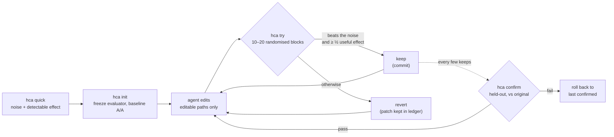

Translated from README.md at commit b9bad05. The English README is authoritative for numbers.

<div align="center">

[English](../../README.md) · [简体中文](README.zh-CN.md) · [繁體中文](README.zh-TW.md) · [日本語](README.ja.md) · [한국어](README.ko.md) · [Español](README.es.md) · [Português (Brasil)](README.pt-BR.md) · [Français](README.fr.md) · [Deutsch](README.de.md) · [Русский](README.ru.md) · [Türkçe](README.tr.md) · [Tiếng Việt](README.vi.md) · **Bahasa Indonesia** · [हिन्दी](README.hi.md)

# HillClimbAnything

### Harness untuk hill-climb tantangan teknis apa pun.

**Arahkan coding agent Anda ke satu angka. Simpan hanya kemenangan yang nyata.**

[](../../README.md#quick-start)
[](../../pyproject.toml)
[](../../tests)
[](../../skills/hca/SKILL.md)
[](../../LICENSE)

<code>pip install git+https://github.com/JaiS1/HillClimbAnything && hca quick -- python bench.py</code>

<br /><br />

<picture>
  <source media="(prefers-color-scheme: dark)" srcset="../assets/climb-dark.svg" />
  
</picture>

</div>

---

Loop bergaya autoresearch memungkinkan agent mengedit, mengukur, dan menyimpan apa pun yang skornya terbaik. Pada metrik yang berisik, "terbaik" sering kali hanya keberuntungan. Pada desktop biasa, menyimpan skor terbaik mentah mempertahankan **17–55%** perubahan yang sebenarnya tidak berpengaruh apa-apa, tergantung benchmark-nya ([hasil pengukuran](../../spikes/phase0/RESULT.md)).

HillClimbAnything adalah **wasit** untuk loop itu:

- ia mengukur seberapa berisik angka Anda sebelum Anda mulai;
- ia hanya menyimpan perubahan jika melampaui noise tersebut;
- ia mengonfirmasi total peningkatan pada data yang tidak pernah dipakai agent untuk tuning.

Agent Anda mengusulkan, HCA yang memutuskan. HCA adalah CLI Python kecil tanpa dependensi, ditambah sebuah skill (Markdown biasa) yang mengajarkan metodenya kepada coding agent. Sudah diuji dengan Claude Code.

## Mulai cepat

**1. Instal** (Python 3.11+; diuji di Linux dan WSL, macOS belum diuji):

```bash
pip install git+https://github.com/JaiS1/HillClimbAnything     # belum ada di PyPI
npx skills add JaiS1/HillClimbAnything --skill hca             # opsional: skill untuk agent
```

**2. Minta agent Anda:**

```text
Instal HillClimbAnything (github.com/JaiS1/HillClimbAnything) dan ikuti skills/hca/SKILL.md.
Buat `python bench.py` lebih cepat: jalankan `hca quick` lebih dulu, tulis hca.toml bersama saya,
mendaki dengan `hca try`, dan laporkan hanya apa yang diloloskan oleh `hca confirm`.
```

**3. Atau jalankan sendiri:**

<div align="center">

</div>

```bash
hca quick -- <cmd>     # 2 menit, tanpa setup: seberapa berisik angka ini, kemenangan apa yang bisa kita deteksi?
hca init               # bekukan evaluator, buat branch, ukur noise baseline
hca try -m "why"       # ukur editan Anda terhadap keep terakhir → keep (commit) atau revert
hca confirm            # ukur ulang total peningkatan terhadap versi asli, pada data held-out
hca report             # setiap percobaan, verdict, dan buktinya
```

Sebuah task terdiri dari brief, path yang boleh diedit agent, dan satu perintah yang mencetak angkanya:

```toml
# hca.toml
[task]
name     = "api-latency"
editable = ["src/**"]          # agent boleh mengubah ini
frozen   = ["bench/**"]        # evaluator: di-hash, tidak pernah diedit

[objective]
command       = ["python3", "bench/run.py"]   # mencetak METRIC p95_ms=212.4
metric        = "p95_ms"
direction     = "min"
useful_effect = "5%"           # kemenangan terkecil yang layak disimpan
```

## Showcase: Python-Markdown, 2× lebih cepat

Sebuah coding agent Sonnet mendaki [Python-Markdown](https://github.com/Python-Markdown/markdown) 3.11.1 dengan HCA sebagai wasit: 18 percobaan dalam sekitar 80 menit, 14 di-keep.

| Pemeriksaan | Hasil |
|---|---|
| `hca confirm` pada dokumen held-out | waktu render **−53.8%** (minimal −53.0%) |
| Pengukuran ulang independen di luar HCA, pada fixture pengujian proyek | **−63.5%** |
| Output: test suite proyek (1,126 test; 110 di-skip, sama seperti di 3.11.1) dan 23,000 dokumen acak | **identik** dengan 3.11.1 |
| Perubahan yang ditolak HCA tetapi akan di-keep oleh loop satu-kali-jalan | **3 dari 4**, salah satunya "−17.9%" yang sebenarnya hanya −1.7% |

Kemenangan terbesar datang dari melewati pola regex inline ketika teks tidak mungkin memuat karakter yang dibutuhkan setiap kecocokan. Baca [tulisan lengkap, patch, log per percobaan, dan ledger mentah](../../showcases/python-markdown/README.md). Ini satu mesin dan satu kali jalan, dan patch-nya belum ditinjau di upstream.

## Mengapa perlu wasit?

Dua build identik, dibandingkan dengan cara yang dipakai kebanyakan loop ([Phase 0](../../spikes/phase0/RESULT.md)):

| Aturan keep | Perubahan no-op yang di-keep | Percepatan 5% yang nyata dan di-keep |
|---|---|---|
| Simpan skor terbaik mentah | **17–55%** | 100% |
| Uji HCA pada blok acak | **≤ 1%** | 76–96% (15 blok) |

Rentang itu mencakup dua benchmark (web server dan CLI). Baris HCA adalah satu kali pengujian pada α = 1%; aturan yang dirilis lebih ketat.

Loop yang mempertahankan seperlima hingga separuh perubahan no-op-nya sedang mendaki noise. Peningkatannya terlihat menumpuk, lalu menguap saat Anda mengukur ulang.

## Cara kerjanya



- **Blok acak.** Setiap percobaan menjalankan baseline dan kandidat berurutan dalam urutan acak, 10 hingga 20 kali. Urutan acak membuat uji sign-flip eksak tetap valid apa pun bentuk noise-nya: ekor berat, lonjakan termal, atau game yang berjalan di latar belakang.
- **Bukti dan besaran.** Sebuah keep memerlukan uji satu sisi yang lolos pada 1% per percobaan, dan estimasinya harus mencapai setidaknya setengah dari useful effect Anda.
- **Lengan yang identik.** Kedua lengan adalah git worktree bersih dari commit yang persis. Commit yang di-keep adalah tree yang persis sama dengan yang diukur.
- **Confirm, atau dianggap tidak terjadi.** `hca confirm` memeriksa riwayat, lalu mengukur ulang total peningkatan terhadap versi asli. Agent hanya melihat PASS atau FAIL.
- **Semuanya di disk.** Patch, run mentah, verdict, dan alasan setiap percobaan ada di `.hca/`.

## Apa yang bisa didaki

Apa pun yang dapat diubah oleh sebuah perintah menjadi angka, selama angkanya cukup berulang untuk diukur noise-nya.

| Target | Contoh metrik | Status |
|---|---|---|
| Hot path library | waktu render / parse | ✅ sudah ada showcase (Python-Markdown, −53.8%) |
| Waktu CLI dan build | detik wall-clock | 🧪 terkalibrasi ([Phase 0](../../spikes/phase0/RESULT.md)) |
| Latensi web server | time to first byte per route | 🧪 terkalibrasi ([Phase 0](../../spikes/phase0/RESULT.md)) |
| Pemuatan halaman di browser | LCP per halaman | 🗺️ showcase direncanakan |
| Frame time UI atau game | p99 frame ms per scene | 🗺️ showcase direncanakan |
| Akurasi model atau prompt | skor eval per item | 🧪 mode `items`, sudah di-unit-test |
| Training GPU berbayar | skor eval setelah training | 📋 metode campaign ada di [referensi skill](../../skills/hca/references/campaign-card.md); tooling direncanakan |

## Untuk agent

Jika Anda adalah AI agent yang membaca ini:

- **Metode:** [`skills/hca/SKILL.md`](../../skills/hca/SKILL.md). Mencakup pemeriksaan premis, satu mekanisme per percobaan, dan tidak pernah menyentuh file frozen.
- **Spec dan kontrak output:** [`skills/hca/references/spec.md`](../../skills/hca/references/spec.md).
- **Ringkasan untuk crawler dan asisten:** [`llms.txt`](../../llms.txt).
- **Mengerjakan repo ini:** [`AGENTS.md`](../../AGENTS.md).

| Exit code | `hca try` | `hca confirm` |
|---|---|---|
| 0 | di-keep (`keep`) | lolos |
| 1 | di-revert (`revert`) | gagal (di-rollback) |
| 2 | tidak valid / void / ditolak: tidak ada yang di-keep, editan Anda dibiarkan | tidak meyakinkan atau ditolak |
| 3 / 4 | kesalahan penggunaan / kesalahan internal | sama |

Laporkan hanya apa yang diloloskan `hca confirm`, beserta batasnya dan jumlah percobaan.

## FAQ

<details>
<summary><strong>Apakah HCA memanggil LLM atau memerlukan API key?</strong></summary>

Tidak. HCA tidak pernah memanggil model. Agent Anda (Claude Code, Codex, Cursor, atau yang lain) yang berpikir, sedangkan HCA hanya mengukur dan memutuskan. `hca quick` bekerja tanpa agent sama sekali.
</details>

<details>
<summary><strong>Berapa lama satu percobaan?</strong></summary>

Sekitar 20 hingga 40 kali menjalankan perintah Anda: 10 blok, diperpanjang menjadi 20 bila hasilnya menjanjikan, dengan dua run per blok. Benchmark 3 detik memakan 1 hingga 2 menit per percobaan. `hca quick` memberi tahu biayanya sebelum Anda mulai.
</details>

<details>
<summary><strong>Metrik saya berisik. Apakah ini akan berhasil?</strong></summary>

`hca quick` menjawabnya dalam sekitar 2 menit. Ia melaporkan noise dan kemenangan terkecil yang bisa Anda deteksi. Jika jawabannya "terlalu berisik di sini", ia menyebutkan perbaikan termurah: lebih banyak item per run, run yang lebih lama, atau menutup beban lain. Mendaki sebelum itu hanya membuang tenaga.
</details>

<details>
<summary><strong>Bisakah agent curang?</strong></summary>

Bisa mencoba, dan HCA membuatnya merepotkan:

- file evaluator yang frozen di-hash;
- edit di luar path yang dideklarasikan membatalkan percobaan;
- kedua lengan berjalan dari worktree bersih;
- crash dinilai sebagai nilai terburuk;
- percobaan berulang dihitung.

Ini bukan batas keamanan, jadi baca patch-nya. [docs/LIMITS.md](../LIMITS.md) mendaftar setiap celah yang diketahui dan cara menanganinya.
</details>

<details>
<summary><strong>Apa bedanya dengan autoresearch?</strong></summary>

[autoresearch](https://github.com/karpathy/autoresearch) menunjukkan betapa produktifnya agent di dalam loop, dan HCA mempertahankan loop itu. Yang ditambahkan HCA adalah keputusannya: untuk perintah dan metrik apa pun, apakah suatu perubahan itu nyata atau noise, ditambah langkah confirm yang melindungi dari winner's curse.
</details>

<details>
<summary><strong>Bagaimana dengan run yang mahal, seperti training GPU?</strong></summary>

Referensi skill membawa disiplin dari kampanye fine-tuning model sungguhan yang berlangsung berbulan-bulan:

- kartu yang di-preregister dengan kontrol "compute sama, tanpa ide" sebagai pembanding;
- gladi murah sebelum run berbayar;
- adversarial review;
- watcher dan meter anggaran di dalam job remote;
- evaluasi mendalam sebelum verdict apa pun.

Tooling untuk ini direncanakan.
</details>

<details>
<summary><strong>Windows?</strong></summary>

Gunakan WSL. Kontrol proses Windows native belum diuji, begitu pula macOS.
</details>

## Dokumentasi

- [Showcase: Python-Markdown](../../showcases/python-markdown/README.md)
- [Batasan dan celah yang diketahui](../LIMITS.md)
- [Kalibrasi Phase 0](../../spikes/phase0/RESULT.md)
- [Desain](../DESIGN-hca.md)
- [Kontrak arsitektur](../ARCHITECTURE-v1.md)

## Status dan kredit

Rilis riset awal (0.2.0.dev): loop inti dan satu showcase. HCA tumbuh dari [Dream Loop](https://github.com/JaiS1/dream-loop/tree/dream-loop-v0.1), yang statistik berpasangannya dipertahankan. HCA meminjam gagasan dari loop bergaya [autoresearch](https://github.com/karpathy/autoresearch) dan dari kebersihan evaluasi dalam makalah [Harness Learning](https://arxiv.org/abs/2609.35738).

```bash
python3 -m unittest discover -s tests      # pengembangan
```

[Lisensi MIT](../../LICENSE). Jika HCA menyelamatkan Anda dari merilis kemenangan palsu, sebuah bintang membantu orang lain menemukannya.
