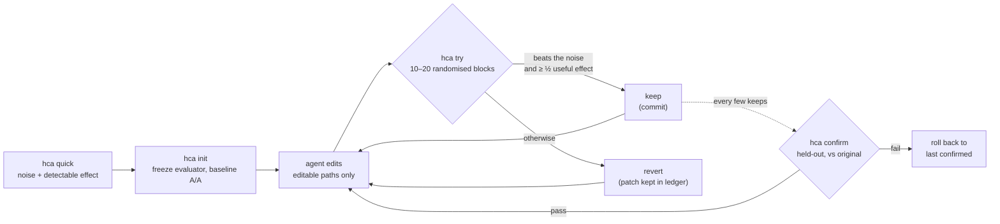

README.md（commit 59b1150）からの翻訳です。数値は英語版 README が正です。

<div align="center">

[English](../../README.md) · [简体中文](README.zh-CN.md) · [繁體中文](README.zh-TW.md) · **日本語** · [한국어](README.ko.md) · [Español](README.es.md) · [Português (Brasil)](README.pt-BR.md) · [Français](README.fr.md) · [Deutsch](README.de.md) · [Русский](README.ru.md) · [Türkçe](README.tr.md) · [Tiếng Việt](README.vi.md) · [Bahasa Indonesia](README.id.md) · [हिन्दी](README.hi.md)

# HillClimbAnything

### あらゆる技術課題を山登り法で攻略するためのハーネス。

**コーディングエージェントに数値を目標として与え、本当に効いた改善だけを残す。**

[](#クイックスタート)
[](../../pyproject.toml)
[](../../tests)
[](../../skills/hca/SKILL.md)
[](../../LICENSE)

<code>uvx --from hillclimbanything hca quick -- python bench.py</code>

<sub>何もインストールせずに試せます：ベンチマークのノイズはどれくらいか、どれだけの改善を検出できるか。</sub>

<br /><br />

<picture>
  <source media="(prefers-color-scheme: dark)" srcset="../assets/climb-dark.svg" />
  
</picture>

</div>

---

Autoresearch 型のループでは、エージェントが編集と計測を繰り返し、最もスコアの良かったものを残します。ノイズの多い指標では、その「最良」はしばしば運にすぎません。一般的なデスクトップ機で生のベストスコアをそのまま採用すると、効果のない変更の **17–55%** が残ってしまいました（ベンチマークによる。[計測結果](../../spikes/phase0/RESULT.md)）。

HillClimbAnything は、このループの**審判**です。

- 開始前に、あなたの数値がどれだけノイズを含むかを計測します。
- ノイズを上回った変更だけを keep します。
- エージェントが一度もチューニングに使っていないデータで、全体の改善を confirm します。

エージェントが提案し、HCA が判定します。HCA は依存ライブラリなしの小さな Python CLI と、コーディングエージェントにこの手法を教える skill（素の Markdown）で構成されています。Claude Code で動作確認済みです。

## クイックスタート

**1. インストール**（Python 3.11+。Linux、WSL、ネイティブ Windows で動作確認済み、macOS は未確認）：

```bash
uv tool install hillclimbanything   # または: pipx install hillclimbanything
hca setup                                                        # エージェント用スキルを追加（先に計画を表示します）
```

`hca setup` は、エージェントが探す場所にスキルを置きます：`~/.claude/skills/hca`（Claude Code）と
`~/.agents/skills/hca`（Codex、Cursor、Gemini CLI、Copilot）。置き換えるものはバックアップし、
`hca setup --uninstall` で元に戻せます。[`uv`](https://docs.astral.sh/uv/getting-started/installation/) も [`pipx`](https://pipx.pypa.io/stable/installation/) もない場合：通常の
`pip install` は仮想環境の中なら動きます。環境の外では拒否するシステムが多いです（PEP 668）。

<details>
<summary>スキルを追加するその他の方法</summary>

**Claude Code プラグイン：**

```text
/plugin marketplace add JaiS1/HillClimbAnything
/plugin install hca@hillclimbanything
```

**[skills.sh](https://github.com/vercel-labs/skills):**

```bash
npx skills add JaiS1/HillClimbAnything --skill hca
```

どちらの方法でも、スキルは `hca` CLI を操作するので、CLI もインストールしてください。
</details>

**2. エージェントに頼む：**

```text
hca スキル（HillClimbAnything）を使って `python bench.py` を速くしてください。まず `hca quick` を実行し、
私と一緒に hca.toml を書き、`hca try` で山登りして、`hca confirm` を通ったものだけを報告してください。
```

**3. 自分で操作する：**

<div align="center">

</div>

```bash
hca compare -- <A> -- <B>   # 2 分で出る最初の結果：B は本当に A より良いか？ git も hca.toml も不要
hca quick -- <cmd>     # 2 分、セットアップ不要：この数値のノイズはどれくらいか、どの程度の改善なら検出できるか？
hca init               # 評価器を固定し、ブランチを作成し、ベースラインのノイズを計測
hca try -m "why"       # 直前の keep と比べて編集を計測 → keep（コミット）または revert
hca confirm            # 元の状態に対する全体の改善を、ホールドアウトデータで再計測
hca report             # すべての試行と、その判定・根拠
```

`hca compare` はリポジトリも設定も要りません。2 つのコマンドをランダム化した A/B ブロックで実行し、差を区間と p 値つきで報告します。あわせて、観測したノイズと、検出できたはずの最小の差も示すので、「検出できる差なし」という結果に意味が出ます。終了コード 0 は B が A より有意に良いこと、1 はそうでないこと、2 は実行が失敗したか指標が得られなかったことを表します。コマンドはシェルを介さずに実行されます（必要なら `sh -c '...'` と書いてください）。既定の指標は実行時間で、`--metric NAME` を渡すと `METRIC NAME=value` の行を読みます。自分のコードを保護つきで改善していきたいときは、次の一歩が `hca init` です。

タスクは、概要、エージェントが編集してよいパス、そして数値を出力する 1 つのコマンドで構成されます。

```toml
# hca.toml
[task]
name     = "api-latency"
editable = ["src/**"]          # エージェントが変更してよいもの
frozen   = ["bench/**"]        # 評価器：ハッシュで保護され、編集されない

[objective]
command       = ["python3", "bench/run.py"]   # METRIC p95_ms=212.4 を出力する
metric        = "p95_ms"
direction     = "min"
useful_effect = "5%"           # keep する価値のある最小の改善幅
```

## ショーケース：Python-Markdown が 2 倍高速に

Sonnet のコーディングエージェントが、HCA を審判として [Python-Markdown](https://github.com/Python-Markdown/markdown) 3.11.1 を山登りしました。約 80 分で 18 回試行し、14 回を keep しています。

| チェック | 結果 |
|---|---|
| ホールドアウト文書での `hca confirm` | レンダリング時間 **−53.8%**（少なくとも −53.0%） |
| HCA の外で、プロジェクトのテストフィクスチャを使った独立再計測 | **−63.5%** |
| 出力：プロジェクトのテストスイート（1,126 テスト。3.11.1 と同じく 110 件スキップ）と 23,000 件のランダム文書 | 3.11.1 と**同一** |
| 1 回実行だけのループなら keep していたが、HCA が却下した変更 | **4 件中 3 件**。うち 1 件は「−17.9%」に見えて実際は −1.7% |

最大の改善は、すべてのマッチに必要な文字がテキストに含まれ得ない場合に、インラインの正規表現パターンをスキップしたことです。[解説、パッチ、試行ごとのログ、生の台帳](../../showcases/python-markdown/README.md)をご覧ください。これは 1 台のマシンでの 1 回の実行であり、パッチは上流のレビューを受けていません。

## ショーケース：js-yaml が 15% 高速に

2 つ目の山登りです。言語も指標の種類も別で、Node 上の [js-yaml](https://github.com/nodeca/js-yaml) 5.5.0 について、GitHub Actions、Kubernetes、Helm、Compose、OpenAPI の実在ファイル 491 件を、1 文書につき `load()` を 1 回ずつ計測しました。コーディングエージェントが約 1 時間で 12 回試行し、3 回を keep しています。

<div align="center">
<picture>
  <source media="(prefers-color-scheme: dark)" srcset="../assets/climb-yaml-dark.svg" />
  
</picture>
</div>

| チェック | 結果 |
|---|---|
| ホールドアウト文書での `hca confirm`（同じジャンル、ファイルはほぼ別） | `load()` 時間 **−15.3%**（項目ごとの中央値。少なくとも −13.3%） |
| クリーンなクローンでの元リリースとの A/B、新規プロセス 200 回 | 合計時間 **−15.3%**（95% 信頼区間 −16.6% から −14.4%） |
| 出力：js-yaml 自身の 1,633 テスト、ESM と CJS の各ビルドで 25,384 件の比較、fuzz 11,250 件の比較 | 5.5.0 との差は **0 件** |

改善は、パーサーでの無駄な処理を省く小さな変更によるものです。ノードごとの割り当てを減らし、先頭文字で分岐し、単純なスカラーに高速経路を設けています。keep された 3 回のうち 2 回は、単独では keep の下限に届かない変更をまとめたもので、解説にその旨を明記しており、confirm は最終状態を対象にしています。指標は、小さな文書が中心の 1 回呼び出しあたりの時間（どちらかといえばコールド寄り）で、ホットなループでのスループットではありません。1 台のマシンでの結果で、パッチは上流に提出していません。[解説、パッチ、台帳、ハーネス](../../showcases/js-yaml/README.md)をご覧ください。

## なぜ審判が必要か

同一の 2 つのビルドを、多くのループと同じ方法で比較した結果です（[Phase 0](../../spikes/phase0/RESULT.md)）。

| keep のルール | keep された no-op 変更 | keep された本物の 5% 高速化 |
|---|---|---|
| 生のベストスコアを残す | **17–55%** | 100% |
| ランダム化ブロックでの HCA の検定 | **≤ 1%** | 76–96%（15 ブロック） |

範囲は 2 つのベンチマーク（Web サーバーと CLI）にわたります。HCA の行は α = 1% で 1 回見た結果で、実際に出荷しているルールはより厳格です。

no-op の 5 分の 1 から半数を keep してしまうループは、ノイズを登っています。改善は積み上がって見えても、再計測すると消えてしまいます。

## 仕組み



- **ランダム化ブロック。** 各 try では、ベースラインと候補をランダムな順序で連続して 10〜20 回実行します。順序がランダムなので、重い裾、熱による一時的な乱れ、バックグラウンドで動くゲームなど、ノイズがどんな形でも、厳密な符号反転検定が成り立ちます。
- **根拠と大きさ。** keep するには、片側検定が try ごとに 1% で通り、かつ推定値が想定する有用な効果の半分以上に達している必要があります。
- **同一の両アーム。** 両アームとも、正確なコミットのクリーンな git worktree です。keep されるコミットは、計測されたツリーそのものです。
- **confirm できなければ無かったことに。** `hca confirm` は履歴を確認したうえで、元の状態に対する全体の改善を再計測します。エージェントに見えるのは PASS か FAIL だけです。
- **すべてディスクに。** 各試行のパッチ、生の実行データ、判定、理由は `.hca/` に残ります。

## 何を山登りできるか

コマンドで数値にでき、ノイズを計測できる程度にその数値が再現可能なものなら、何でも対象になります。

| 対象 | 指標の例 | 状態 |
|---|---|---|
| ライブラリのホットパス | レンダリング / パース時間 | ✅ ショーケースあり（Python-Markdown、−53.8%；js-yaml、−15.3%） |
| CLI とビルド時間 | 実時間（秒） | 🧪 キャリブレーション済み（[Phase 0](../../spikes/phase0/RESULT.md)） |
| Web サーバーのレイテンシ | ルートごとの TTFB | 🧪 キャリブレーション済み（[Phase 0](../../spikes/phase0/RESULT.md)） |
| ブラウザでのページ読み込み | ページごとの LCP | 🗺️ ショーケース予定 |
| UI やゲームのフレーム時間 | シーンごとの p99 フレーム ms | 🗺️ ショーケース予定 |
| モデルやプロンプトの精度 | 項目ごとの評価スコア | 🧪 `items` モード、ユニットテスト済み |
| 有料の GPU 学習 | 学習後の評価スコア | 📋 キャンペーン手法は [skill のリファレンス](../../skills/hca/references/campaign-card.md)に記載。ツールは計画中 |

## エージェント向け

あなたが AI エージェントとしてこれを読んでいる場合：

- **手法：**[`skills/hca/SKILL.md`](../../skills/hca/SKILL.md)。前提の確認、1 回の try につき 1 つの仕組みだけを変えること、frozen ファイルには決して触れないことを扱います。
- **仕様と出力の契約：**[`skills/hca/references/spec.md`](../../skills/hca/references/spec.md)。
- **クローラーやアシスタント向けの概要：**[`llms.txt`](../../llms.txt)。
- **このリポジトリで作業する場合：**[`AGENTS.md`](../../AGENTS.md)。

| 終了コード | `hca try` | `hca confirm` |
|---|---|---|
| 0 | keep された | 通過 |
| 1 | revert された | 失敗（ロールバック済み） |
| 2 | 無効 / void / 拒否：何も keep されず、編集はそのまま残る | 判定不能または拒否 |
| 3 / 4 | 使い方の誤り / 内部エラー | 同左 |

報告するのは `hca confirm` を通ったものだけにし、その境界値と try の回数を添えてください。

## FAQ

<details>
<summary><strong>HCA は LLM を呼び出しますか？ API キーは必要ですか？</strong></summary>

いいえ。HCA はモデルを一切呼び出しません。考えるのはあなたのエージェント（Claude Code、Codex、Cursor など何でも）で、HCA は計測と判定だけを行います。`hca quick` はエージェントなしでも動きます。
</details>

<details>
<summary><strong>1 回の try にどれくらいかかりますか？</strong></summary>

コマンドを 20〜40 回ほど実行します。10 ブロックで、有望そうなら 20 ブロックに延長され、1 ブロックあたり 2 回実行します。3 秒のベンチマークなら 1 回の try に 1〜2 分です。コストは開始前に `hca quick` が教えてくれます。
</details>

<details>
<summary><strong>指標がノイジーですが、使えますか？</strong></summary>

`hca quick` が約 2 分で答えを出します。ノイズと、検出できる最小の改善幅を報告します。「ここではノイズが大きすぎる」という結果なら、最も安上がりな対処を示します。1 回の実行あたりの項目数を増やす、実行を長くする、他の負荷を止める、のいずれかです。それを済ませる前に山登りしても無駄になります。
</details>

<details>
<summary><strong>エージェントはズルできますか？</strong></summary>

試みることはできますが、HCA はそれを面倒にします。

- frozen の評価器ファイルはハッシュで保護されます。
- 宣言したパスの外への編集は、その try を無効にします。
- 両アームともクリーンな worktree から実行されます。
- クラッシュは最悪値として採点されます。
- 繰り返しの試行は数えられます。

これはセキュリティ境界ではないので、パッチは読んでください。[docs/LIMITS.md](../LIMITS.md) に、既知の穴と対処法をすべて挙げています。
</details>

<details>
<summary><strong>autoresearch とは何が違いますか？</strong></summary>

[autoresearch](https://github.com/karpathy/autoresearch) は、ループの中のエージェントがどれほど生産的になり得るかを示しました。HCA はそのループを引き継いでいます。HCA が加えるのは判定です。任意のコマンドと任意の指標について、変更が本物かノイズかを判定し、さらに勝者の呪いを防ぐ confirm のステップを備えます。
</details>

<details>
<summary><strong>GPU 学習のような高コストの実行はどうですか？</strong></summary>

skill のリファレンスには、数か月にわたる実際のモデルファインチューニングのキャンペーンで培った作法が入っています。

- 事前登録されたカードと、「同じ計算量でアイデアなし」という対応する対照群
- 有料の実行の前に行う、低コストのリハーサル
- 敵対的レビュー
- リモートジョブ内の監視と予算メーター
- 判定を出す前の詳細な評価

そのためのツールは計画中です。
</details>

<details>
<summary><strong>Windows は？</strong></summary>

ネイティブ Windows でも動作します（Python 3.11+）。タイムアウト時は Job Object と `taskkill` でプロセスツリー全体を終了します。シェルは使わないので、コマンドは argv のリストで書いてください（バッチファイルは `["cmd", "/c", "build.bat"]`）。最も厳密なプロセス分離は引き続き WSL で、macOS は未確認です。
</details>

## ドキュメント

- [ショーケース：Python-Markdown](../../showcases/python-markdown/README.md)
- [ショーケース：js-yaml](../../showcases/js-yaml/README.md)
- [制限事項と既知の穴](../LIMITS.md)
- [Phase 0 キャリブレーション](../../spikes/phase0/RESULT.md)
- [設計](../DESIGN-hca.md)
- [アーキテクチャ契約](../ARCHITECTURE-v1.md)

## ステータスとクレジット

初期の研究リリース（0.2.0.dev）：コアのループと 2 つのショーケース。HCA は [Dream Loop](https://github.com/JaiS1/dream-loop/tree/dream-loop-v0.1) から生まれ、そのペア統計を引き継いでいます。[autoresearch](https://github.com/karpathy/autoresearch) 型のループの発想と、[Harness Learning](https://arxiv.org/abs/2609.35738) 論文の評価の衛生管理からも着想を得ています。

```bash
python3 -m unittest discover -s tests      # 開発用
```

[MIT ライセンス](../../LICENSE)。HCA のおかげで偽の改善を出荷せずに済んだなら、star をいただけると、ほかの人が見つける助けになります。
