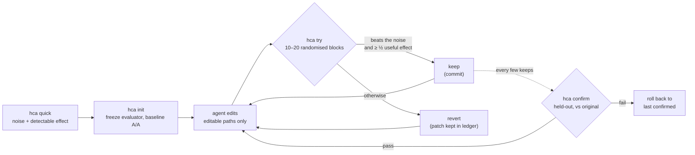

README.md(commit b9bad05)를 번역한 문서입니다. 수치는 영어 README가 기준입니다.

<div align="center">

[English](../../README.md) · [简体中文](README.zh-CN.md) · [繁體中文](README.zh-TW.md) · [日本語](README.ja.md) · **한국어** · [Español](README.es.md) · [Português (Brasil)](README.pt-BR.md) · [Français](README.fr.md) · [Deutsch](README.de.md) · [Русский](README.ru.md) · [Türkçe](README.tr.md) · [Tiếng Việt](README.vi.md) · [Bahasa Indonesia](README.id.md) · [हिन्दी](README.hi.md)

# HillClimbAnything

### 어떤 기술 과제든 힐 클라이밍으로 풀어 내는 하네스.

**코딩 에이전트에게 숫자 하나를 목표로 주고, 진짜 개선만 남기세요.**

[](#빠른-시작)
[](../../pyproject.toml)
[](../../tests)
[](../../skills/hca/SKILL.md)
[](../../LICENSE)

<code>uvx --from hillclimbanything hca quick -- python bench.py</code>

<sub>아무것도 설치하지 않고 써 보세요: 벤치마크의 노이즈는 얼마나 되고, 어느 정도의 개선을 감지할 수 있을까요?</sub>

<br /><br />

<picture>
  <source media="(prefers-color-scheme: dark)" srcset="../assets/climb-dark.svg" />
  
</picture>

</div>

---

Autoresearch 방식의 루프는 에이전트가 수정하고, 측정하고, 가장 점수가 좋았던 것을 남기게 합니다. 노이즈가 있는 지표에서는 그 "최고 점수"가 단지 운인 경우가 많습니다. 일반적인 데스크톱에서 원시 최고 점수를 그대로 남기면, 벤치마크에 따라 아무 효과가 없는 변경의 **17–55%**가 그대로 남았습니다([측정 결과](../../spikes/phase0/RESULT.md)).

HillClimbAnything은 이 루프의 **심판**입니다.

- 시작하기 전에 여러분의 숫자가 얼마나 노이즈가 있는지 측정합니다.
- 노이즈를 넘어서는 변경만 keep합니다.
- 에이전트가 한 번도 튜닝에 쓰지 않은 데이터로 전체 개선을 confirm합니다.

에이전트가 제안하고, HCA가 판정합니다. HCA는 의존성이 없는 작은 Python CLI와, 코딩 에이전트에게 이 방법을 가르치는 skill(순수 Markdown)로 이루어져 있습니다. Claude Code로 테스트했습니다.

## 빠른 시작

**1. 설치** (Python 3.11+; Linux, WSL, 네이티브 Windows에서 테스트했고 macOS는 테스트하지 않음):

```bash
uv tool install hillclimbanything   # 또는: pipx install hillclimbanything
hca setup                                                        # 에이전트 스킬 추가(먼저 계획을 보여 줍니다)
```

`hca setup`은 에이전트가 찾는 위치에 스킬을 둡니다: `~/.claude/skills/hca`(Claude Code)와
`~/.agents/skills/hca`(Codex, Cursor, Gemini CLI, Copilot). 교체하는 항목은 백업하며,
`hca setup --uninstall`로 다시 제거할 수 있습니다. [`uv`](https://docs.astral.sh/uv/getting-started/installation/)나 [`pipx`](https://pipx.pypa.io/stable/installation/)가 없나요? 일반
`pip install`은 가상 환경 안에서는 동작하지만, 많은 시스템이 환경 밖에서는 거부합니다(PEP 668).

<details>
<summary>스킬을 추가하는 다른 방법</summary>

**Claude Code 플러그인:**

```text
/plugin marketplace add JaiS1/HillClimbAnything
/plugin install hca@hillclimbanything
```

**[skills.sh](https://github.com/vercel-labs/skills):**

```bash
npx skills add JaiS1/HillClimbAnything --skill hca
```

어느 쪽이든 스킬은 `hca` CLI를 구동하므로 CLI도 설치하세요.
</details>

**2. 에이전트에게 요청하기:**

```text
hca 스킬(HillClimbAnything)을 사용해 `python bench.py`를 더 빠르게 만들어 주세요. 먼저 `hca quick`을 실행하고,
저와 함께 hca.toml을 작성한 뒤, `hca try`로 개선해 나가고, `hca confirm`을 통과한 결과만 보고해 주세요.
```

**3. 또는 직접 실행하기:**

<div align="center">

</div>

```bash
hca quick -- <cmd>     # 2분, 설정 불필요: 이 숫자의 노이즈는 어느 정도이고, 어느 정도의 개선까지 감지할 수 있는가?
hca init               # 평가기를 고정하고, 브랜치를 만들고, 기준선 노이즈를 측정
hca try -m "why"       # 마지막 keep과 비교해 수정을 측정 → keep(커밋) 또는 revert
hca confirm            # 원본 대비 전체 개선을 홀드아웃 데이터로 다시 측정
hca report             # 모든 시도와 그 판정, 근거
```

작업(task)은 설명, 에이전트가 수정해도 되는 경로, 그리고 숫자를 출력하는 명령 하나로 이루어집니다.

```toml
# hca.toml
[task]
name     = "api-latency"
editable = ["src/**"]          # 에이전트가 바꿀 수 있는 파일
frozen   = ["bench/**"]        # 평가기: 해시로 보호되며 절대 수정하지 않음

[objective]
command       = ["python3", "bench/run.py"]   # METRIC p95_ms=212.4 를 출력
metric        = "p95_ms"
direction     = "min"
useful_effect = "5%"           # 남길 만한 가장 작은 개선 폭
```

## 쇼케이스: Python-Markdown, 2배 빨라짐

Sonnet 코딩 에이전트가 HCA를 심판으로 삼아 [Python-Markdown](https://github.com/Python-Markdown/markdown) 3.11.1을 개선했습니다. 약 80분 동안 18번 시도해 14번을 keep했습니다.

| 확인 항목 | 결과 |
|---|---|
| 홀드아웃 문서에서 `hca confirm` | 렌더링 시간 **−53.8%** (최소 −53.0%) |
| HCA 밖에서 프로젝트의 테스트 픽스처로 독립 재측정 | **−63.5%** |
| 출력: 프로젝트 테스트 스위트(테스트 1,126개; 3.11.1과 같이 110개 건너뜀)와 무작위 문서 23,000개 | 3.11.1과 **동일** |
| 단일 실행 루프라면 keep했을 변경 중 HCA가 거부한 것 | **4개 중 3개**, 그중 하나는 "−17.9%"처럼 보였지만 실제로는 −1.7% |

가장 큰 개선은, 모든 매치에 필요한 문자가 텍스트에 있을 수 없을 때 인라인 정규식 패턴을 건너뛰는 것이었습니다. [작성 문서, 패치, 시도별 로그, 원본 레저](../../showcases/python-markdown/README.md)를 읽어 보세요. 한 대의 머신에서 한 번 실행한 결과이며, 패치는 업스트림 리뷰를 받지 않았습니다.

## 쇼케이스: js-yaml, 15% 빨라짐

두 번째 개선입니다. 언어도 지표의 종류도 다릅니다. Node 위의 [js-yaml](https://github.com/nodeca/js-yaml) 5.5.0에서 GitHub Actions, Kubernetes, Helm, Compose, OpenAPI의 실제 파일 491개를 문서당 `load()` 한 번씩 측정했습니다. 코딩 에이전트가 약 한 시간 동안 12번 시도해 3번을 keep했습니다.

<div align="center">
<picture>
  <source media="(prefers-color-scheme: dark)" srcset="../assets/climb-yaml-dark.svg" />
  
</picture>
</div>

| 확인 항목 | 결과 |
|---|---|
| 홀드아웃 문서에서 `hca confirm` (같은 장르, 대부분 다른 파일) | `load()` 시간 **−15.3%** (항목별 중앙값, 최소 −13.3%) |
| 원본 릴리스와 클린 클론에서 A/B, 새 프로세스 200개 | 전체 시간 **−15.3%** (95% 신뢰구간 −16.6% ~ −14.4%) |
| 출력: js-yaml 자체 테스트 1,633개, ESM과 CJS 빌드 각각에서 비교 25,384건, fuzz 비교 11,250건 | 5.5.0과 **차이 0건** |

개선은 파서에서 불필요한 일을 줄이는 작은 변경들입니다. 노드마다 할당을 줄이고, 첫 글자로 분기하고, 단순 스칼라에 빠른 경로를 둡니다. keep된 3번 중 2번은 단독으로는 keep 기준에 못 미치는 변경들을 묶은 것이며, 작성 문서에 이를 밝혀 두었고 confirm은 최종 상태를 대상으로 합니다. 지표는 대부분 작은 문서에서의 호출당 시간(다소 콜드 쪽)이며, 뜨거운 루프에서의 처리량이 아닙니다. 한 대의 머신에서 얻은 결과이고, 패치는 업스트림에 제출하지 않았습니다. [작성 문서, 패치, 레저, 하네스](../../showcases/js-yaml/README.md)를 읽어 보세요.

## 왜 심판이 필요한가?

동일한 두 빌드를 대부분의 루프가 비교하는 방식으로 비교했습니다([Phase 0](../../spikes/phase0/RESULT.md)).

| keep 규칙 | keep된 no-op 변경 | keep된 실제 5% 속도 향상 |
|---|---|---|
| 원시 최고 점수를 남김 | **17–55%** | 100% |
| 무작위 블록에 대한 HCA의 검정 | **≤ 1%** | 76–96% (15개 블록) |

범위는 두 가지 벤치마크(웹 서버와 CLI)를 아우릅니다. HCA 행은 α = 1%에서 한 번 본 결과이며, 실제로 배포된 규칙은 더 엄격합니다.

no-op의 5분의 1에서 절반을 keep하는 루프는 노이즈를 오르고 있는 것입니다. 개선이 쌓이는 것처럼 보이다가, 다시 측정하면 사라집니다.

## 작동 방식



- **무작위 블록.** 각 try는 기준선과 후보를 무작위 순서로 연달아 10~20번 실행합니다. 순서가 무작위이므로 두꺼운 꼬리 분포, 열로 인한 일시적 변동, 백그라운드에서 돌아가는 게임 등 노이즈가 어떤 모양이든 정확한 부호 뒤집기 검정이 성립합니다.
- **근거와 크기.** keep하려면 단측 검정이 try당 1%에서 통과해야 하고, 추정치가 여러분이 정한 유용한 효과의 절반 이상이어야 합니다.
- **동일한 두 팔.** 두 팔 모두 정확한 커밋의 깨끗한 git worktree입니다. keep되는 커밋은 측정된 트리 그대로입니다.
- **confirm하지 못하면 없던 일.** `hca confirm`은 기록을 확인한 뒤, 원본 대비 전체 개선을 다시 측정합니다. 에이전트에게는 PASS 또는 FAIL만 보입니다.
- **모든 것을 디스크에.** 각 시도의 패치, 원시 실행 결과, 판정과 이유가 `.hca/`에 남습니다.

## 무엇을 개선할 수 있나

명령으로 숫자를 만들어 낼 수 있고, 그 노이즈를 측정할 수 있을 만큼 숫자가 반복 가능하다면 무엇이든 가능합니다.

| 대상 | 지표 예시 | 상태 |
|---|---|---|
| 라이브러리 핫 패스 | 렌더링 / 파싱 시간 | ✅ 쇼케이스 완료 (Python-Markdown, −53.8%; js-yaml, −15.3%) |
| CLI와 빌드 시간 | 실제 경과 시간(초) | 🧪 보정 완료 ([Phase 0](../../spikes/phase0/RESULT.md)) |
| 웹 서버 지연 시간 | 라우트별 TTFB | 🧪 보정 완료 ([Phase 0](../../spikes/phase0/RESULT.md)) |
| 브라우저의 페이지 로드 | 페이지별 LCP | 🗺️ 쇼케이스 계획 중 |
| UI 또는 게임 프레임 시간 | 장면별 p99 프레임 ms | 🗺️ 쇼케이스 계획 중 |
| 모델 또는 프롬프트 정확도 | 항목별 평가 점수 | 🧪 `items` 모드, 단위 테스트 완료 |
| 유료 GPU 학습 | 학습 후 평가 점수 | 📋 캠페인 방법은 [skill 레퍼런스](../../skills/hca/references/campaign-card.md)에 있음; 도구는 계획 중 |

## 에이전트를 위한 안내

AI 에이전트로서 이 문서를 읽고 있다면:

- **방법:** [`skills/hca/SKILL.md`](../../skills/hca/SKILL.md). 전제 확인, try마다 하나의 메커니즘만 바꾸기, frozen 파일은 절대 건드리지 않기를 다룹니다.
- **명세와 출력 계약:** [`skills/hca/references/spec.md`](../../skills/hca/references/spec.md).
- **크롤러와 어시스턴트를 위한 개요:** [`llms.txt`](../../llms.txt).
- **이 저장소에서 작업하기:** [`AGENTS.md`](../../AGENTS.md).

| 종료 코드 | `hca try` | `hca confirm` |
|---|---|---|
| 0 | keep됨 | 통과 |
| 1 | revert됨 | 실패(롤백됨) |
| 2 | 유효하지 않음 / void / 거부됨: 아무것도 keep되지 않고 수정 내용은 그대로 남음 | 결론 불가 또는 거부됨 |
| 3 / 4 | 사용법 오류 / 내부 오류 | 동일 |

`hca confirm`이 통과시킨 것만, 그 경계값과 try 횟수와 함께 보고하세요.

## FAQ

<details>
<summary><strong>HCA가 LLM을 호출하거나 API 키가 필요한가요?</strong></summary>

아니요. HCA는 모델을 호출하지 않습니다. 생각은 여러분의 에이전트(Claude Code, Codex, Cursor 등 무엇이든)가 하고, HCA는 측정하고 판정만 합니다. `hca quick`은 에이전트 없이도 동작합니다.
</details>

<details>
<summary><strong>try 한 번에 얼마나 걸리나요?</strong></summary>

명령을 대략 20~40번 실행합니다. 10개 블록이고, 결과가 유망해 보이면 20개로 늘어나며, 블록마다 두 번씩 실행합니다. 3초짜리 벤치마크라면 try 한 번에 1~2분이 걸립니다. 비용은 시작하기 전에 `hca quick`이 알려 줍니다.
</details>

<details>
<summary><strong>제 지표는 노이즈가 큽니다. 그래도 되나요?</strong></summary>

`hca quick`이 약 2분 안에 답해 줍니다. 노이즈와, 감지할 수 있는 가장 작은 개선 폭을 알려 줍니다. "여기서는 노이즈가 너무 크다"는 결과가 나오면, 가장 저렴한 해결책을 알려 줍니다. 실행당 항목 수를 늘리거나, 실행 시간을 늘리거나, 다른 부하를 끄는 것입니다. 그 전에 개선을 시작하는 것은 헛수고입니다.
</details>

<details>
<summary><strong>에이전트가 부정행위를 할 수 있나요?</strong></summary>

시도할 수는 있지만, HCA가 그것을 번거롭게 만듭니다.

- frozen 평가기 파일은 해시로 보호됩니다.
- 선언된 경로 밖의 수정은 해당 try를 무효로 만듭니다.
- 두 팔 모두 깨끗한 worktree에서 실행됩니다.
- 크래시는 최악의 값으로 점수가 매겨집니다.
- 반복된 시도는 집계됩니다.

보안 경계는 아니므로 패치를 직접 읽어 보세요. [docs/LIMITS.md](../LIMITS.md)에 알려진 허점과 대처법이 모두 정리되어 있습니다.
</details>

<details>
<summary><strong>autoresearch와는 어떻게 다른가요?</strong></summary>

[autoresearch](https://github.com/karpathy/autoresearch)는 루프 안의 에이전트가 얼마나 생산적일 수 있는지 보여 주었고, HCA는 그 루프를 그대로 유지합니다. HCA가 더하는 것은 판정입니다. 어떤 명령과 어떤 지표에 대해서도 변경이 진짜인지 노이즈인지 판정하고, 승자의 저주를 막는 confirm 단계를 더합니다.
</details>

<details>
<summary><strong>GPU 학습처럼 비용이 큰 실행은요?</strong></summary>

skill의 레퍼런스에는 수개월에 걸친 실제 모델 파인튜닝 캠페인에서 얻은 원칙이 담겨 있습니다.

- 사전 등록된 카드와, 대응하는 "같은 연산량, 아이디어 없음" 대조군
- 유료 실행 전의 저렴한 리허설
- 적대적 리뷰
- 원격 작업 내부의 감시자와 예산 미터
- 판정을 내리기 전의 심층 평가

이를 위한 도구는 계획 중입니다.
</details>

<details>
<summary><strong>Windows는요?</strong></summary>

네이티브 Windows도 동작합니다(Python 3.11+). 타임아웃이 되면 Job Object와 `taskkill`로 프로세스 트리 전체를 종료합니다. 셸이 없으므로 명령은 argv 리스트로 작성하세요(배치 파일은 `["cmd", "/c", "build.bat"]`). 가장 엄격한 프로세스 격리는 여전히 WSL이며, macOS는 테스트하지 않았습니다.
</details>

## 문서

- [쇼케이스: Python-Markdown](../../showcases/python-markdown/README.md)
- [쇼케이스: js-yaml](../../showcases/js-yaml/README.md)
- [한계와 알려진 허점](../LIMITS.md)
- [Phase 0 보정](../../spikes/phase0/RESULT.md)
- [설계](../DESIGN-hca.md)
- [아키텍처 계약](../ARCHITECTURE-v1.md)

## 상태와 크레딧

초기 연구 릴리스(0.2.0.dev): 핵심 루프와 쇼케이스 두 개. HCA는 [Dream Loop](https://github.com/JaiS1/dream-loop/tree/dream-loop-v0.1)에서 출발했으며 그 쌍체(paired) 통계를 이어받았습니다. [autoresearch](https://github.com/karpathy/autoresearch) 방식 루프의 아이디어와 [Harness Learning](https://arxiv.org/abs/2609.35738) 논문의 평가 위생(evaluation hygiene)에서도 영감을 얻었습니다.

```bash
python3 -m unittest discover -s tests      # 개발용
```

[MIT 라이선스](../../LICENSE). HCA 덕분에 가짜 개선을 내보내지 않았다면, star를 눌러 주시면 다른 사람들이 찾는 데 도움이 됩니다.
