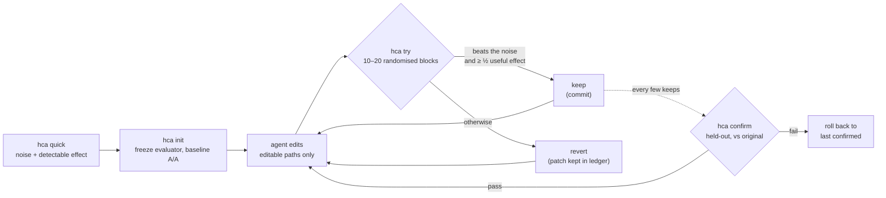

Traduzido de README.md no commit b9bad05. O README em inglês é a referência para os números.

<div align="center">

[English](../../README.md) · [简体中文](README.zh-CN.md) · [繁體中文](README.zh-TW.md) · [日本語](README.ja.md) · [한국어](README.ko.md) · [Español](README.es.md) · **Português (Brasil)** · [Français](README.fr.md) · [Deutsch](README.de.md) · [Русский](README.ru.md) · [Türkçe](README.tr.md) · [Tiếng Việt](README.vi.md) · [Bahasa Indonesia](README.id.md) · [हिन्दी](README.hi.md)

# HillClimbAnything

### O harness para fazer hill-climbing em qualquer desafio técnico.

**Aponte seu agente de programação para um número. Fique só com os ganhos reais.**

[](#início-rápido)
[](../../pyproject.toml)
[](../../tests)
[](../../skills/hca/SKILL.md)
[](../../LICENSE)

<code>uvx --from git+https://github.com/JaiS1/HillClimbAnything hca quick -- python bench.py</code>

<sub>Experimente sem instalar nada: quão ruidoso é o seu benchmark e que ganho você conseguiria detectar?</sub>

<br /><br />

<picture>
  <source media="(prefers-color-scheme: dark)" srcset="../assets/climb-dark.svg" />
  
</picture>

</div>

---

Loops no estilo autoresearch deixam um agente editar, medir e manter o que pontuou melhor. Em uma
métrica ruidosa, "o melhor" costuma ser sorte. Em um desktop comum, manter a melhor pontuação bruta
manteve **17–55%** das mudanças que não faziam nada, dependendo do benchmark ([medido](../../spikes/phase0/RESULT.md)).

O HillClimbAnything é o **árbitro** desse loop:

- mede o quanto o seu número é ruidoso antes de você começar;
- só mantém uma mudança se ela superar esse ruído;
- confirma o ganho total em dados contra os quais o agente nunca otimizou.

Seu agente propõe e o HCA decide. O HCA é uma CLI em Python pequena e sem dependências, mais uma skill
(Markdown puro) que ensina o método a um agente de programação. Foi testado com o Claude Code.

## Início rápido

**1. Instale** (Python 3.11+; testado em Linux e WSL, macOS não testado):

```bash
uv tool install git+https://github.com/JaiS1/HillClimbAnything   # ou: pipx install git+https://github.com/JaiS1/HillClimbAnything
hca setup                                                        # adiciona a skill do agente (mostra o plano antes)
```

`hca setup` coloca a skill onde os agentes a procuram: `~/.claude/skills/hca` (Claude Code) e
`~/.agents/skills/hca` (Codex, Cursor, Gemini CLI, Copilot). Ele faz backup de tudo que substitui,
e `hca setup --uninstall` a remove de novo. Sem [`uv`](https://docs.astral.sh/uv/getting-started/installation/) nem [`pipx`](https://pipx.pypa.io/stable/installation/)? O `pip install`
simples funciona dentro de um virtualenv; muitos sistemas o recusam fora de um (PEP 668).

<details>
<summary>Outras formas de adicionar a skill</summary>

**Plugin do Claude Code:**

```text
/plugin marketplace add JaiS1/HillClimbAnything
/plugin install hca@hillclimbanything
```

**[skills.sh](https://github.com/vercel-labs/skills):**

```bash
npx skills add JaiS1/HillClimbAnything --skill hca
```

De qualquer forma, a skill usa a CLI `hca`, então instale a CLI também.
</details>

**2. Peça ao seu agente:**

```text
Use a skill hca (HillClimbAnything) para deixar `python bench.py` mais rápido: rode `hca quick` primeiro,
escreva o hca.toml comigo, suba com `hca try` e reporte apenas o que o `hca confirm` aprovar.
```

**3. Ou use você mesmo:**

<div align="center">

</div>

```bash
hca quick -- <cmd>     # 2 minutos, sem configuração: quanto ruído tem esse número e que ganho dá para detectar?
hca init               # congela o avaliador, cria uma branch, mede o ruído da linha de base
hca try -m "why"       # mede sua edição contra o último keep → keep (commit) ou revert
hca confirm            # remede o ganho total contra o original, em dados reservados
hca report             # cada tentativa, seu veredito e as evidências
```

Uma tarefa é um briefing, os caminhos que o agente pode editar e um comando que imprime o número:

```toml
# hca.toml
[task]
name     = "api-latency"
editable = ["src/**"]          # o agente pode alterar estes arquivos
frozen   = ["bench/**"]        # o avaliador: tem o hash calculado, nunca é editado

[objective]
command       = ["python3", "bench/run.py"]   # imprime METRIC p95_ms=212.4
metric        = "p95_ms"
direction     = "min"
useful_effect = "5%"           # o menor ganho que vale a pena manter
```

## Estudo de caso: Python-Markdown, 2× mais rápido

Um agente de programação Sonnet escalou o [Python-Markdown](https://github.com/Python-Markdown/markdown)
3.11.1 com o HCA como árbitro: 18 tentativas em cerca de 80 minutos, 14 mantidas.

| Verificação | Resultado |
|---|---|
| `hca confirm` em documentos reservados | tempo de renderização **−53.8%** (no mínimo −53.0%) |
| Nova medição independente fora do HCA, nos fixtures de teste do projeto | **−63.5%** |
| Saída: a suíte de testes do projeto (1.126 testes; 110 ignorados, como no 3.11.1) e 23.000 documentos aleatórios | **idêntica** à do 3.11.1 |
| Mudanças que o HCA rejeitou e que um loop de execução única teria mantido | **3 de 4**, uma delas um "−17.9%" que na verdade era −1.7% |

O maior ganho veio de pular os padrões regex inline quando o texto não pode conter um caractere de que
toda correspondência precisa. Leia o [relato, o patch, o log por tentativa e o ledger bruto](../../showcases/python-markdown/README.md).
É uma única máquina e uma única execução, e o patch não foi revisado pelo projeto original.

## Por que um árbitro?

Dois builds idênticos, comparados do jeito que a maioria dos loops compara ([Fase 0](../../spikes/phase0/RESULT.md)):

| Regra para manter | Mudanças nulas mantidas | Acelerações reais de 5% mantidas |
|---|---|---|
| Manter a melhor pontuação bruta | **17–55%** | 100% |
| Teste do HCA em blocos aleatorizados | **≤ 1%** | 76–96% (15 blocos) |

Os intervalos cobrem dois benchmarks (um servidor web e uma CLI). A linha do HCA é uma única avaliação
com α = 1%; a regra que acompanha o projeto é mais rígida.

Um loop que mantém de um quinto à metade das suas mudanças nulas está escalando ruído. Os ganhos parecem
se acumular e depois evaporam quando você mede de novo.

## Como funciona



- **Blocos aleatorizados.** Cada tentativa executa a linha de base e o candidato um logo após o outro,
  em ordem aleatória, de 10 a 20 vezes. A ordem aleatória torna válido um teste exato de inversão de sinais
  (sign-flip), qualquer que seja o formato do ruído: caudas pesadas, picos térmicos, um jogo rodando em segundo plano.
- **Evidência e tamanho.** Um keep exige que o teste unilateral passe a 1% por tentativa e que a
  estimativa chegue a pelo menos metade do seu efeito útil.
- **Braços idênticos.** Os dois braços são git worktrees limpos de commits exatos. O commit mantido é
  exatamente a árvore que foi medida.
- **Confirmar, ou não conta.** O `hca confirm` verifica o histórico e depois remede o ganho total contra
  o original. O agente só vê PASS ou FAIL.
- **Tudo em disco.** O patch de cada tentativa, as execuções brutas, o veredito e os motivos ficam em `.hca/`.

## O que dá para escalar

Qualquer coisa que um comando consiga transformar em um número, desde que o número seja repetível o
bastante para medir seu ruído.

| Alvo | Métrica de exemplo | Situação |
|---|---|---|
| Caminho crítico de uma biblioteca | tempo de renderização / parsing | ✅ estudo de caso (Python-Markdown, −53.8%) |
| CLI e tempo de build | segundos de relógio | 🧪 calibrado ([Fase 0](../../spikes/phase0/RESULT.md)) |
| Latência de servidor web | tempo até o primeiro byte por rota | 🧪 calibrado ([Fase 0](../../spikes/phase0/RESULT.md)) |
| Carregamento de página em um navegador | LCP por página | 🗺️ estudo de caso planejado |
| Tempo de quadro de UI ou jogo | ms de quadro p99 por cena | 🗺️ estudo de caso planejado |
| Acurácia de modelo ou prompt | nota de avaliação por item | 🧪 modo `items`, com testes unitários |
| Treinamentos pagos em GPU | nota de avaliação após o treino | 📋 método de campanha nas [referências da skill](../../skills/hca/references/campaign-card.md); ferramentas planejadas |

## Para agentes

Se você é um agente de IA lendo isto:

- **Método:** [`skills/hca/SKILL.md`](../../skills/hca/SKILL.md). Cobre a verificação de premissas, um
  mecanismo por tentativa e nunca tocar nos arquivos congelados.
- **Especificação e contrato de saída:** [`skills/hca/references/spec.md`](../../skills/hca/references/spec.md).
- **Visão geral para crawlers e assistentes:** [`llms.txt`](../../llms.txt).
- **Trabalhando neste repositório:** [`AGENTS.md`](../../AGENTS.md).

| Código de saída | `hca try` | `hca confirm` |
|---|---|---|
| 0 | keep | aprovado |
| 1 | revert | reprovado (rollback) |
| 2 | inválido / nulo / recusado: nada é mantido, suas edições permanecem onde estão | inconclusivo ou recusado |
| 3 / 4 | erro de uso / erro interno | igual |

Reporte apenas o que o `hca confirm` aprovou, com seu limite e o número de tentativas.

## FAQ

<details>
<summary><strong>O HCA chama um LLM ou precisa de uma API key?</strong></summary>

Não. O HCA nunca chama um modelo. Seu agente (Claude Code, Codex, Cursor ou qualquer outro) faz o
raciocínio, e o HCA só mede e decide. O `hca quick` funciona sem agente nenhum.
</details>

<details>
<summary><strong>Quanto tempo leva uma tentativa?</strong></summary>

Cerca de 20 a 40 execuções do seu comando: 10 blocos, estendidos para 20 quando o resultado parece
promissor, com duas execuções por bloco. Um benchmark de 3 segundos leva de 1 a 2 minutos por
tentativa. O `hca quick` informa o custo antes de você começar.
</details>

<details>
<summary><strong>Minha métrica é ruidosa. Vai funcionar?</strong></summary>

O `hca quick` responde isso em cerca de 2 minutos. Ele informa o ruído e o menor ganho que você consegue
detectar. Se a resposta for "ruidoso demais aqui", ele aponta a correção mais barata: mais itens por
execução, execuções mais longas ou encerrar outras cargas. Escalar antes disso é esforço desperdiçado.
</details>

<details>
<summary><strong>O agente pode trapacear?</strong></summary>

Pode tentar, e o HCA torna isso trabalhoso:

- os arquivos congelados do avaliador têm o hash verificado;
- edições fora dos caminhos declarados invalidam a tentativa;
- os dois braços rodam a partir de worktrees limpos;
- falhas recebem a pior nota possível;
- tentativas repetidas são contadas.

Não é uma barreira de segurança, então leia os patches. O [docs/LIMITS.md](../LIMITS.md) lista cada
brecha conhecida e o que fazer a respeito.
</details>

<details>
<summary><strong>Em que isso difere do autoresearch?</strong></summary>

O [autoresearch](https://github.com/karpathy/autoresearch) mostrou como um agente em loop pode ser
produtivo, e o HCA mantém esse loop. O que o HCA acrescenta é a decisão: para qualquer comando e
qualquer métrica, se uma mudança é real ou ruído, além de uma etapa de confirmação que protege contra
a maldição do vencedor.
</details>

<details>
<summary><strong>E execuções caras, como treinamento em GPU?</strong></summary>

As referências da skill trazem a disciplina de uma campanha real, de vários meses, de fine-tuning de modelo:

- uma ficha pré-registrada com um controle equivalente de "mesma computação, sem a ideia";
- um ensaio barato antes da execução paga;
- revisão adversarial;
- vigias e medidores de orçamento dentro do job remoto;
- uma avaliação aprofundada antes de qualquer veredito.

As ferramentas para isso estão planejadas.
</details>

<details>
<summary><strong>Windows?</strong></summary>

Use o WSL. O controle de processos nativo do Windows ainda não foi testado, e o macOS também não.
</details>

## Documentação

- [Estudo de caso: Python-Markdown](../../showcases/python-markdown/README.md)
- [Limites e brechas conhecidas](../LIMITS.md)
- [Calibração da Fase 0](../../spikes/phase0/RESULT.md)
- [Design](../DESIGN-hca.md)
- [Contrato de arquitetura](../ARCHITECTURE-v1.md)

## Status e créditos

Versão de pesquisa inicial (0.2.0.dev): o loop principal e um estudo de caso. O HCA nasceu do
[Dream Loop](https://github.com/JaiS1/dream-loop/tree/dream-loop-v0.1), cuja estatística pareada ele
mantém. Toma emprestadas ideias de loops no estilo [autoresearch](https://github.com/karpathy/autoresearch)
e da higiene de avaliação do paper [Harness Learning](https://arxiv.org/abs/2609.35738).

```bash
python3 -m unittest discover -s tests      # desenvolvimento
```

[Licença MIT](../../LICENSE). Se o HCA evitou que você publicasse um ganho falso, uma estrela ajuda outras pessoas a encontrá-lo.
