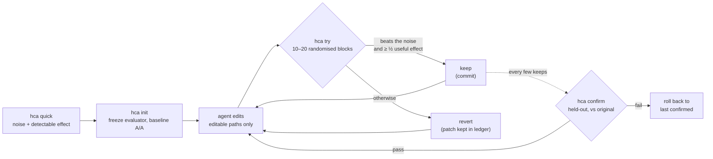

Переведено с README.md, коммит 59b1150. Для чисел авторитетна английская версия README.

<div align="center">

[English](../../README.md) · [简体中文](README.zh-CN.md) · [繁體中文](README.zh-TW.md) · [日本語](README.ja.md) · [한국어](README.ko.md) · [Español](README.es.md) · [Português (Brasil)](README.pt-BR.md) · [Français](README.fr.md) · [Deutsch](README.de.md) · **Русский** · [Türkçe](README.tr.md) · [Tiếng Việt](README.vi.md) · [Bahasa Indonesia](README.id.md) · [हिन्दी](README.hi.md)

# HillClimbAnything

### Обвязка для hill-climbing в любой технической задаче.

**Направьте кодинг-агента на число. Оставляйте только настоящие улучшения.**

[](#быстрый-старт)
[](../../pyproject.toml)
[](../../tests)
[](../../skills/hca/SKILL.md)
[](../../LICENSE)

<code>uvx --from hillclimbanything hca quick -- python bench.py</code>

<sub>Попробуйте, ничего не устанавливая: насколько шумный ваш бенчмарк и какой выигрыш вы сможете обнаружить?</sub>

<br /><br />

<picture>
  <source media="(prefers-color-scheme: dark)" srcset="../assets/climb-dark.svg" />
  
</picture>

</div>

---

Циклы в духе autoresearch позволяют агенту править код, замерять результат и оставлять то, что набрало
лучший балл. На шумной метрике «лучшее» часто оказывается везением. На обычном настольном компьютере
оставление сырого лучшего результата сохраняло **17–55%** изменений, которые ничего не делали, в
зависимости от бенчмарка ([замерено](../../spikes/phase0/RESULT.md)).

HillClimbAnything — это **арбитр** для такого цикла:

- перед началом он измеряет, насколько шумно ваше число;
- он оставляет изменение, только если оно превосходит этот шум;
- он подтверждает общий выигрыш на данных, под которые агент никогда не подгонялся.

Агент предлагает, HCA решает. HCA — это небольшой CLI на Python без зависимостей плюс skill (обычный
Markdown), который обучает кодинг-агента этому методу. Протестировано с Claude Code.

## Быстрый старт

**1. Установите** (Python 3.11+; проверено на Linux, WSL и нативном Windows, macOS не проверялась):

```bash
uv tool install hillclimbanything   # или: pipx install hillclimbanything
hca setup                                                        # добавить skill для агента (сначала показывает свой план)
```

`hca setup` кладёт skill туда, где его ищут агенты: `~/.claude/skills/hca` (Claude Code) и
`~/.agents/skills/hca` (Codex, Cursor, Gemini CLI, Copilot). То, что он заменяет, сохраняется в резервной копии,
а `hca setup --uninstall` убирает его обратно. Нет [`uv`](https://docs.astral.sh/uv/getting-started/installation/) или [`pipx`](https://pipx.pypa.io/stable/installation/)? Обычный
`pip install` работает внутри виртуального окружения; многие системы отказывают вне его (PEP 668).

<details>
<summary>Другие способы добавить skill</summary>

**Плагин Claude Code:**

```text
/plugin marketplace add JaiS1/HillClimbAnything
/plugin install hca@hillclimbanything
```

**[skills.sh](https://github.com/vercel-labs/skills):**

```bash
npx skills add JaiS1/HillClimbAnything --skill hca
```

В любом случае skill управляет CLI `hca`, поэтому установите и CLI.
</details>

**2. Попросите своего агента:**

```text
Используй skill hca (HillClimbAnything), чтобы ускорить `python bench.py`: сначала запусти `hca quick`,
составь hca.toml вместе со мной, улучшай через `hca try` и сообщай только то, что прошло `hca confirm`.
```

**3. Или работайте сами:**

<div align="center">

</div>

```bash
hca compare -- <A> -- <B>   # первый результат за несколько минут для быстрой команды: B действительно лучше A? без git, без hca.toml
hca quick -- <cmd>     # 2 минуты, без настройки: насколько шумно это число и какой выигрыш можно заметить?
hca init               # заморозить оценщик, создать ветку, измерить базовый шум
hca try -m "why"       # измерить вашу правку относительно последнего keep → keep (коммит) или revert
hca confirm            # заново измерить общий выигрыш относительно оригинала на отложенных данных
hca report             # каждая попытка, её вердикт и доказательства
```

`hca compare` не требует ни репозитория, ни конфигурации: он запускает две команды случайно упорядоченными A/B-блоками и сообщает разницу с интервалом и p-значением, увиденный шум и наименьшую разницу, которую он мог бы заметить, — поэтому «заметной разницы нет» что-то значит. Код выхода 0 означает, что B значимо лучше A, 1 — что нет, 2 — что запуск завершился ошибкой или не выдал метрику. Команды запускаются без оболочки (если она нужна, напишите `sh -c '...'`); метрика по умолчанию — время выполнения, а с `--metric NAME` читается строка `METRIC NAME=value`. Если нужен защищённый подъём по метрике на вашем коде, следующий шаг — `hca init`. Обычно он выполняет все 20 блоков (останавливается на 10, только если первый просмотр уже даёт однозначный ответ). Коды выхода: 0 B лучше, 1 нет, 2 недействительно, 3 ошибка использования, 4 внутренняя ошибка. В нативном Windows встроенные команды оболочки и `.cmd`-обёртки вроде `npm` или `dir` требуют `cmd /c ...`. Команда A не может содержать `--`; другой разделитель выбирается через `--sep TOKEN`.

Задача состоит из описания, путей, которые агенту разрешено править, и одной команды, выводящей число:

```toml
# hca.toml
[task]
name     = "api-latency"
editable = ["src/**"]          # агент может менять эти файлы
frozen   = ["bench/**"]        # оценщик: хешируется, никогда не правится

[objective]
command       = ["python3", "bench/run.py"]   # выводит METRIC p95_ms=212.4
metric        = "p95_ms"
direction     = "min"
useful_effect = "5%"           # наименьший выигрыш, который стоит сохранять
```

## Кейс: Python-Markdown, 2× быстрее

Кодинг-агент на Sonnet оптимизировал [Python-Markdown](https://github.com/Python-Markdown/markdown)
3.11.1, а HCA выступал арбитром: 18 попыток примерно за 80 минут, 14 сохранено.

| Проверка | Результат |
|---|---|
| `hca confirm` на отложенных документах | время рендеринга **−53.8%** (не хуже −53.0%) |
| Независимое повторное измерение вне HCA, на тестовых фикстурах проекта | **−63.5%** |
| Вывод: набор тестов проекта (1 126 тестов; 110 пропущено, как и в 3.11.1) и 23 000 случайных документов | **идентичен** 3.11.1 |
| Изменения, которые HCA отклонил, а цикл с единичным замером оставил бы | **3 из 4**, одно из них — «−17.9%», которое на самом деле было −1.7% |

Самый большой выигрыш дал пропуск встроенных (inline) regex-шаблонов, когда в тексте не может быть
символа, необходимого любому совпадению. Читайте [разбор, патч, журнал по каждой попытке и сырой ledger](../../showcases/python-markdown/README.md).
Это одна машина и один прогон, а патч не прошёл ревью в основном проекте.

## Кейс: js-yaml, на 15% быстрее

Второе восхождение: другой язык и другой тип метрики. [js-yaml](https://github.com/nodeca/js-yaml) 5.5.0 на Node, замер `load()` по одному разу на документ на 491 реальном файле GitHub Actions, Kubernetes, Helm, Compose и OpenAPI. Кодинг-агент сделал 12 попыток примерно за час, сохранено 3.

<div align="center">
<picture>
  <source media="(prefers-color-scheme: dark)" srcset="../assets/climb-yaml-dark.svg" />
  
</picture>
</div>

| Проверка | Результат |
|---|---|
| `hca confirm` на отложенных документах (те же жанры, в основном другие файлы) | время `load()` **−15.3%** по медиане на элемент (не хуже −13.3%) |
| A/B в чистом клоне против исходного релиза, 200 новых процессов | суммарное время **−15.3%** (95% ДИ от −16.6% до −14.4%) |
| Вывод: собственные 1 633 теста js-yaml, 25 384 сравнения для каждой из сборок ESM и CJS, 11 250 сравнений fuzz | **0 расхождений** с 5.5.0 |

Выигрыш дают небольшие изменения, которые убирают лишнюю работу в парсере: меньше аллокаций на узел, переход по первому символу и быстрый путь для простых скаляров. Две из трёх сохранённых попыток объединяют изменения, каждое из которых по отдельности не дотягивало до порога сохранения; в разборе это указано, а подтверждение охватывает итоговое состояние. Метрика — время одного вызова, скорее «холодное», на в основном небольших документах, а не пропускная способность в горячем цикле. Это одна машина, и патч не отправлялся в основной проект. Читайте [разбор, патч, ledger и обвязку](../../showcases/js-yaml/README.md).

## Зачем нужен арбитр?

Две идентичные сборки, сравниваемые так, как их сравнивает большинство циклов ([Фаза 0](../../spikes/phase0/RESULT.md)):

| Правило сохранения | Сохранено пустых изменений | Сохранено реальных ускорений на 5% |
|---|---|---|
| Оставлять сырой лучший результат | **17–55%** | 100% |
| Тест HCA на рандомизированных блоках | **≤ 1%** | 76–96% (15 блоков) |

Диапазоны охватывают два бенчмарка (веб-сервер и CLI). Строка HCA — это один взгляд при α = 1%;
поставляемое правило строже.

Цикл, который оставляет от пятой части до половины своих пустых изменений, карабкается по шуму. Его
выигрыши выглядят накапливающимися, а при повторном замере испаряются.

## Как это работает



- **Рандомизированные блоки.** Каждая попытка запускает базовую версию и кандидата друг за другом в
  случайном порядке, от 10 до 20 раз. Случайный порядок делает корректным точный тест со сменой знаков
  (sign-flip) независимо от вида шума: тяжёлые хвосты, тепловые всплески, игра, запущенная в фоне.
- **Доказательство и величина.** Для keep односторонний тест должен проходить при 1% на попытку, а
  оценка — достигать как минимум половины вашего полезного эффекта.
- **Одинаковые ветви.** Обе ветви — чистые git worktree с точными коммитами. Сохраняемый коммит — это
  в точности то дерево, которое измерялось.
- **Подтвердите, иначе не считается.** `hca confirm` проверяет историю, затем заново измеряет общий
  выигрыш относительно оригинала. Агент видит только PASS или FAIL.
- **Всё на диске.** Патч каждой попытки, сырые прогоны, вердикт и причины лежат в `.hca/`.

## Режим исследования (экспериментальный, по желанию)

Всё описанное выше — это *линейный режим*: каждый кандидат проверяется против последнего keep. Режим
исследования добавляет память идей и дерево программ-кандидатов, не снижая планку для keep.

- **Идеи.** Агент записывает гипотезы в `IDEAS.md` (`## I4 [avoid-work] Skip absent patterns`). `hca try --idea I4` фиксирует, какую идею
  проверяла попытка, а `hca next` показывает итог по каждой идее.
- **Отсев (screens).** `hca try --explore` измеряет потомка против его *родителя* — не обязательно последнего
  keep — за 5–8 блоков. Отсев ранжирует потомка и кладёт его в архив. Он никогда ничего не сохраняет и не
  является доказательством.
- **Архив.** По одной элите на каждый затронутый модуль, чтобы промежуточный шаг, который поначалу выглядит хуже,
  прожил достаточно долго и успел улучшиться. После каждого отсева HCA случайно выбирает следующего родителя
  (последний keep — не реже чем в 40% случаев) и выставляет на него редактируемые пути.
- **Продвижение.** `hca try --promote M` проверяет члена архива M против последнего keep как обычную попытку, на
  свежих блоках, поэтому доля ложных keep в 1% на проверку сохраняется, как бы ни был выбран M. `hca confirm`
  работает как прежде; проваленный confirm помечает как испорченного (tainted) каждого члена, построенного на
  отменённых им keep.
- **`hca next`** показывает бюджет, родителя и его родословную, идеи, архив и подсказку о продвижении — не больше
  чем в 60 строках. Он заменяет `hca status`, который останется ещё на один релиз.
  Сам по себе `hca next` также выбирает родителя и печатает готовую к запуску команду; чтобы выбрать другого родителя, нужен `--parent M --why "..."`, и отчёт считает такие переопределения.

Это не доказано. Лучше ли популяция кандидатов поднимается на реальных целях, чем одна линия, измерят
проверочные восхождения из [проектного документа](../DESIGN-climb-engine.md). Пока они не проведены, линейный режим остаётся режимом
по умолчанию, и оба кейса выше пройдены в линейном режиме. Режим исследования работает только в режиме `blocks`.
Записанный отсев завершается с кодом 5, никогда не 0, чтобы его нельзя было принять за keep; недействительный — с кодом 2.

## Что можно оптимизировать

Всё, что команда способна превратить в число, если это число достаточно воспроизводимо, чтобы измерить
его шум.

| Цель | Пример метрики | Статус |
|---|---|---|
| Горячий путь библиотеки | время рендеринга / разбора | ✅ есть кейс (Python-Markdown, −53.8%; js-yaml, −15.3%) |
| CLI и время сборки | секунды по часам | 🧪 откалибровано ([Фаза 0](../../spikes/phase0/RESULT.md)) |
| Задержка веб-сервера | время до первого байта по маршрутам | 🧪 откалибровано ([Фаза 0](../../spikes/phase0/RESULT.md)) |
| Загрузка страницы в браузере | LCP по страницам | 🗺️ кейс запланирован |
| Время кадра интерфейса или игры | p99 мс кадра по сценам | 🗺️ кейс запланирован |
| Точность модели или промпта | оценка по каждому элементу | 🧪 режим `items`, покрыт юнит-тестами |
| Платное обучение на GPU | оценка после обучения | 📋 методика кампании в [справочных материалах skill](../../skills/hca/references/campaign-card.md); инструменты запланированы |

## Для агентов

Если вы ИИ-агент и читаете это:

- **Метод:** [`skills/hca/SKILL.md`](../../skills/hca/SKILL.md). Описывает проверку предпосылок, один
  механизм за попытку и запрет трогать замороженные файлы.
- **Спецификация и контракт вывода:** [`skills/hca/references/spec.md`](../../skills/hca/references/spec.md).
- **Обзор для краулеров и ассистентов:** [`llms.txt`](../../llms.txt).
- **Работа над этим репозиторием:** [`AGENTS.md`](../../AGENTS.md).

| Код выхода | `hca try` | `hca confirm` |
|---|---|---|
| 0 | keep | пройдено |
| 1 | revert | провалено (откат) |
| 2 | недействительно / пусто / отказ: ничего не сохранено, ваши правки остаются на месте | неопределённо или отказ |
| 3 / 4 | ошибка использования / внутренняя ошибка | то же |

Сообщайте только то, что прошло `hca confirm`, вместе с его границей и числом попыток.

## FAQ

<details>
<summary><strong>Вызывает ли HCA LLM и нужен ли ему API-ключ?</strong></summary>

Нет. HCA никогда не обращается к модели. Думает ваш агент (Claude Code, Codex, Cursor или любой другой),
а HCA только измеряет и решает. `hca quick` работает вообще без агента.
</details>

<details>
<summary><strong>Сколько длится одна попытка?</strong></summary>

Примерно 20–40 запусков вашей команды: 10 блоков, расширяемых до 20, если результат выглядит
многообещающе, по два запуска на блок. Бенчмарк на 3 секунды занимает от 1 до 2 минут на попытку.
`hca quick` называет стоимость до начала работы.
</details>

<details>
<summary><strong>Моя метрика шумная. Это сработает?</strong></summary>

`hca quick` отвечает на это примерно за 2 минуты. Он сообщает уровень шума и наименьший выигрыш, который
можно заметить. Если ответ «здесь слишком шумно», он называет самое дешёвое решение: больше элементов
за запуск, более длинные запуски или закрыть другую нагрузку. Оптимизировать до этого — впустую тратить силы.
</details>

<details>
<summary><strong>Может ли агент сжульничать?</strong></summary>

Может попытаться, и HCA делает это неудобным:

- замороженные файлы оценщика хешируются;
- правки вне объявленных путей делают попытку недействительной;
- обе ветви запускаются из чистых worktree;
- сбои засчитываются как худшее значение;
- повторные попытки учитываются.

Это не граница безопасности, поэтому читайте патчи. В [docs/LIMITS.md](../LIMITS.md) перечислены все
известные пробелы и что с ними делать.
</details>

<details>
<summary><strong>Чем это отличается от autoresearch?</strong></summary>

[autoresearch](https://github.com/karpathy/autoresearch) показал, насколько продуктивен агент в цикле,
и HCA сохраняет этот цикл. Добавляет HCA само решение: для любой команды и любой метрики — реально
изменение или это шум, а также шаг подтверждения, защищающий от проклятия победителя.
</details>

<details>
<summary><strong>А дорогие запуски, например обучение на GPU?</strong></summary>

Справочные материалы skill несут дисциплину реальной многомесячной кампании по дообучению модели:

- заранее зарегистрированная карточка с парным контролем «те же вычисления, без идеи»;
- дешёвая репетиция перед платным запуском;
- состязательное ревью;
- наблюдатели и счётчики бюджета внутри удалённого задания;
- глубокая оценка перед любым вердиктом.

Инструменты для этого запланированы.
</details>

<details>
<summary><strong>Windows?</strong></summary>

Нативный Windows работает (Python 3.11+). По таймауту всё дерево процессов завершается через Job Object и `taskkill`. Оболочки нет, поэтому пишите команды списками argv (batch-файл — это `["cmd", "/c", "build.bat"]`). Самую строгую изоляцию процессов по-прежнему даёт WSL, а macOS не проверялась.
</details>

## Документация

- [Кейс: Python-Markdown](../../showcases/python-markdown/README.md)
- [Кейс: js-yaml](../../showcases/js-yaml/README.md)
- [Ограничения и известные пробелы](../LIMITS.md)
- [Калибровка Фазы 0](../../spikes/phase0/RESULT.md)
- [Дизайн](../DESIGN-hca.md)
- [Архитектурный контракт](../ARCHITECTURE-v1.md)

## Статус и благодарности

Ранний исследовательский релиз (0.2.0.dev): основной цикл и два кейса. HCA вырос из
[Dream Loop](https://github.com/JaiS1/dream-loop/tree/dream-loop-v0.1), чью парную статистику он
сохраняет. Он заимствует идеи у циклов в духе [autoresearch](https://github.com/karpathy/autoresearch)
и у практики честной оценки из статьи [Harness Learning](https://arxiv.org/abs/2609.35738).

```bash
python3 -m unittest discover -s tests      # разработка
```

[Лицензия MIT](../../LICENSE). Если HCA уберёг вас от выкатки мнимого выигрыша, звезда поможет другим его найти.
