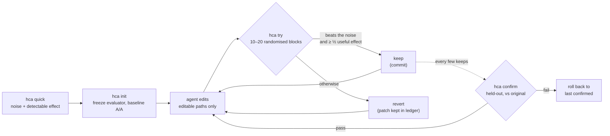

Translated from README.md at commit b9bad05. The English README is authoritative for numbers.

<div align="center">

[English](../../README.md) · [简体中文](README.zh-CN.md) · [繁體中文](README.zh-TW.md) · [日本語](README.ja.md) · [한국어](README.ko.md) · [Español](README.es.md) · [Português (Brasil)](README.pt-BR.md) · [Français](README.fr.md) · [Deutsch](README.de.md) · [Русский](README.ru.md) · **Türkçe** · [Tiếng Việt](README.vi.md) · [Bahasa Indonesia](README.id.md) · [हिन्दी](README.hi.md)

# HillClimbAnything

### Herhangi bir teknik zorlukta hill-climb yapmanızı sağlayan harness.

**Kodlama ajanınızı bir sayıya yöneltin. Yalnızca gerçek kazanımları tutun.**

[](../../README.md#quick-start)
[](../../pyproject.toml)
[](../../tests)
[](../../skills/hca/SKILL.md)
[](../../LICENSE)

<code>pip install git+https://github.com/JaiS1/HillClimbAnything && hca quick -- python bench.py</code>

<br /><br />

<picture>
  <source media="(prefers-color-scheme: dark)" srcset="../assets/climb-dark.svg" />
  
</picture>

</div>

---

Autoresearch tarzı döngüler, bir ajanın kodu düzenlemesine, ölçmesine ve en iyi skoru getireni tutmasına izin verir. Gürültülü bir metrikte "en iyi" çoğu zaman şanstır. Sıradan bir masaüstü bilgisayarda, ham en iyi skoru tutmak, hiçbir işe yaramayan değişikliklerin **%17–55**'ini tuttu; oran benchmark'a göre değişiyor ([ölçüm](../../spikes/phase0/RESULT.md)).

HillClimbAnything bu döngünün **hakemidir**:

- başlamadan önce sayınızın ne kadar gürültülü olduğunu ölçer;
- bir değişikliği yalnızca gürültüyü aşarsa tutar;
- toplam kazancı, ajanın hiç ayar yapmadığı veriler üzerinde doğrular.

Ajanınız öneri getirir, HCA karar verir. HCA, bağımlılığı olmayan küçük bir Python CLI'ıdır; yanında, bir kodlama ajanına yöntemi öğreten bir skill (düz Markdown) bulunur. Claude Code ile test edilmiştir.

## Hızlı başlangıç

**1. Kurulum** (Python 3.11+; Linux ve WSL'de test edildi, macOS test edilmedi):

```bash
pip install git+https://github.com/JaiS1/HillClimbAnything     # henüz PyPI'da yok
npx skills add JaiS1/HillClimbAnything --skill hca             # isteğe bağlı: ajan skill'i
```

**2. Ajanınıza söyleyin:**

```text
HillClimbAnything'i (github.com/JaiS1/HillClimbAnything) kur ve skills/hca/SKILL.md dosyasını izle.
`python bench.py` komutunu hızlandır: önce `hca quick` çalıştır, hca.toml dosyasını benimle birlikte yaz,
`hca try` ile tırman ve yalnızca `hca confirm`'ün geçirdiklerini raporla.
```

**3. Ya da kendiniz kullanın:**

<div align="center">

</div>

```bash
hca quick -- <cmd>     # 2 dakika, kurulum yok: bu sayı ne kadar gürültülü, hangi kazancı tespit edebiliriz?
hca init               # evaluator'ı dondur, bir branch oluştur, başlangıç gürültüsünü ölç
hca try -m "why"       # düzenlemeni son keep'e karşı ölç → keep (commit) ya da revert
hca confirm            # toplam kazancı, ayrılmış (held-out) veride orijinale karşı yeniden ölç
hca report             # her deneme, kararı ve kanıtı
```

Bir görev; bir brief, ajanın düzenleyebileceği yollar ve sayıyı yazdıran tek bir komuttan oluşur:

```toml
# hca.toml
[task]
name     = "api-latency"
editable = ["src/**"]          # ajan bunları değiştirebilir
frozen   = ["bench/**"]        # evaluator: hash'lenir, asla düzenlenmez

[objective]
command       = ["python3", "bench/run.py"]   # METRIC p95_ms=212.4 yazdırır
metric        = "p95_ms"
direction     = "min"
useful_effect = "5%"           # tutmaya değer en küçük kazanç
```

## Showcase: Python-Markdown, 2× daha hızlı

Bir Sonnet kodlama ajanı, HCA'yı hakem olarak kullanarak [Python-Markdown](https://github.com/Python-Markdown/markdown) 3.11.1 üzerinde tırmandı: yaklaşık 80 dakikada 18 deneme, 14'ü tutuldu.

| Kontrol | Sonuç |
|---|---|
| Ayrılmış (held-out) belgelerde `hca confirm` | render süresi **−53.8%** (en az −53.0%) |
| HCA dışında, projenin test fixture'ları üzerinde bağımsız yeniden ölçüm | **−63.5%** |
| Çıktı: projenin test paketi (1,126 test; 3.11.1'de olduğu gibi 110'u atlandı) ve 23,000 rastgele belge | 3.11.1 ile **aynı** |
| Tek çalıştırmalı bir döngünün tutacağı, ama HCA'nın reddettiği değişiklikler | **4'te 3**; biri "−17.9%" görünürken gerçekte −1.7% çıktı |

En büyük kazanç, metin, her eşleşmenin gerektirdiği bir karakteri içeremiyorsa inline regex desenlerini atlamaktan geldi. [Yazı, patch, deneme başına log ve ham ledger](../../showcases/python-markdown/README.md) bağlantısından okuyabilirsiniz. Tek bir makine ve tek bir çalıştırmadır; patch upstream tarafından incelenmedi.

## Neden bir hakem?

İki özdeş build, çoğu döngünün karşılaştırdığı biçimde karşılaştırıldı ([Phase 0](../../spikes/phase0/RESULT.md)):

| Tutma kuralı | Tutulan etkisiz değişiklikler | Tutulan gerçek %5 hızlanmalar |
|---|---|---|
| Ham en iyi skoru tut | **17–55%** | 100% |
| HCA'nın rastgele bloklar üzerindeki testi | **≤ 1%** | 76–96% (15 blok) |

Aralıklar iki benchmark'ı kapsar (bir web sunucusu ve bir CLI). HCA satırı, α = 1% ile tek bir bakıştır; gerçekte kullanılan kural daha katıdır.

Etkisiz değişikliklerin beşte birinden yarısına kadarını tutan bir döngü gürültüye tırmanıyordur. Kazançları üst üste yığılmış görünür, sonra yeniden ölçtüğünüzde buharlaşır.

## Nasıl çalışır



- **Rastgele bloklar.** Her deneme, baseline ve adayı art arda, rastgele sırayla 10 ila 20 kez çalıştırır. Rastgele sıra, gürültü nasıl görünürse görünsün (ağır kuyruklar, termal sıçramalar, arka planda açık bir oyun) kesin bir sign-flip testini geçerli kılar.
- **Kanıt ve büyüklük.** Bir keep için, tek yönlü testin deneme başına %1'de geçmesi ve tahminin, faydalı etkinizin en az yarısına ulaşması gerekir.
- **Özdeş kollar.** Her iki kol da tam commit'lerin temiz git worktree'leridir. Tutulan commit, ölçülen ağacın aynısıdır.
- **Confirm yoksa olmamıştır.** `hca confirm` geçmişi kontrol eder, ardından toplam kazancı orijinale karşı yeniden ölçer. Ajan yalnızca PASS veya FAIL görür.
- **Her şey diskte.** Her denemenin patch'i, ham çalıştırmaları, kararı ve gerekçeleri `.hca/` içindedir.

## Neyi tırmanabilirsiniz

Bir komutun sayıya çevirebildiği her şey; yeter ki sayı, gürültüsünü ölçecek kadar tekrarlanabilir olsun.

| Hedef | Örnek metrik | Durum |
|---|---|---|
| Kütüphane hot path'i | render / parse süresi | ✅ showcase var (Python-Markdown, −53.8%) |
| CLI ve build süresi | duvar saati saniyesi | 🧪 kalibre edildi ([Phase 0](../../spikes/phase0/RESULT.md)) |
| Web sunucusu gecikmesi | route başına ilk bayta kadar süre | 🧪 kalibre edildi ([Phase 0](../../spikes/phase0/RESULT.md)) |
| Tarayıcıda sayfa yüklenmesi | sayfa başına LCP | 🗺️ planlanan showcase |
| UI veya oyun kare süresi | sahne başına p99 kare ms | 🗺️ planlanan showcase |
| Model veya prompt doğruluğu | öğe başına eval skoru | 🧪 `items` modu, unit test'li |
| Ücretli GPU eğitim çalıştırmaları | eğitim sonrası eval skoru | 📋 kampanya yöntemi [skill referanslarında](../../skills/hca/references/campaign-card.md); araçlar planlandı |

## Ajanlar için

Bunu okuyan bir yapay zekâ ajanıysanız:

- **Yöntem:** [`skills/hca/SKILL.md`](../../skills/hca/SKILL.md). Önkoşul kontrollerini, deneme başına tek mekanizmayı ve dondurulmuş dosyalara asla dokunmamayı kapsar.
- **Spec ve çıktı sözleşmesi:** [`skills/hca/references/spec.md`](../../skills/hca/references/spec.md).
- **Crawler'lar ve asistanlar için genel bakış:** [`llms.txt`](../../llms.txt).
- **Bu repo üzerinde çalışmak:** [`AGENTS.md`](../../AGENTS.md).

| Çıkış kodu | `hca try` | `hca confirm` |
|---|---|---|
| 0 | tutuldu (`keep`) | geçti |
| 1 | geri alındı (`revert`) | başarısız (geri alındı) |
| 2 | geçersiz / void / reddedildi: hiçbir şey tutulmadı, düzenlemeleriniz yerinde bırakıldı | sonuçsuz veya reddedildi |
| 3 / 4 | kullanım hatası / dahili hata | aynı |

Yalnızca `hca confirm`'ün geçirdiğini, sınırı ve deneme sayısıyla birlikte raporlayın.

## SSS

<details>
<summary><strong>HCA bir LLM çağırıyor mu, API anahtarı gerekiyor mu?</strong></summary>

Hayır. HCA hiçbir zaman bir model çağırmaz. Düşünme işini ajanınız (Claude Code, Codex, Cursor veya başka biri) yapar; HCA yalnızca ölçer ve karar verir. `hca quick` hiçbir ajan olmadan da çalışır.
</details>

<details>
<summary><strong>Bir deneme ne kadar sürer?</strong></summary>

Komutunuzun yaklaşık 20 ila 40 çalıştırması: 10 blok, sonuç umut verici görünürse 20'ye uzatılır, blok başına iki çalıştırma. 3 saniyelik bir benchmark'ta deneme başına 1 ila 2 dakika sürer. `hca quick` maliyeti başlamadan önce söyler.
</details>

<details>
<summary><strong>Metriğim gürültülü. Bu işe yarar mı?</strong></summary>

`hca quick` bunu yaklaşık 2 dakikada yanıtlar. Gürültüyü ve tespit edebileceğiniz en küçük kazancı bildirir. Yanıt "burada çok gürültülü" ise en ucuz çözümü söyler: çalıştırma başına daha fazla öğe, daha uzun çalıştırmalar ya da diğer yükü kapatmak. Bundan önce tırmanmak boşa emektir.
</details>

<details>
<summary><strong>Ajan hile yapabilir mi?</strong></summary>

Deneyebilir; HCA bunu zahmetli hale getirir:

- dondurulmuş evaluator dosyaları hash'lenir;
- bildirilen yolların dışındaki düzenlemeler denemeyi geçersiz kılar;
- iki kol da temiz worktree'lerden çalışır;
- çöken çalıştırmalar en kötü değer olarak puanlanır;
- tekrarlanan denemeler sayılır.

Bu bir güvenlik sınırı değildir, bu yüzden patch'leri okuyun. [docs/LIMITS.md](../LIMITS.md) bilinen tüm boşlukları ve bunlar için ne yapılacağını listeler.
</details>

<details>
<summary><strong>Bu, autoresearch'ten nasıl ayrılıyor?</strong></summary>

[autoresearch](https://github.com/karpathy/autoresearch), döngü içindeki bir ajanın ne kadar verimli olabileceğini gösterdi; HCA da bu döngüyü korur. HCA'nın eklediği şey karardır: herhangi bir komut ve metrik için bir değişikliğin gerçek mi yoksa gürültü mü olduğu, bir de kazananın laneti (winner's curse) karşısında koruyan bir confirm adımı.
</details>

<details>
<summary><strong>GPU eğitimi gibi pahalı çalıştırmalar ne olacak?</strong></summary>

Skill'in referansları, aylar süren gerçek bir model fine-tuning kampanyasından edinilen disiplini taşır:

- eşleştirilmiş bir "aynı hesaplama, fikir yok" kontrolü içeren, önceden kayda geçirilmiş (preregistered) bir kart;
- ücretli çalıştırmadan önce ucuz bir prova;
- adversarial review;
- uzak işin içinde watcher'lar ve bütçe sayaçları;
- herhangi bir karardan önce derin bir değerlendirme.

Bunun araçları planlanıyor.
</details>

<details>
<summary><strong>Windows?</strong></summary>

WSL kullanın. Yerel Windows süreç kontrolü henüz test edilmedi, macOS da öyle.
</details>

## Dokümantasyon

- [Showcase: Python-Markdown](../../showcases/python-markdown/README.md)
- [Sınırlar ve bilinen boşluklar](../LIMITS.md)
- [Phase 0 kalibrasyonu](../../spikes/phase0/RESULT.md)
- [Tasarım](../DESIGN-hca.md)
- [Mimari sözleşme](../ARCHITECTURE-v1.md)

## Durum ve katkılar

Erken araştırma sürümü (0.2.0.dev): çekirdek döngü ve bir showcase. HCA, eşleştirilmiş istatistiklerini koruduğu [Dream Loop](https://github.com/JaiS1/dream-loop/tree/dream-loop-v0.1)'tan doğdu. [autoresearch](https://github.com/karpathy/autoresearch) tarzı döngülerden ve [Harness Learning](https://arxiv.org/abs/2609.35738) makalesinin değerlendirme hijyeninden fikirler ödünç alır.

```bash
python3 -m unittest discover -s tests      # geliştirme
```

[MIT Lisansı](../../LICENSE). HCA sizi sahte bir kazancı yayına almaktan kurtardıysa, bir yıldız başkalarının onu bulmasına yardımcı olur.
