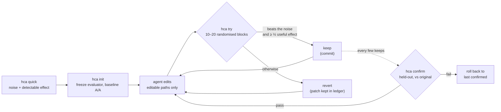

Translated from README.md at commit 59b1150. The English README is authoritative for numbers.

<div align="center">

[English](../../README.md) · [简体中文](README.zh-CN.md) · [繁體中文](README.zh-TW.md) · [日本語](README.ja.md) · [한국어](README.ko.md) · [Español](README.es.md) · [Português (Brasil)](README.pt-BR.md) · [Français](README.fr.md) · [Deutsch](README.de.md) · [Русский](README.ru.md) · [Türkçe](README.tr.md) · **Tiếng Việt** · [Bahasa Indonesia](README.id.md) · [हिन्दी](README.hi.md)

# HillClimbAnything

### Bộ khung giúp bạn hill-climb mọi bài toán kỹ thuật.

**Chỉ cho agent lập trình của bạn một con số. Chỉ giữ lại những cải thiện thật.**

[](../../README.md#quick-start)
[](../../pyproject.toml)
[](../../tests)
[](../../skills/hca/SKILL.md)
[](../../LICENSE)

<code>uvx --from hillclimbanything hca quick -- python bench.py</code>

<sub>Dùng thử mà không cần cài gì: benchmark của bạn nhiễu đến đâu, và bạn có thể phát hiện mức cải thiện nào?</sub>

<br /><br />

<picture>
  <source media="(prefers-color-scheme: dark)" srcset="../assets/climb-dark.svg" />
  
</picture>

</div>

---

Các vòng lặp kiểu autoresearch cho phép agent sửa code, đo, rồi giữ lại bản có điểm tốt nhất. Với một chỉ số nhiễu, "tốt nhất" thường chỉ là may mắn. Trên một máy tính để bàn thông thường, việc giữ lại điểm cao nhất theo giá trị thô đã giữ lại **17–55%** số thay đổi vốn chẳng có tác dụng gì, tùy benchmark ([số liệu đo](../../spikes/phase0/RESULT.md)).

HillClimbAnything là **trọng tài** cho vòng lặp đó:

- nó đo xem con số của bạn nhiễu đến đâu trước khi bắt đầu;
- nó chỉ giữ một thay đổi nếu thay đổi đó vượt qua mức nhiễu;
- nó xác nhận tổng mức cải thiện trên dữ liệu mà agent chưa từng dùng để tinh chỉnh.

Agent của bạn đề xuất, còn HCA quyết định. HCA là một CLI Python nhỏ, không có dependency, kèm một skill (Markdown thuần) dạy agent lập trình phương pháp này. Đã được thử nghiệm với Claude Code.

## Bắt đầu nhanh

**1. Cài đặt** (Python 3.11+; đã thử trên Linux, WSL và Windows gốc, chưa thử trên macOS):

```bash
uv tool install hillclimbanything   # hoặc: pipx install hillclimbanything
hca setup                                                        # thêm skill cho agent (hiện kế hoạch của nó trước)
```

`hca setup` đặt skill ở nơi các agent tìm nó: `~/.claude/skills/hca` (Claude Code) và
`~/.agents/skills/hca` (Codex, Cursor, Gemini CLI, Copilot). Nó sao lưu mọi thứ bị thay thế,
và `hca setup --uninstall` gỡ nó đi. Không có [`uv`](https://docs.astral.sh/uv/getting-started/installation/) hoặc [`pipx`](https://pipx.pypa.io/stable/installation/)? `pip install`
thông thường chạy được trong virtualenv; nhiều hệ thống từ chối ngoài virtualenv (PEP 668).

<details>
<summary>Các cách khác để thêm skill</summary>

**Plugin Claude Code:**

```text
/plugin marketplace add JaiS1/HillClimbAnything
/plugin install hca@hillclimbanything
```

**[skills.sh](https://github.com/vercel-labs/skills):**

```bash
npx skills add JaiS1/HillClimbAnything --skill hca
```

Dù cách nào, skill điều khiển CLI `hca`, nên hãy cài cả CLI.
</details>

**2. Nhờ agent của bạn:**

```text
Dùng skill hca (HillClimbAnything) để làm `python bench.py` nhanh hơn: chạy `hca quick` trước,
cùng tôi viết hca.toml, leo bằng `hca try`, và chỉ báo cáo những gì `hca confirm` cho qua.
```

**3. Hoặc tự chạy:**

<div align="center">

</div>

```bash
hca compare -- <A> -- <B>   # kết quả đầu tiên trong vài phút với lệnh chạy nhanh: B có thật sự tốt hơn A không? không cần git, không cần hca.toml
hca quick -- <cmd>     # 2 phút, không cần thiết lập: con số này nhiễu cỡ nào, ta phát hiện được mức cải thiện nào?
hca init               # đóng băng evaluator, tạo branch, đo mức nhiễu baseline
hca try -m "why"       # đo thay đổi của bạn so với lần keep gần nhất → keep (commit) hoặc revert
hca confirm            # đo lại tổng mức cải thiện so với bản gốc, trên dữ liệu held-out
hca report             # mọi lần thử, kết luận và bằng chứng của nó
```

`hca compare` không cần repo lẫn config: nó chạy hai lệnh trong các block A/B được xáo ngẫu nhiên và báo mức chênh lệch kèm khoảng tin cậy và giá trị p, mức nhiễu đã thấy, và chênh lệch nhỏ nhất mà nó có thể phát hiện, để "không phát hiện được chênh lệch" thực sự có ý nghĩa. Exit code 0 nghĩa là B tốt hơn A một cách có ý nghĩa thống kê, 1 nghĩa là không, 2 nghĩa là có một lần chạy thất bại hoặc không trả về metric. Các lệnh chạy không qua shell (viết `sh -c '...'` nếu cần); metric mặc định là wall time, hoặc truyền `--metric NAME` để đọc dòng `METRIC NAME=value`. Muốn leo dốc có kiểm soát trên code của bạn thì bước tiếp theo là `hca init`. Thường nó chạy đủ 20 block (chỉ dừng ở 10 khi lần xem đầu đã rõ ràng). Exit code: 0 B tốt hơn, 1 không, 2 không hợp lệ, 3 dùng sai, 4 lỗi nội bộ. Trên Windows native, lệnh dựng sẵn của shell và các shim `.cmd` như `npm` hay `dir` cần `cmd /c ...`. Lệnh A không được chứa `--`; chọn dấu phân cách khác bằng `--sep TOKEN`.

Một tác vụ gồm một bản brief, các đường dẫn agent được phép sửa, và một lệnh in ra con số:

```toml
# hca.toml
[task]
name     = "api-latency"
editable = ["src/**"]          # agent được sửa các file này
frozen   = ["bench/**"]        # evaluator: được băm hash, không bao giờ bị sửa

[objective]
command       = ["python3", "bench/run.py"]   # in ra METRIC p95_ms=212.4
metric        = "p95_ms"
direction     = "min"
useful_effect = "5%"           # mức cải thiện nhỏ nhất đáng để giữ
```

## Showcase: Python-Markdown nhanh gấp 2×

Một agent lập trình Sonnet đã leo [Python-Markdown](https://github.com/Python-Markdown/markdown) 3.11.1 với HCA làm trọng tài: 18 lần thử trong khoảng 80 phút, 14 lần được giữ.

| Kiểm tra | Kết quả |
|---|---|
| `hca confirm` trên tài liệu held-out | thời gian render **−53.8%** (tối thiểu −53.0%) |
| Đo lại độc lập bên ngoài HCA, trên các test fixture của dự án | **−63.5%** |
| Đầu ra: bộ test của dự án (1,126 test; 110 bị skip, giống như ở 3.11.1) và 23,000 tài liệu ngẫu nhiên | **giống hệt** 3.11.1 |
| Thay đổi HCA từ chối mà một vòng lặp chỉ đo một lần sẽ giữ lại | **3 trên 4**, trong đó có một cái "−17.9%" thực ra chỉ là −1.7% |

Cải thiện lớn nhất đến từ việc bỏ qua các pattern regex inline khi văn bản không thể chứa một ký tự mà mọi kết quả khớp đều cần. Xem [bài viết, patch, log từng lần thử và ledger thô](../../showcases/python-markdown/README.md). Đây là một máy và một lần chạy, và patch chưa được upstream review.

## Showcase: js-yaml nhanh hơn 15%

Lần leo thứ hai, ở một ngôn ngữ khác và với một loại chỉ số khác: [js-yaml](https://github.com/nodeca/js-yaml) 5.5.0 trên Node, đo `load()` một lần cho mỗi tài liệu trên 491 tệp thật của GitHub Actions, Kubernetes, Helm, Compose và OpenAPI. Một agent lập trình đã thử 12 lần trong khoảng một giờ, 3 lần được giữ.

<div align="center">
<picture>
  <source media="(prefers-color-scheme: dark)" srcset="../assets/climb-yaml-dark.svg" />
  
</picture>
</div>

| Kiểm tra | Kết quả |
|---|---|
| `hca confirm` trên tài liệu held-out (cùng thể loại, phần lớn là tệp khác) | thời gian `load()` **−15.3%** (trung vị theo từng mục, tối thiểu −13.3%) |
| A/B trong bản clone sạch so với bản phát hành gốc, 200 tiến trình mới | tổng thời gian **−15.3%** (KTC 95% −16.6% đến −14.4%) |
| Đầu ra: 1,633 test riêng của js-yaml, 25,384 phép so sánh cho mỗi bản build ESM và CJS, 11,250 phép so sánh fuzz | **0 khác biệt** so với 5.5.0 |

Các cải thiện là những thay đổi nhỏ giúp tránh việc thừa trong parser: ít cấp phát hơn cho mỗi node, rẽ nhánh theo ký tự đầu tiên và một đường nhanh cho scalar thông thường. Hai trong ba lần thử được giữ gộp những thay đổi mà riêng từng cái đều dưới ngưỡng giữ; bài viết có nói rõ điều này, và confirm bao trùm trạng thái cuối. Chỉ số là thời gian mỗi lần gọi, thiên về chạy nguội, trên các tài liệu phần lớn nhỏ, không phải thông lượng trong vòng lặp nóng. Đây là một máy, và patch chưa được gửi lên upstream. Xem [bài viết, patch, ledger và harness](../../showcases/js-yaml/README.md).

## Vì sao cần trọng tài?

Hai bản build giống hệt nhau, được so sánh theo cách hầu hết các vòng lặp vẫn làm ([Phase 0](../../spikes/phase0/RESULT.md)):

| Quy tắc giữ | Thay đổi no-op bị giữ | Cải thiện 5% thật được giữ |
|---|---|---|
| Giữ điểm thô tốt nhất | **17–55%** | 100% |
| Phép kiểm định của HCA trên các block ngẫu nhiên | **≤ 1%** | 76–96% (15 block) |

Các khoảng này bao gồm hai benchmark (một web server và một CLI). Hàng của HCA là một lần xét tại α = 1%; quy tắc thực tế được phát hành còn chặt hơn.

Một vòng lặp giữ lại từ một phần năm đến một nửa số thay đổi no-op là đang leo lên nhiễu. Các cải thiện trông như cộng dồn, rồi tan biến khi bạn đo lại.

## Cách hoạt động



- **Block ngẫu nhiên.** Mỗi lần try chạy baseline và candidate liền nhau theo thứ tự ngẫu nhiên, từ 10 đến 20 lần. Thứ tự ngẫu nhiên khiến phép kiểm định sign-flip chính xác luôn hợp lệ, dù nhiễu trông thế nào: đuôi nặng, thermal blip, hay một tựa game đang chạy nền.
- **Bằng chứng và độ lớn.** Một lần keep cần phép kiểm định một phía đạt ở mức 1% cho mỗi lần try, và ước lượng phải đạt ít nhất một nửa useful effect của bạn.
- **Hai nhánh giống hệt.** Cả hai nhánh đều là git worktree sạch của các commit chính xác. Commit được giữ chính là cây thư mục đã được đo.
- **Phải confirm, nếu không coi như chưa có.** `hca confirm` kiểm tra lịch sử, rồi đo lại tổng mức cải thiện so với bản gốc. Agent chỉ thấy PASS hoặc FAIL.
- **Mọi thứ nằm trên đĩa.** Patch, các lần chạy thô, kết luận và lý do của từng lần thử đều nằm trong `.hca/`.

## Chế độ khám phá (thử nghiệm, tùy chọn)

Mọi thứ ở trên là *chế độ đường thẳng*: mỗi candidate được kiểm tra so với lần keep gần nhất. Chế độ khám phá bổ sung một bộ nhớ ý tưởng và một cây các chương trình candidate, mà không hạ thấp tiêu chuẩn cho một lần keep.

- **Ý tưởng.** Agent ghi các giả thuyết vào `IDEAS.md` (`## I4 [avoid-work] Skip absent patterns`). `hca try --idea I4` ghi lại lần thử đã kiểm tra ý tưởng nào, và `hca next` liệt kê kết quả của từng ý tưởng.
- **Sàng lọc (screen).** `hca try --explore` đo một con so với *cha* của nó, vốn không nhất thiết là lần keep gần nhất, trong 5–8 block. Một lần sàng lọc chỉ xếp hạng con và lưu nó vào kho. Nó không bao giờ keep được gì, và không phải là bằng chứng.
- **Kho lưu trữ.** Mỗi module được chạm tới có một elite, để một bước đệm lúc đầu trông tệ hơn vẫn sống sót đủ lâu để cải thiện. Sau mỗi lần sàng lọc, HCA lấy mẫu cha tiếp theo (ít nhất 40% số lần là lần keep gần nhất) và đặt các đường dẫn có thể sửa về cha đó.
- **Thăng hạng.** `hca try --promote M` kiểm tra thành viên M so với lần keep gần nhất như một lần try bình thường, trên các block mới, nên tỷ lệ keep sai 1% cho mỗi phép kiểm tra vẫn giữ nguyên dù M được chọn theo cách nào. `hca confirm` hoạt động như trước; một lần confirm thất bại sẽ đánh dấu tainted mọi thành viên được xây trên các lần keep mà nó hoàn tác.
- **`hca next`** hiển thị ngân sách, cha và dòng dõi của nó, các ý tưởng, kho lưu trữ và một gợi ý thăng hạng, trong tối đa 60 dòng. Lệnh này thay cho `hca status`, vốn còn được giữ thêm một bản phát hành.

Điều này chưa được chứng minh. Một quần thể candidate có leo tốt hơn một đường thẳng duy nhất trên các mục tiêu thực hay không là điều mà các lần leo kiểm chứng trong [tài liệu thiết kế](../DESIGN-climb-engine.md) sẽ đo. Cho đến khi chúng được chạy, chế độ đường thẳng vẫn là mặc định, và cả hai showcase ở trên đều được leo bằng chế độ đường thẳng. Chế độ khám phá chỉ hoạt động ở chế độ `blocks`. Một lần sàng lọc được ghi lại thoát với mã 0, và một lần không hợp lệ thoát với mã 2.

## Bạn có thể leo gì

Bất cứ thứ gì một lệnh có thể biến thành con số, miễn là con số đó đủ lặp lại được để đo mức nhiễu của nó.

| Mục tiêu | Chỉ số ví dụ | Trạng thái |
|---|---|---|
| Hot path của thư viện | thời gian render / parse | ✅ đã có showcase (Python-Markdown, −53.8%; js-yaml, −15.3%) |
| CLI và thời gian build | giây theo đồng hồ treo tường | 🧪 đã hiệu chuẩn ([Phase 0](../../spikes/phase0/RESULT.md)) |
| Độ trễ web server | time to first byte theo từng route | 🧪 đã hiệu chuẩn ([Phase 0](../../spikes/phase0/RESULT.md)) |
| Tải trang trong trình duyệt | LCP theo từng trang | 🗺️ showcase dự kiến |
| Frame time của UI hoặc game | p99 frame ms theo từng scene | 🗺️ showcase dự kiến |
| Độ chính xác của model hoặc prompt | điểm eval theo từng item | 🧪 chế độ `items`, có unit test |
| Chạy huấn luyện GPU tốn phí | điểm eval sau huấn luyện | 📋 phương pháp campaign trong [tài liệu tham khảo của skill](../../skills/hca/references/campaign-card.md); công cụ đang được lên kế hoạch |

## Dành cho agent

Nếu bạn là một AI agent đang đọc tài liệu này:

- **Phương pháp:** [`skills/hca/SKILL.md`](../../skills/hca/SKILL.md). Gồm việc kiểm tra tiền đề, mỗi lần try chỉ một cơ chế, và không bao giờ đụng vào file frozen.
- **Spec và hợp đồng đầu ra:** [`skills/hca/references/spec.md`](../../skills/hca/references/spec.md).
- **Tổng quan cho crawler và trợ lý:** [`llms.txt`](../../llms.txt).
- **Làm việc trên repo này:** [`AGENTS.md`](../../AGENTS.md).

| Exit code | `hca try` | `hca confirm` |
|---|---|---|
| 0 | được giữ (`keep`) | đạt |
| 1 | bị hoàn tác (`revert`) | không đạt (đã rollback) |
| 2 | không hợp lệ / void / bị từ chối: không giữ gì, các thay đổi của bạn được để nguyên | không kết luận được hoặc bị từ chối |
| 3 / 4 | lỗi cách dùng / lỗi nội bộ | như nhau |

Chỉ báo cáo những gì `hca confirm` đã cho qua, kèm cận (bound) và số lần try.

## Câu hỏi thường gặp

<details>
<summary><strong>HCA có gọi LLM hay cần API key không?</strong></summary>

Không. HCA không bao giờ gọi model. Agent của bạn (Claude Code, Codex, Cursor hay bất kỳ agent nào khác) lo phần suy nghĩ, còn HCA chỉ đo và quyết định. `hca quick` chạy được mà không cần agent nào.
</details>

<details>
<summary><strong>Một lần try mất bao lâu?</strong></summary>

Khoảng 20 đến 40 lần chạy lệnh của bạn: 10 block, kéo dài lên 20 khi kết quả có vẻ khả quan, mỗi block hai lần chạy. Một benchmark 3 giây mất 1 đến 2 phút cho mỗi lần try. `hca quick` cho bạn biết chi phí trước khi bắt đầu.
</details>

<details>
<summary><strong>Chỉ số của tôi nhiễu. Cách này có dùng được không?</strong></summary>

`hca quick` trả lời câu hỏi đó trong khoảng 2 phút. Nó báo mức nhiễu và mức cải thiện nhỏ nhất bạn có thể phát hiện. Nếu câu trả lời là "ở đây quá nhiễu", nó sẽ chỉ ra cách khắc phục rẻ nhất: thêm item cho mỗi lần chạy, chạy lâu hơn, hoặc tắt các tải khác. Leo trước khi giải quyết điều này là công cốc.
</details>

<details>
<summary><strong>Agent có thể gian lận không?</strong></summary>

Nó có thể thử, và HCA khiến việc đó bất tiện:

- các file evaluator frozen được băm hash;
- sửa ngoài các đường dẫn đã khai báo sẽ làm lần try mất hiệu lực;
- cả hai nhánh đều chạy từ worktree sạch;
- chạy bị crash được tính là giá trị tệ nhất;
- các lần thử lặp lại đều được đếm.

Đây không phải là ranh giới bảo mật, nên hãy đọc các patch. [docs/LIMITS.md](../LIMITS.md) liệt kê mọi lỗ hổng đã biết và cách xử lý.
</details>

<details>
<summary><strong>Khác autoresearch thế nào?</strong></summary>

[autoresearch](https://github.com/karpathy/autoresearch) cho thấy một agent trong vòng lặp có thể hiệu quả đến mức nào, và HCA giữ nguyên vòng lặp đó. Điều HCA bổ sung là khâu quyết định: với bất kỳ lệnh và chỉ số nào, một thay đổi là thật hay chỉ là nhiễu, cùng một bước confirm để phòng tránh winner's curse.
</details>

<details>
<summary><strong>Còn các lần chạy đắt đỏ, như huấn luyện trên GPU?</strong></summary>

Phần tham khảo của skill mang theo kỷ luật rút ra từ một chiến dịch fine-tuning model thực tế kéo dài nhiều tháng:

- một thẻ đăng ký trước (preregistered) với nhóm đối chứng "cùng compute, không có ý tưởng" tương ứng;
- một lần chạy thử rẻ trước khi chạy tốn tiền;
- adversarial review;
- watcher và đồng hồ đo ngân sách bên trong job từ xa;
- một đợt đánh giá sâu trước mọi kết luận.

Công cụ cho việc này đang được lên kế hoạch.
</details>

<details>
<summary><strong>Windows?</strong></summary>

Windows gốc hoạt động (Python 3.11+). Khi hết thời gian, toàn bộ cây tiến trình bị dừng qua Job Object và `taskkill`. Không có shell, nên hãy viết lệnh dưới dạng danh sách argv (file batch là `["cmd", "/c", "build.bat"]`). WSL vẫn cho cách ly tiến trình chặt chẽ nhất, còn macOS chưa được thử.
</details>

## Tài liệu

- [Showcase: Python-Markdown](../../showcases/python-markdown/README.md)
- [Showcase: js-yaml](../../showcases/js-yaml/README.md)
- [Giới hạn và các lỗ hổng đã biết](../LIMITS.md)
- [Hiệu chuẩn Phase 0](../../spikes/phase0/RESULT.md)
- [Thiết kế](../DESIGN-hca.md)
- [Hợp đồng kiến trúc](../ARCHITECTURE-v1.md)

## Trạng thái và ghi công

Bản phát hành nghiên cứu sớm (0.2.0.dev): vòng lặp lõi và hai showcase. HCA phát triển từ [Dream Loop](https://github.com/JaiS1/dream-loop/tree/dream-loop-v0.1), dự án mà nó kế thừa phần thống kê theo cặp. HCA mượn ý tưởng từ các vòng lặp kiểu [autoresearch](https://github.com/karpathy/autoresearch) và từ cách giữ vệ sinh đánh giá trong bài báo [Harness Learning](https://arxiv.org/abs/2609.35738).

```bash
python3 -m unittest discover -s tests      # phát triển
```

[Giấy phép MIT](../../LICENSE). Nếu HCA đã giúp bạn khỏi phải tung ra một cải thiện giả, một ngôi sao sẽ giúp người khác tìm thấy nó.
