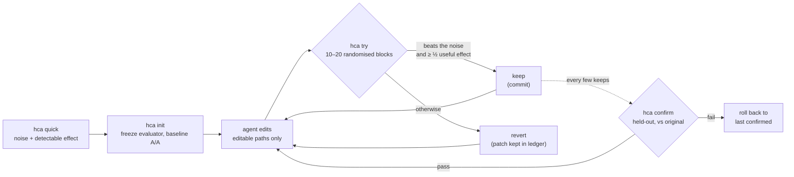

译自 commit b9bad05 的 README.md。数字以英文版 README 为准。

<div align="center">

[English](../../README.md) · **简体中文** · [繁體中文](README.zh-TW.md) · [日本語](README.ja.md) · [한국어](README.ko.md) · [Español](README.es.md) · [Português (Brasil)](README.pt-BR.md) · [Français](README.fr.md) · [Deutsch](README.de.md) · [Русский](README.ru.md) · [Türkçe](README.tr.md) · [Tiếng Việt](README.vi.md) · [Bahasa Indonesia](README.id.md) · [हिन्दी](README.hi.md)

# HillClimbAnything

### 让你能对任何技术难题做爬山优化的工具。

**把你的编码 agent 指向一个数字，只保留真正有效的提升。**

[](#快速开始)
[](../../pyproject.toml)
[](../../tests)
[](../../skills/hca/SKILL.md)
[](../../LICENSE)

<code>pip install git+https://github.com/JaiS1/HillClimbAnything && hca quick -- python bench.py</code>

<br /><br />

<picture>
  <source media="(prefers-color-scheme: dark)" srcset="../assets/climb-dark.svg" />
  
</picture>

</div>

---

Autoresearch 式的循环让 agent 反复编辑、测量，并保留得分最高的版本。在有噪声的指标上，“最高分”往往只是运气。在一台普通的台式机上，直接保留原始最高分，会把 **17–55%** 实际没有效果的改动也留下来，具体取决于基准测试（[实测](../../spikes/phase0/RESULT.md)）。

HillClimbAnything 就是这个循环的**裁判**：

- 开始之前，先测出你的数字有多大噪声；
- 只有改动的效果超过噪声，才会保留；
- 用 agent 从未针对其调优过的数据，确认总体提升。

agent 负责提出改动，HCA 负责裁决。HCA 是一个零依赖的小型 Python CLI，外加一个 skill（纯 Markdown），用来教编码 agent 这套方法。目前已用 Claude Code 测试过。

## 快速开始

**1. 安装**（Python 3.11+；在 Linux 和 WSL 上测试过，macOS 未测试）：

```bash
pip install git+https://github.com/JaiS1/HillClimbAnything     # not on PyPI yet
npx skills add JaiS1/HillClimbAnything --skill hca             # optional: the agent skill
```

**2. 告诉你的 agent：**

```text
安装 HillClimbAnything（github.com/JaiS1/HillClimbAnything），并按照它的 skills/hca/SKILL.md 操作。
让 `python bench.py` 更快：先运行 `hca quick`，和我一起写好 hca.toml，用
`hca try` 逐步爬升，最后只汇报 `hca confirm` 通过的结果。
```

**3. 或者自己动手：**

<div align="center">

</div>

```bash
hca quick -- <cmd>     # 2 分钟，无需配置：这个数字的噪声有多大，能检测到多大的提升？
hca init               # 冻结评估器，创建分支，测量基线噪声
hca try -m "why"       # 把你的改动与上一个 keep 对比 → keep（提交）或 revert
hca confirm            # 在留出数据上，重新测量相对原始版本的总提升
hca report             # 每次尝试、它的结论和证据
```

一个任务由这几部分组成：一段说明、agent 可以编辑的路径，以及一条输出该数字的命令：

```toml
# hca.toml
[task]
name     = "api-latency"
editable = ["src/**"]          # agent 可以修改这些
frozen   = ["bench/**"]        # 评估器：会计算哈希，绝不编辑

[objective]
command       = ["python3", "bench/run.py"]   # 输出 METRIC p95_ms=212.4
metric        = "p95_ms"
direction     = "min"
useful_effect = "5%"           # 值得保留的最小提升
```

## 展示案例：Python-Markdown 快 2 倍

一个 Sonnet 编码 agent 以 HCA 为裁判，对 [Python-Markdown](https://github.com/Python-Markdown/markdown) 3.11.1 做爬山优化：约 80 分钟内尝试 18 次，保留 14 次。

| 检查项 | 结果 |
|---|---|
| 在留出文档上运行 `hca confirm` | 渲染时间 **−53.8%**（至少 −53.0%） |
| 在 HCA 之外、用项目自带测试夹具独立重测 | **−63.5%** |
| 输出：项目测试套件（1,126 个测试；110 个跳过，与 3.11.1 相同）和 23,000 份随机文档 | 与 3.11.1 **完全一致** |
| HCA 拒绝、但单次运行的循环会保留的改动 | **4 个中的 3 个**，其中一个“−17.9%”实际只有 −1.7% |

收益最大的一项改动是：当文本中不可能出现某个字符，而每个匹配都需要该字符时，就跳过相应的行内正则模式。完整内容见[文字说明、补丁、逐次记录和原始账本](../../showcases/python-markdown/README.md)。这只是一台机器、一次运行，补丁也没有经过上游评审。

## 为什么需要裁判？

两个完全相同的构建，用大多数循环常用的方式比较（[Phase 0](../../spikes/phase0/RESULT.md)）：

| 保留规则 | 被保留的空操作改动 | 被保留的真实 5% 提速 |
|---|---|---|
| 保留原始最高分 | **17–55%** | 100% |
| HCA 在随机化 block 上的检验 | **≤ 1%** | 76–96%（15 个 block） |

范围涵盖两个基准测试（一个 Web 服务器和一个 CLI）。HCA 一行是在 α = 1% 下看一次的结果；实际发布的规则更严格。

一个循环如果保留了五分之一到一半的空操作改动，那它爬的其实是噪声。收益看起来层层叠加，重新测量时却烟消云散。

## 工作原理



- **随机化 block。** 每次 try 让基线版本和候选版本以随机顺序连续交替运行，共 10 到 20 次。随机顺序使精确的符号翻转检验在任何噪声形态下都成立：重尾分布、热波动、后台运行的游戏。
- **证据与幅度。** 要 keep，单侧检验必须在每次 try 1% 的水平下通过，且估计的提升至少达到你设定的有用效果的一半。
- **完全相同的两组。** 两组都是确切 commit 的干净 git worktree。被保留的 commit 就是被测量过的那棵树。
- **没有 confirm 就不算数。** `hca confirm` 会先检查历史记录，再重新测量相对原始版本的总提升。agent 看到的只有 PASS 或 FAIL。
- **一切落盘。** 每次尝试的补丁、原始运行数据、结论和理由都在 `.hca/` 中。

## 能爬什么

只要一条命令能把它变成数字，并且这个数字足够可重复、能测出其噪声，就可以爬。

| 目标 | 示例指标 | 状态 |
|---|---|---|
| 库的热点路径 | 渲染 / 解析时间 | ✅ 已有展示案例（Python-Markdown，−53.8%） |
| CLI 与构建时间 | 墙钟秒数 | 🧪 已校准（[Phase 0](../../spikes/phase0/RESULT.md)） |
| Web 服务器延迟 | 每个路由的首字节时间 | 🧪 已校准（[Phase 0](../../spikes/phase0/RESULT.md)） |
| 浏览器中的页面加载 | 每个页面的 LCP | 🗺️ 计划中的展示案例 |
| UI 或游戏帧时间 | 每个场景的 p99 帧毫秒数 | 🗺️ 计划中的展示案例 |
| 模型或 prompt 准确率 | 逐项评测得分 | 🧪 `items` 模式，已有单元测试 |
| 付费 GPU 训练 | 训练后的评测得分 | 📋 campaign 方法见 [skill 参考资料](../../skills/hca/references/campaign-card.md)；工具链计划中 |

## 给 agent 的说明

如果你是正在阅读本文的 AI agent：

- **方法：**[`skills/hca/SKILL.md`](../../skills/hca/SKILL.md)。内容包括前提检查、每次 try 只改一个机制，以及绝不触碰被冻结的文件。
- **规范与输出约定：**[`skills/hca/references/spec.md`](../../skills/hca/references/spec.md)。
- **面向爬虫和助手的概述：**[`llms.txt`](../../llms.txt)。
- **参与本仓库开发：**[`AGENTS.md`](../../AGENTS.md)。

| 退出码 | `hca try` | `hca confirm` |
|---|---|---|
| 0 | 已 keep | 通过 |
| 1 | 已 revert | 失败（已回滚） |
| 2 | 无效 / 作废 / 被拒绝：什么都没保留，你的编辑原样留着 | 无结论或被拒绝 |
| 3 / 4 | 用法错误 / 内部错误 | 同左 |

只汇报 `hca confirm` 通过的结果，并附上它的界限和 try 的次数。

## 常见问题

<details>
<summary><strong>HCA 会调用 LLM 或需要 API key 吗？</strong></summary>

不会。HCA 从不调用模型。思考由你的 agent（Claude Code、Codex、Cursor 或其他任何 agent）完成，HCA 只负责测量和裁决。`hca quick` 完全不需要 agent。
</details>

<details>
<summary><strong>一次 try 要多久？</strong></summary>

大约运行你的命令 20 到 40 次：10 个 block，结果看起来有希望时扩展到 20 个，每个 block 运行两次。一个 3 秒的基准测试，每次 try 需要 1 到 2 分钟。`hca quick` 会在你开始之前告诉你成本。
</details>

<details>
<summary><strong>我的指标噪声很大，还能用吗？</strong></summary>

`hca quick` 大约 2 分钟就能回答这个问题。它会报告噪声大小，以及你能检测到的最小提升。如果结论是“这里噪声太大”，它会指出成本最低的补救办法：每次运行包含更多条目、运行更长时间，或者关闭其他负载。在此之前就开始爬升只是白费力气。
</details>

<details>
<summary><strong>agent 能作弊吗？</strong></summary>

它可以尝试，但 HCA 会让作弊变得很麻烦：

- 被冻结的评估器文件会计算哈希；
- 在声明路径之外的编辑会使该次 try 无效；
- 两组都从干净的 worktree 运行；
- 崩溃按最差值计分；
- 重复尝试会被计数。

这并不是安全边界，所以请检查补丁。[docs/LIMITS.md](../LIMITS.md) 列出了所有已知缺口以及应对方法。
</details>

<details>
<summary><strong>这和 autoresearch 有什么不同？</strong></summary>

[autoresearch](https://github.com/karpathy/autoresearch) 展示了循环中的 agent 能有多高产，HCA 保留了这个循环。HCA 增加的是裁决：对于任意命令和任意指标，判断一个改动是真实有效还是噪声，并加上一个防范赢家诅咒的确认步骤。
</details>

<details>
<summary><strong>昂贵的运行（比如 GPU 训练）怎么办？</strong></summary>

skill 的参考资料沿用了一次持续数月的真实模型微调 campaign 中的做法：

- 一张预先登记的卡片，带有匹配的“相同算力、没有新想法”对照组；
- 在付费运行之前先做一次低成本的预演；
- 对抗式评审；
- 远程任务内部的监视器和预算计量；
- 在给出任何结论之前做深入评估。

相应的工具链在计划中。
</details>

<details>
<summary><strong>Windows 呢？</strong></summary>

请使用 WSL。原生 Windows 的进程控制尚未测试，macOS 也是。
</details>

## 文档

- [展示案例：Python-Markdown](../../showcases/python-markdown/README.md)
- [局限与已知缺口](../LIMITS.md)
- [Phase 0 校准](../../spikes/phase0/RESULT.md)
- [设计](../DESIGN-hca.md)
- [架构约定](../ARCHITECTURE-v1.md)

## 状态与致谢

早期研究版本（0.2.0.dev）：核心循环加一个展示案例。HCA 源自 [Dream Loop](https://github.com/JaiS1/dream-loop/tree/dream-loop-v0.1)，并保留了它的配对统计方法。它借鉴了 [autoresearch](https://github.com/karpathy/autoresearch) 式循环的思路，以及 [Harness Learning](https://arxiv.org/abs/2609.35738) 论文中的评估规范。

```bash
python3 -m unittest discover -s tests      # 开发
```

[MIT 许可证](../../LICENSE)。如果 HCA 帮你避免了发布一个虚假的提升，欢迎点个 star，帮助更多人找到它。
