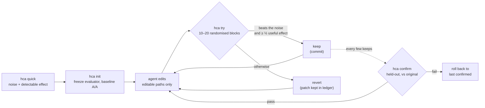

譯自 commit b9bad05 的 README.md。數字以英文版 README 為準。

<div align="center">

[English](../../README.md) · [简体中文](README.zh-CN.md) · **繁體中文** · [日本語](README.ja.md) · [한국어](README.ko.md) · [Español](README.es.md) · [Português (Brasil)](README.pt-BR.md) · [Français](README.fr.md) · [Deutsch](README.de.md) · [Русский](README.ru.md) · [Türkçe](README.tr.md) · [Tiếng Việt](README.vi.md) · [Bahasa Indonesia](README.id.md) · [हिन्दी](README.hi.md)

# HillClimbAnything

### 讓你能對任何技術難題做爬山最佳化的工具。

**把你的程式開發 agent 指向一個數字，只保留真正有效的提升。**

[](#快速開始)
[](../../pyproject.toml)
[](../../tests)
[](../../skills/hca/SKILL.md)
[](../../LICENSE)

<code>uvx --from git+https://github.com/JaiS1/HillClimbAnything hca quick -- python bench.py</code>

<sub>不必安裝即可試用：你的基準測試雜訊有多大，你能偵測到多大的提升？</sub>

<br /><br />

<picture>
  <source media="(prefers-color-scheme: dark)" srcset="../assets/climb-dark.svg" />
  
</picture>

</div>

---

Autoresearch 式的迴圈讓 agent 反覆編輯、量測，並保留得分最高的版本。在有雜訊的指標上，「最高分」往往只是運氣。在一般的桌上型電腦上，直接保留原始最高分，會把 **17–55%** 其實沒有效果的變更也留下來，視基準測試而定（[實測](../../spikes/phase0/RESULT.md)）。

HillClimbAnything 就是這個迴圈的**裁判**：

- 開始之前，先量出你的數字有多少雜訊；
- 只有變更的效果超過雜訊，才會保留；
- 用 agent 從未針對其調校過的資料，確認整體提升。

agent 負責提出變更，HCA 負責裁決。HCA 是一個零相依的小型 Python CLI，外加一個 skill（純 Markdown），用來教程式開發 agent 這套方法。目前已用 Claude Code 測試過。

## 快速開始

**1. 安裝**（Python 3.11+；已在 Linux 和 WSL 上測試，macOS 尚未測試）：

```bash
uv tool install git+https://github.com/JaiS1/HillClimbAnything   # 或: pipx install git+https://github.com/JaiS1/HillClimbAnything
hca setup                                                        # 加入 agent skill（會先顯示它的計畫）
```

`hca setup` 會把 skill 放到 agent 尋找它的位置：`~/.claude/skills/hca`（Claude Code）和
`~/.agents/skills/hca`（Codex、Cursor、Gemini CLI、Copilot）。它會備份被取代的內容，
`hca setup --uninstall` 可再次移除。沒有 [`uv`](https://docs.astral.sh/uv/getting-started/installation/) 或 [`pipx`](https://pipx.pypa.io/stable/installation/)？一般的
`pip install` 在虛擬環境中可用；許多系統在虛擬環境之外會拒絕它（PEP 668）。

<details>
<summary>加入 skill 的其他方式</summary>

**Claude Code 外掛：**

```text
/plugin marketplace add JaiS1/HillClimbAnything
/plugin install hca@hillclimbanything
```

**[skills.sh](https://github.com/vercel-labs/skills):**

```bash
npx skills add JaiS1/HillClimbAnything --skill hca
```

無論哪種方式，skill 驅動的都是 `hca` CLI，所以也請安裝 CLI。
</details>

**2. 告訴你的 agent：**

```text
使用 hca skill（HillClimbAnything）讓 `python bench.py` 更快：先執行 `hca quick`，和我一起寫好 hca.toml，
用 `hca try` 逐步爬升，最後只回報 `hca confirm` 通過的結果。
```

**3. 或者自己動手：**

<div align="center">

</div>

```bash
hca quick -- <cmd>     # 2 分鐘，免設定：這個數字的雜訊有多大，能偵測到多大的提升？
hca init               # 凍結評估器，建立分支，量測基線雜訊
hca try -m "why"       # 把你的修改與上一個 keep 比較 → keep（commit）或 revert
hca confirm            # 在保留資料（held-out）上，重新量測相對原始版本的整體提升
hca report             # 每次嘗試、它的結論與證據
```

一個任務由這幾部分組成：一段說明、agent 可以編輯的路徑，以及一條輸出該數字的指令：

```toml
# hca.toml
[task]
name     = "api-latency"
editable = ["src/**"]          # agent 可以修改這些
frozen   = ["bench/**"]        # 評估器：會計算雜湊，絕不編輯

[objective]
command       = ["python3", "bench/run.py"]   # 輸出 METRIC p95_ms=212.4
metric        = "p95_ms"
direction     = "min"
useful_effect = "5%"           # 值得保留的最小提升
```

## 展示案例：Python-Markdown 快 2 倍

一個 Sonnet 程式開發 agent 以 HCA 為裁判，對 [Python-Markdown](https://github.com/Python-Markdown/markdown) 3.11.1 做爬山最佳化：約 80 分鐘內嘗試 18 次，保留 14 次。

| 檢查項目 | 結果 |
|---|---|
| 在保留文件（held-out）上執行 `hca confirm` | 渲染時間 **−53.8%**（至少 −53.0%） |
| 在 HCA 之外、用專案自帶的測試固定資料（fixtures）獨立重測 | **−63.5%** |
| 輸出：專案測試套件（1,126 個測試；110 個跳過，與 3.11.1 相同）和 23,000 份隨機文件 | 與 3.11.1 **完全一致** |
| HCA 拒絕、但單次執行的迴圈會保留的變更 | **4 個中的 3 個**，其中一個「−17.9%」實際只有 −1.7% |

收益最大的一項變更是：當文字中不可能出現某個字元，而每個比對都需要該字元時，就跳過相應的行內正規表達式模式。完整內容請見[文字說明、patch、逐次紀錄與原始帳本](../../showcases/python-markdown/README.md)。這只是一台機器、一次執行，patch 也尚未經過上游審查。

## 為什麼需要裁判？

兩個完全相同的建置，用大多數迴圈慣用的方式比較（[Phase 0](../../spikes/phase0/RESULT.md)）：

| 保留規則 | 被保留的空操作變更 | 被保留的真實 5% 加速 |
|---|---|---|
| 保留原始最高分 | **17–55%** | 100% |
| HCA 在隨機化 block 上的檢定 | **≤ 1%** | 76–96%（15 個 block） |

範圍涵蓋兩個基準測試（一個 Web 伺服器和一個 CLI）。HCA 那一列是在 α = 1% 下看一次的結果；實際發布的規則更嚴格。

一個迴圈如果保留了五分之一到一半的空操作變更，那它爬的其實是雜訊。收益看起來層層疊加，重新量測時卻煙消雲散。

## 運作方式



- **隨機化 block。** 每次 try 讓基線版本和候選版本以隨機順序連續交替執行，共 10 到 20 次。隨機順序使精確的符號翻轉檢定在任何雜訊型態下都成立：厚尾分布、熱波動、背景執行的遊戲。
- **證據與幅度。** 要 keep，單尾檢定必須在每次 try 1% 的水準下通過，且估計的提升至少達到你設定的有用效果的一半。
- **完全相同的兩組。** 兩組都是確切 commit 的乾淨 git worktree。被保留的 commit 就是被量測過的那棵樹。
- **沒有 confirm 就不算數。** `hca confirm` 會先檢查歷史紀錄，再重新量測相對原始版本的整體提升。agent 看到的只有 PASS 或 FAIL。
- **一切落地存檔。** 每次嘗試的 patch、原始執行資料、結論與理由都在 `.hca/` 中。

## 能爬什麼

只要一條指令能把它變成數字，而且這個數字夠可重複、能量出其雜訊，就可以爬。

| 目標 | 範例指標 | 狀態 |
|---|---|---|
| 函式庫的熱點路徑 | 渲染 / 解析時間 | ✅ 已有展示案例（Python-Markdown，−53.8%） |
| CLI 與建置時間 | 實際經過秒數 | 🧪 已校準（[Phase 0](../../spikes/phase0/RESULT.md)） |
| Web 伺服器延遲 | 每個路由的首位元組時間 | 🧪 已校準（[Phase 0](../../spikes/phase0/RESULT.md)） |
| 瀏覽器中的頁面載入 | 每個頁面的 LCP | 🗺️ 規劃中的展示案例 |
| UI 或遊戲影格時間 | 每個場景的 p99 影格毫秒數 | 🗺️ 規劃中的展示案例 |
| 模型或 prompt 準確率 | 逐項評測分數 | 🧪 `items` 模式，已有單元測試 |
| 付費 GPU 訓練 | 訓練後的評測分數 | 📋 campaign 方法見 [skill 參考資料](../../skills/hca/references/campaign-card.md)；工具鏈規劃中 |

## 給 agent 的說明

如果你是正在閱讀本文的 AI agent：

- **方法：**[`skills/hca/SKILL.md`](../../skills/hca/SKILL.md)。內容包括前提檢查、每次 try 只改一個機制，以及絕不碰被凍結的檔案。
- **規格與輸出約定：**[`skills/hca/references/spec.md`](../../skills/hca/references/spec.md)。
- **給爬蟲與助理的概覽：**[`llms.txt`](../../llms.txt)。
- **參與本儲存庫開發：**[`AGENTS.md`](../../AGENTS.md)。

| 結束碼 | `hca try` | `hca confirm` |
|---|---|---|
| 0 | 已 keep | 通過 |
| 1 | 已 revert | 失敗（已回復） |
| 2 | 無效 / 作廢 / 被拒絕：什麼都沒保留，你的修改原樣留著 | 無結論或被拒絕 |
| 3 / 4 | 用法錯誤 / 內部錯誤 | 同左 |

只回報 `hca confirm` 通過的結果，並附上它的界限和 try 的次數。

## 常見問題

<details>
<summary><strong>HCA 會呼叫 LLM 或需要 API key 嗎？</strong></summary>

不會。HCA 從不呼叫模型。思考由你的 agent（Claude Code、Codex、Cursor 或其他任何 agent）完成，HCA 只負責量測和裁決。`hca quick` 完全不需要 agent。
</details>

<details>
<summary><strong>一次 try 要多久？</strong></summary>

大約執行你的指令 20 到 40 次：10 個 block，結果看起來有希望時擴充到 20 個，每個 block 執行兩次。一個 3 秒的基準測試，每次 try 需要 1 到 2 分鐘。`hca quick` 會在你開始之前告訴你成本。
</details>

<details>
<summary><strong>我的指標雜訊很大，還能用嗎？</strong></summary>

`hca quick` 大約 2 分鐘就能回答這個問題。它會回報雜訊大小，以及你能偵測到的最小提升。如果結論是「這裡雜訊太大」，它會指出成本最低的補救辦法：每次執行包含更多項目、執行更久，或者關閉其他負載。在此之前就開始爬升只是白費力氣。
</details>

<details>
<summary><strong>agent 能作弊嗎？</strong></summary>

它可以嘗試，但 HCA 會讓作弊變得很麻煩：

- 被凍結的評估器檔案會計算雜湊；
- 在宣告路徑之外的編輯會使該次 try 無效；
- 兩組都從乾淨的 worktree 執行；
- 當機按最差值計分；
- 重複嘗試會被計數。

這並不是安全邊界，所以請檢查 patch。[docs/LIMITS.md](../LIMITS.md) 列出了所有已知缺口以及因應方法。
</details>

<details>
<summary><strong>這和 autoresearch 有什麼不同？</strong></summary>

[autoresearch](https://github.com/karpathy/autoresearch) 展示了迴圈中的 agent 能有多高產，HCA 保留了這個迴圈。HCA 增加的是裁決：對於任意指令和任意指標，判斷一個變更是真實有效還是雜訊，並加上一個防範贏家詛咒的確認步驟。
</details>

<details>
<summary><strong>昂貴的執行（例如 GPU 訓練）怎麼辦？</strong></summary>

skill 的參考資料沿用了一次持續數月的真實模型微調 campaign 中的做法：

- 一張預先登記的卡片，帶有相符的「相同算力、沒有新想法」對照組；
- 在付費執行之前先做一次低成本的預演；
- 對抗式審查；
- 遠端任務內部的監看器和預算計量；
- 在給出任何結論之前做深入評估。

相應的工具鏈規劃中。
</details>

<details>
<summary><strong>Windows 呢？</strong></summary>

請使用 WSL。原生 Windows 的行程控制尚未測試，macOS 也是。
</details>

## 文件

- [展示案例：Python-Markdown](../../showcases/python-markdown/README.md)
- [限制與已知缺口](../LIMITS.md)
- [Phase 0 校準](../../spikes/phase0/RESULT.md)
- [設計](../DESIGN-hca.md)
- [架構約定](../ARCHITECTURE-v1.md)

## 狀態與致謝

早期研究版本（0.2.0.dev）：核心迴圈加一個展示案例。HCA 源自 [Dream Loop](https://github.com/JaiS1/dream-loop/tree/dream-loop-v0.1)，並保留了它的配對統計方法。它借鏡了 [autoresearch](https://github.com/karpathy/autoresearch) 式迴圈的想法，以及 [Harness Learning](https://arxiv.org/abs/2609.35738) 論文中的評估規範。

```bash
python3 -m unittest discover -s tests      # 開發
```

[MIT 授權條款](../../LICENSE)。如果 HCA 幫你避免了發布一個虛假的提升，歡迎點個 star，幫助更多人找到它。
